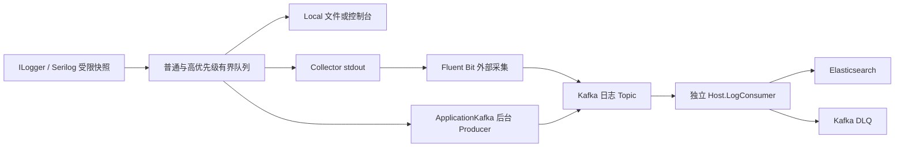

# 日志模块：配置、模式选择与运维知识库

> 更新：2026-10-18；原日志收尾基线：`a7a68776`；本地文件扩展基线：`db17f85d` 加本次工作区变更。本文面向开发、部署和运维，描述当前配置，不把历史方案示例当作部署接口。后续配置变更以源码、Chart 校验及实际验证为准。

## 1. 从哪里开始

- 想看本机日志或简化服务器部署：阅读第 3、5 节；Local 可选择 Console 或本地 txt，生产必须启用文件。
- 想集中查看多个实例：阅读第 3、6 节，选择 `Collector`，另外部署采集及存储设施。
- 想省去 stdout 采集环节：阅读第 3、7 节，选择 `ApplicationKafka`，另外部署 Broker 和消费者。
- 想看后台“请求参数 / 返回内容”：阅读第 9 节，配置 B1 受限详情；这与 Kafka 模式无关。
- 想处理积压、丢弃、重启或切换：阅读第 10、11 节。
- 想按 TraceId 或时间范围加会话、用户、IP 指纹定位：阅读文末“日志关联时间线”。

长期决策见 [ADR-0012](../docs/architecture/adr/ADR-0012-configurable-log-delivery.md)，实现说明见[日志模块运维手册](../docs/operations/logging-module.md)，前期记录见[收尾验收](../docs/verification/2026-10-02-logging-module-closeout.md)。历史计划中的待办不自动代表当前缺口，也不代表所有设想都已实现。

本知识库维护当前实现、配置和适用边界；实际验收状态、原始失败与分批复验结果统一见[整改计划](../docs/superpowers/plans/2026-10-17-logging-remediation.md)。发布成功、预检或局部用例通过不能代替受影响原生运行，未测容量保持 `Capacity-not-verified`。

受控 HTTP 探针约 500/s，Summary/Projected 请求 P99 为 2.35–2.92ms；不外推到全业务 API 或万级容量。持续配额中，20% 保护把优先保留从 2/100 提升到 100/100，最终普通记录少 99–105 条；部分轮次普通文件出口 P99 约 1.02 秒、优先约 250ms，普通丢弃仍有波动。`PriorityReservePercent=20` 优先保存诊断历史，设 0 关闭保护；两通道共用磁盘，文件写入返回不表示 fsync 或端到端持久确认。

## 2. 日志、审计、Trace 是不同的数据通路

| 通路 | 用途 | 写入和可靠性边界 | 主要查看入口 |
| --- | --- | --- | --- |
| B0 领域审计 | 重要业务状态变更的审计事实 | 按业务事务边界写库，不改成普通日志 | 对应业务/审计功能 |
| B1 HTTP 重要审计 | 操作、异常、出站调用及受限操作详情 | 独立有界微批写审计库；等待写入尝试，默认 fail-open 并告警 | Vue 管理端日志页面 |
| B2 / 运行诊断日志 | 请求摘要、宿主和运行诊断 | `ILogger<T>` → Serilog → 有界后台管道；允许采样、过载丢弃 | stdout、集中日志存储 |
| Trace / Metrics | 调用链、耗时、吞吐与资源指标 | OpenTelemetry 独立出口 | 对应追踪和监控平台 |

Kafka/ES 的开关主要改变 B2 集中投递路线，不替换 B0/B1 数据库。后台操作日志并非从 ES 读取；开启 Kafka 不会自动丰富“请求参数”页签。日志与 Audit 不使用事务 Outbox；可靠业务事件仍走自己的 Outbox/Inbox 通路。

访问日志入库属于单独的 `Auditing:AccessLogCapture` 功能，默认配置与 Development 覆盖可能不同；开启后查询接口自身也可能被记录，不能用全局总数恒定判断是否重复。

## 3. 三种应用入口与适用场景

| 入口 | 适用场景 | 应用行为 | 环境要求与限制 |
| --- | --- | --- | --- |
| `Local` | 开发、离线诊断、单服务器简化部署 | 默认 Console；启用 LocalFile 后输出受限结构化 txt，关闭本管道 Console 镜像 | 生产必须启用文件；Kubernetes Chart 要求 PVC、单副本且关闭 HPA；Collector 排除该流 |
| `Collector` | Kubernetes 多实例集中采集，应用不持有远程日志凭据 | 应用输出 Compact JSON，外部采集器接管 | 单独部署固定版本采集器、路由、缓冲及目标；允许显式生产入口配置 |
| `ApplicationKafka` | 已有 Kafka 平台，愿意承担宿主客户端和凭据，希望简化采集链 | 后台 Producer 发送普通/优先两个 Topic | 静态适配器、TLS、双 Topic、预算、冻结索引路由、Producer Secret；允许显式生产入口配置 |

应用与 Helm 默认使用 `Collector`，即输出结构化控制台快照；默认值不代表外部采集器已经部署。仅支持 `Local`、`Collector`、`ApplicationKafka`。显式配置模式必须同时设置同值 `ExpectedDeliveryMode`；仅配置一个值会拒绝启动。旧 `FullNet:Logging:Elasticsearch` 配置节已删除，残留该节会拒绝启动，请从配置和环境变量中移除；不提供旧直写或兼容入口。入口及凭据/路由变更通过重新发布和重启生效，不自动热切换。

两种集中路线的选择依据请求 P99、每实例日志**字节**吞吐、CPU、托管/native 内存、丢弃率及故障恢复。现有同负载正反序试验没有稳定性能胜者，不因“Kafka 并发高”或“本地队列快”直接选定路线。见[路线比较](../docs/verification/2026-10-01-logging-route-comparison.md)。

### 拓扑与组件开关



图中不同入口是部署时的选择，不是同时广播。Collector 的采集出口也可以设计为直接存储，但不能把它与已验证 Kafka→独立消费者组合的确认语义混为一谈。

| 部署组合 | Kafka | ES | 说明 |
| --- | --- | --- | --- |
| Local | 不需要 | 不需要 | 生产需本地文件；外部采集规则需排除 |
| Collector + 直接存储 | 可不使用 | 按目标选择 | 采集出口另行配置和验证；应用 Chart 不替你创建 ES 或出口 |
| Collector + Kafka + 消费者 | 使用 | 当前消费者使用 | 采集器到 Broker，再由独立消费进程写 ES |
| ApplicationKafka + 消费者 | 使用 | 当前消费者使用 | 应用直发 Broker，采集器排除该应用流 |

Kafka 与 ES 在架构上分别可选，但**当前 `Host.LogConsumer` 必须配置 ES**，不是可任选目标的通用消费者。关闭 ES 而保留 Kafka，必须另外配置有效消费目的地，不能只打开 Producer 后期待日志可查询。

## 4. 组件职责与环境要求

| 组件 | 运行位置 | 必需资源/权限 | 不负责什么 |
| --- | --- | --- | --- |
| API / Worker 的日志管道 | 每个宿主进程 | 独立条数、字节和退出预算；仅直发入口需要 Kafka Producer 凭据 | 不提供默认磁盘 Spool；不确认最终 ES 落库 |
| Fluent Bit | 平台管理 DaemonSet | 容器日志读取、Kubernetes 元数据、缓冲磁盘、出口连接；参考固定镜像 4.1.1 | 应用配置开启不等于 DaemonSet 已安装 |
| Kafka | 独立 Broker 平台 | 日志 Topic、分区、保留、复制/ISR、ACL、TLS、磁盘与配额 | 不自动消费或写 ES；不保住未到 Broker 的应用内存日志 |
| Host.LogConsumer | 独立平台进程 / 独立 Chart | Kafka 读/Group 权限、DLQ 写权限、ES 最小写权限、CA 与资源预算 | 不复用业务 Worker；不执行 B1 详情清理 |
| Elasticsearch | 独立查询存储 | HTTPS、授权、固定索引/保留策略、磁盘、分片及写入预算 | 不是审计数据库；不接收 Restricted 详情 |
| 业务 Worker / Migrator | 原有宿主 | 双库迁移、审计写入及详情清理 | 不自动启动独立日志消费者 |

本地编译遵循[构建与测试指南](build-and-test.md)，真实链路测试需要 Docker。Kubernetes 部署需要可用集群、Helm、对应镜像、Secret 和网络路径；Prometheus Operator CRD 仅在启用消费者 PodMonitor 时需要。Chart 不创建 Broker/ES 集群。

本机 `kind-fullnet-local` 可用于联调；三个节点共用一台 Docker Desktop 主机。按项目批准标准，本地实际测试可作为验收证据，结论必须限定硬件、规模和故障范围，不能据此宣称独立物理故障隔离或 10K 容量已通过。

ApplicationKafka 涉及 Confluent.Kafka/native 依赖，不能仅改配置就让不含静态适配器的自定义宿主具备能力。已有 API/Worker 原生运行证据不自动覆盖其他 OS、RID 或自定义发布产物。运行时关闭也不代表依赖从发布闭包移除；核心 Hosting 已移除旧 ES Sink 及其传递依赖；修改宿主或依赖后，须按实际影响范围验证 Native AOT 发布与原生运行。

## 5. 应用配置：默认值与最小示例

### 公共预算

配置节为 `FullNet:Logging`，见 [LoggingOptions](../src/BuildingBlocks/Full.NET.Hosting/Observability/LoggingOptions.cs)。

| 键 | 默认值 | 含义 |
| --- | ---: | --- |
| `AsyncBufferSize` | 10000 | 普通队列条数 |
| `HighPriorityAsyncBufferSize` | 1000 | Error/Fatal 独立队列条数 |
| `GeneralQueueMaxBytes` | 67108864 | 普通队列与 Sink 在途快照预算，64 MiB |
| `HighPriorityQueueMaxBytes` | 8388608 | 优先队列独立预算，8 MiB |
| `MaxEventBytes` | 16384 | 单条输出 JSON 最大 UTF-8 字节 |
| `BlockWhenFull` | false | true 被拒绝；满载不等待请求线程 |
| `ShutdownFlushTimeout` | `00:00:05` | 宿主双通道及 Kafka Flush 共用退出期限；native Dispose 不支持硬取消，不是成功交付保证 |
| `IndexRouteVersion` / `IndexRetentionDays` | 0 / 0 | 默认未启用；正值必须成对配置，分别 1..9999 / 1..3650 |

非生产本机明确选择 Local 的配置片段：

```json
{
  "FullNet": {
    "Logging": {
      "DeliveryMode": "Local",
      "ExpectedDeliveryMode": "Local",
      "BlockWhenFull": false
    }
  }
}
```

### Local：服务器本地 txt 文件

无需 Kafka/ES/采集器，应用复用受限 UTF-8 快照，在原两条后台消费线程写入 `.txt`，每行一条 Compact JSON。默认关闭；开启后本管道不再镜像到 stdout。生产使用以下配置片段（与原部署配置合并）：

```json
{
  "FullNet": {
    "Logging": {
      "DeliveryMode": "Local",
      "ExpectedDeliveryMode": "Local",
      "LocalFile": {
        "Enabled": true,
        "Directory": "App_Data/logs",
        "FileSizeLimitBytes": 67108864,
        "RetentionDays": 14,
        "MaxDirectoryBytes": 1073741824,
        "PriorityReservePercent": 20,
        "FlushInterval": "00:00:01"
      }
    }
  }
}
```

`Directory` 可改成 Windows `D:/FullNet/logs` 或 Linux `/var/log/fullnet`。相对路径基于宿主 ContentRoot；实际文件位于 `{Directory}/{ApplicationName}/fullnet-{general|priority}-{UTC yyyyMMdd}-{随机标识}.txt`，例如 `D:/FullNet/logs/Full.NET.Host.Api/`，API/Worker 分开。名称内随机标识用于避免覆盖，并非重放队列。

单文件按 UTC 日期/字节上限滚动，默认 64 MiB；保留默认 14 天，目录自有文件合计默认 1 GiB，预算含尚在文件缓冲中的逻辑字节。超过总量时可提前删除已关闭自有文件，保留天数不是最短保存承诺。只处理严格命名的非链接 txt，不递归清理其他文件；预算不包含外部文件、文件系统元数据、API/Worker 的另一目录或进程内存。启动清理存量；运行期至少每分钟检查到期文件，每次清理最多删除 16 个闭合文件，积压时后续写入/原后台刷新周期继续推进，活跃文件不删除。该限制是 OS 调用次数预算，不是磁盘耗时上限；清理积压没有硬完成期限。

`PriorityReservePercent` 是普通日志触发配额回收时，对优先历史文件的保留目标，默认 20，允许 0—50；0 关闭保护。字节目标按目录总预算计算，按完整文件保留，最多有一个滚动文件的粒度余量，但必须留出普通通道一个完整文件的空间，因此目标是尽力保留而非硬性最低量；被保护的优先文件数同时不超过对应的文件名额（非零比例至少一个名额）。到期文件不受保护，优先写入仍可替换旧优先文件，当前活跃文件始终不删除。额度不保证某条事件一定保留，也不等于另建持久队列或隔离磁盘。若一个清理批次不能腾出本次写入所需空间，当前 B2 记录丢弃并计数，后续事件/维护继续回收；目录总字节和文件数上限不会临时放宽。

2026-10-18 Windows 本地验证：Local 文件 18 项回归全部通过，所属日志组 403 通过、1 项 Linux FIFO 跳过，AOT 架构 73/73；相同队列、载荷和配额的 24 场景完成对账。9,900 文件集中到期时，单次维护调用由约 4.8–6.7 秒降到约 3.9–4.1 ms，优先事件排队至本地出口返回的 P99 由约 4.8–6.7 秒降到约 143–155 ms；小配额下最终优先记录由 2/100 增为 16/100。普通日志仍可能丢弃，且某个大目录配额轮次的普通丢弃增加，不能据此认定所有吞吐与尾延迟都改善。结果限于 Windows、CPU2/4GiB、固定探针和两轮短测，不是业务请求 P99、fsync 确认或未测规模容量。本段是该轮 Windows 文件维护特征测试的历史证据；当前受影响原生范围、失败及分批复验结果见[整改计划](../docs/superpowers/plans/2026-10-17-logging-remediation.md#f07-候选集中验证2026-10-18)。

每个应用目录最多管理 10,000 个自有文件，以限制索引内存。滚动达到数量上限时会清理最旧的已关闭文件；启动扫描超过上限则拒绝启动，需要先离线整理。

目录持有 `.fullnet-local.lock` 排他进程锁，同一应用的两个实例不可共享同一个实际目录；多实例需独立根目录/卷。启动无法创建文件、目录有链接、目录被占用或配置非法会明确失败。没有任意热切换；改目录/预算后重启。部署目录应由服务账号独占写权限，txt 中的 Internal 诊断也须限制访问。

运行期写盘故障丢弃当前记录，不拖住请求线程，后台继续尝试；监控 `fullnet.logging.local_file.failures{channel}`、`local_file.files_removed`、`local_file.bytes` 和队列丢弃增量。失败输出仅包含异常类型并限频，不输出正文/路径。刷新失败也可能损失先前已缓冲记录，不能仅用当前事件 dropped 计数核算缺口。

刷新间隔默认一秒（允许 100 ms..30 秒），即使没有新事件也由后台轮询刷新；正常退出最终关闭文件，受原共享退出等待预算约束。刷新只到操作系统，不承诺掉电刷盘、SIGKILL 无损、跨重启重放或可靠审计。服务重启会创建新文件；若故障使旧文件末行截断，历史文件不继续追加。

Kubernetes 需挂载预置可写 PVC，示例片段：

```yaml
logging:
  ingress: Local
  localFile:
    enabled: true
    directory: /var/fullnet/logs
    existingClaimName: fullnet-local-log-files
    priorityReservePercent: 20
api:
  replicaCount: 1
  hpa:
    enabled: false
worker:
  replicaCount: 1
  hpa:
    enabled: false
```

每次生产发布只启用一个角色；Chart 在该档使用 Recreate，先停旧实例再启动新实例，存在更新中断，不能沿用多副本滚动更新的可用性结论。PVC 的创建、容量、权限及故障恢复由部署方负责；Docker 同样需挂载宿主目录/持久卷。`FullNet:ObservabilityAdmin:LogRootPath` 未设置时，文件管理自动使用已启用 Local 的应用子目录，与写入共用定位规则；显式设置时只读取指定目录，不追加应用名。其他投递模式未设置该值时不扫描文件。读取仍受实例路由与权限限制，不会跨服务器聚合。

文件列表、尾读、下载与时间线共同识别顶层 `.log` 及自有 `fullnet-{general|priority}-{yyyyMMdd}-{32位文件标识}.txt`；任意其他 `.txt` 不开放。`MaximumScanEntries` 默认 1000（1—10000），所有目录项均计入预算；`MaximumListFiles` 默认 100（1—100）仅限制返回条数。列表 API 返回 `{ items, isTruncated, scannedEntries }`，达到任一上限时页面提示不完整；恰好达到扫描上限也保守报告截断。只对扫描到的候选文件排序，不保证覆盖整个目录的最新文件。尾读、下载解析也受同一扫描上限约束，大目录中未扫描到的文件可能返回 404，需归档或缩小固定目录；不会接受客户端路径来绕过范围。

Collector 使用相同片段并把两个模式值改为 `Collector`。若准备接入当前消费者写 ES，再成对设置 `IndexRouteVersion=1`、`IndexRetentionDays=30`，并在消费者使用一致映射。应用启动校验只能核对本地配置，不能证明外部采集设施正常。

应用配置环境变量用双下划线，例如 `FullNet__Logging__DeliveryMode=Collector`。不要把宿主 `Logging:LogLevel`、HTTP 捕获模式和投递模式当成同一个开关。当前 Serilog 管道代码设定最低 Information、Microsoft.AspNetCore 最低 Warning；修改 `Logging:LogLevel` 不能假定覆盖这些值，临时诊断另按受控策略处理，见[默认服务注册](../src/BuildingBlocks/Full.NET.Hosting/Observability/ServiceDefaultsExtensions.cs)。

当前应用双通道使用 `BlockingCollection<LogEnvelope>` / `ConcurrentQueue<LogEnvelope>` 和专属消费线程；B1 微批使用独立有界 Channel。**有界双通道是一种容量隔离结构，System.Threading.Channels 是实现工具**，二者不是互斥路线。不要为统一类型而改变非阻塞与审计等待语义。

## 6. Collector 的部署设置

应用 Chart [values.yaml](../deploy/helm/fullnet/values.yaml) 支持下面的入口片段；它必须与角色、镜像、Provider 和原有安全 values 合并，不是完整安装配置。

```yaml
production: true
dotnetEnvironment: Production
logging:
  ingress: Collector
  indexRouteVersion: 1
  indexRetentionDays: 30
```

Chart 将入口和同值预期模式及 `fullnet.io/log-ingress` 标签放入同一 Pod 发布契约。Collector 应用不注入 Kafka/ES 凭据。固定采集规则仅接收 `collector` 标签的流，元数据缺失失败关闭；Local/ApplicationKafka 日志不能被同一规则重复投递。

[Fluent Bit 参考配置](../deploy/observability/fluent-bit-values.yaml)含 Compact JSON 解析、字段准入、普通/优先分流及 filesystem 缓冲。它并非一个 `logPipeline.enabled` 即可安装的应用 Chart 功能；运维手册中的 `logPipeline.*` 综合拓扑示例是**计划模型，不是当前 Chart 接口**。

参考缓冲使用 `emptyDir`，可能帮助应对出口短时故障，但不能承诺 Pod 重建/节点丢失后重放。filesystem 缓冲、逻辑队列额度和物理磁盘占用不是同一个上限；满盘还可能导致输入写入失败。选择持久卷必须另外核对存储、故障窗口和恢复证据，不因改成 PVC 就承诺零丢失。

## 7. ApplicationKafka 的部署设置

应用 Chart 片段：

```yaml
production: true
dotnetEnvironment: Production
logging:
  ingress: ApplicationKafka
  indexRouteVersion: 1
  indexRetentionDays: 30
  kafka:
    configurationSecretName: fullnet-log-producer
    caSecretName: fullnet-log-producer-ca
```

Producer Secret 固定键：`bootstrapServers`、`generalTopic`、`priorityTopic`、`securityProtocol`；SASL 另需 `saslMechanism`、`saslUsername`、`saslPassword`。CA Secret 固定键 `ca.crt`；使用系统信任根时 CA 引用可为空。两个 Topic 必须不同，示例名称为 `fullnet.logs.general.v1` 和 `fullnet.logs.priority.v1`。这里只给 Secret 名，不在知识库或 values 中填写真实凭据。

Kafka 配置节 `FullNet:Logging:Kafka`，见 [KafkaLogProducerOptions](../src/BuildingBlocks/Full.NET.Logging.Kafka/KafkaLogProducerOptions.cs)：

| 参数 | 默认值 / 要求 |
| --- | --- |
| `SecurityProtocol` | `Ssl`；仅允许 `Ssl` / `SaslSsl` |
| `MaxPendingMessages` / `MaxPendingBytes` | 10000 / 67108864，应用投递终态预算 |
| `QueueBufferingMaxMessages` / `QueueBufferingMaxKbytes` | 10000 / 65536，SDK 队列预算；后者单位 KiB |
| `MessageMaxBytes` | 1048576；不代表允许突破宿主 `MaxEventBytes` |
| `MaxInFlightRequests` | 5，允许 1..5 |
| `MessageTimeoutMs` / `LingerMs` | 30000 / 5 ms |
| `ShutdownFlushTimeoutMs` | 5000 ms，仅独立释放 Kafka 适配器时使用；由宿主管理时服从宿主剩余退出预算 |
| Producer 固定语义 | `Acks=All`、幂等 Producer、投递回调；非每条同步 Flush |

应用预算与 SDK 预算分别限制不同阶段，不应简单加总成精确 RSS。普通/优先 Topic 也不能替代宿主队列及 Producer 资源隔离。

应用只获得日志 Topic 最小写权限；消费者、ES 和集群管理凭据不能共享给 API/Worker。日志 Topic 与业务事件的 Topic、Group、ACL 和容量预算分离。`Acks=All` 的可用性与持久效果仍取决于 Broker 复制、ISR 等实际配置，不是全链 Exactly-Once。

## 8. 独立 Kafka→ES 消费进程

源码入口 [Host.LogConsumer](../src/Hosts/Full.NET.Host.LogConsumer/Program.cs)，Chart 位于 [fullnet-log-consumer](../deploy/helm/fullnet-log-consumer/values.yaml)。**应用入口准入与消费者显式实验开关分别管理**；应用选 ApplicationKafka 不会自动启动它。

```yaml
enabled: true
experimental: true
image:
  repository: fullnet-log-consumer
  tag: "your-fixed-release"
configurationSecretName: fullnet-log-consumer
caSecretName: fullnet-log-consumer-ca
batchMaxRecords: 1
environment: Production
podMonitor:
  enabled: false
```

这是与默认 values 合并的片段，镜像必须真实存在且固定发布标签，不使用 `latest`。默认 `enabled=false`、`experimental=false`；资源请求为 100m / 128Mi、限制为 500m / 256Mi，均是模板起点，不能当作生产容量保证。`batchMaxRecords` 范围 1..64，默认仍为 1；同时受 512KiB 原始 Value＋Key 总预算约束，只收集已经可用的消息，不等待凑批。64 是显式吞吐候选，当前持续容量按最新验收记录判定，不能直接套用模板资源限制作容量保证。

| 消费者配置 Secret 键 | 内容 |
| --- | --- |
| `bootstrapServers` / `topics` / `groupId` | Broker、逗号分隔输入 Topic、独立 Consumer Group |
| `dlqTopic` | 与所有输入 Topic 不同的隔离 Topic |
| `routes` | 版本→保留天数，例如 `1:30`，须与宿主冻结路由一致 |
| `maxEventBytes` | 消费者允许的事件字节上限，256..65536；与实际宿主输出协调 |
| `esUrl` / `esApiKey` | HTTPS 根地址（无路径前缀、查询或片段）和最小权限 API Key，安全注入 |
| `securityProtocol` | `Ssl` / `SaslSsl` |
| `saslMechanism` / `saslUsername` / `saslPassword` | SaslSsl 时提供 |

消费者 CA Secret 使用 **`kafka-ca.crt`、`es-ca.crt`**，不同于应用 Producer 的 `ca.crt`。Production 使用在线证书吊销检查；网络须能支持证书链及吊销验证，不关闭验证来绕过配置问题。

消费者关闭自动提交和自动 Offset 存储。仅在 ES **单项**确认或可靠 DLQ Broker 确认后推进分区连续 Offset；Bulk HTTP 成功不等于每项成功。可重试失败不直接提交，重平衡/重启可能造成重投。

索引采用固定 UTC 事件日期路由 `fn-logs-{version}-{class}-{UTC 日期}`，同事件 ID 重试写同索引/ID；不使用 rollover/data stream。版本、发生时间、到期时间不匹配或已到期时不得获得新索引名。去重只覆盖该固定路由与保留窗口，不是跨所有索引永久去重。过期处理也不等于 ES 会自动物理删除旧索引；存储清理策略仍需部署管理。

原 Logstash/PQ 组合的 Offset 与安全落盘顺序未满足要求；不能把 `enable_auto_commit=false` 或 `checkpoint.writes=1` 当作替代此消费者的可靠性证明。历史 Vector/Connect 筛查同样不表示已获准替换实现。

## 9. HTTP 采集、受限详情与后台页面

### B2 请求摘要

`Observability:HttpOperation` 默认开启 `Summary`。`CaptureMode` 可为 `Disabled`、`Summary`、`SanitizedPayload`；成功请求按容量档/`SuccessSampleRate` 采样，错误及慢请求按独立规则进入优先流。`CapacityProfile=XL` 是设计参考，不是 10K 实测通过标志。

SanitizedPayload 只处理静态白名单 `PayloadRouteAllowList` 和受控安全投影；未列出的路由退回摘要。请求上限默认 2048 字节，响应上限默认 0；每实例投影预算默认 1000 事件/秒、2097152 字节/秒。它不能通过配置变成任意原始 Body 捕获器。`CaptureThreadId=false` 为默认；线程号仅说明捕获点，异步请求没有固定生命周期线程。

诊断策略中的 `MaxRequestPayloadBytesOverride` / `MaxResponsePayloadBytesOverride` 已接入 B2 投影捕获：范围 0—2048，null 沿用全局，0 关闭对应方向。按完整 Endpoint、可信 TraceId、租户或 `HttpOperation` 类别匹配，多个未过期规则与全局配置取最小值，TTL 到期后恢复全局限制。策略不能开启全局关闭的捕获、越过路由白名单或投影资格，也不增加全局事件/字节预算。它只控制投影大小，不采集原始请求体或响应体；B1 详情仍由独立策略管理。

### B1 受限操作详情

下面的配置只授权已有静态路由和既有投影，不为每个 Endpoint 自动生成请求/返回投影：

```json
{
  "Auditing": {
    "DetailsCapture": {
      "Enabled": true,
      "RetentionHours": 24,
      "MaxRequestPayloadBytes": 2048,
      "MaxResponsePayloadBytes": 2048,
      "CaptureRouteAllowList": ["/api/v1/auditing/operation-logs/exports"]
    }
  }
}
```

默认 Enabled=false、白名单为空，响应摘要预算为 0。启用前完成双库迁移并运行 Worker 的独立到期详情清理；API 后台读取共享检查点，请求只检查本地资格快照。默认刷新 30 秒、缓存最长 90 秒、检查点最长 180 秒、清理积压最多 300 秒；未知/失效/异常一律拒绝新详情。详情保留不超过操作摘要保留期；关闭一般 `Auditing:Retention.Enabled` 不关闭独立详情清理。

操作导出路由已有固定请求摘要（时间范围、状态和成功筛选）及可选结果摘要（行数、截断、敏感列标记）。其他白名单路由仍需各自有受控投影实现；单纯加入白名单不能让任意参数或 Body 出现。

| 字段类别 | 获取原则与目的地 |
| --- | --- |
| 路由、方法、状态、耗时、TraceId | 使用实际 Endpoint/请求上下文及安全摘要；关联诊断 |
| 用户/租户/业务标识 | 可信上下文；按目的地策略脱敏，不作为 Metrics 高基数标签 |
| 客户端及服务端 IP/端口 | 当前 B1 版本 1 详情已支持，可用且资格通过时采集；原地址不进入普通集中出口 |
| 协议、浏览器、语言、来源等截图信息 | 当前 B1 版本 1 详情契约没有这些字段，不能仅靠开关采集/展示；是否在 B2 安全模型中存在需分别核对，新增 B1 字段须扩展受控契约 |
| 请求参数 / 返回内容 | 受控投影，有资格、白名单和字节上限；不保存全量原始 Body |
| 控制器、Action、显示名 | Minimal API 使用实际路由/Endpoint 元数据，不能伪造 MVC 信息 |
| Token、Cookie、密码、连接串、SQL 参数 | 不因截图中出现就允许采集；不能复制到 Console/File/Kafka/ES/DLQ |

“有字段尽量采集”以实际模型、可信来源和隐私边界为前提，不保证截图每一行都有值。代理后的客户端地址依赖正确 `TrustedProxy` 设置，不能信任任意 Forwarded Header。

后台日志消息页签读取摘要；请求参数/返回内容共用受限详情按需获取。独立详情 API 为 `GET /api/v1/auditing/operation-logs/{operationLogId}/details`，同时要求 `auditing.operations.read` 与 `auditing.operations.details.read`，服务端保持隔离；已认证但无权限返回 403，历史/到期/不合法详情返回 404。撤权后的新会话已验证，不能把这解释为所有旧会话已打开抽屉立即清空。

B1 微批默认 Capacity=4096、QueueMaxBytes=64 MiB、MaxBatchRows=64、MaxBatchBytes=256 KiB、MaxBatchDelay=20 ms、EnqueueTimeout=100 ms、ShutdownFlushTimeout=5 秒。关联快照加入后，操作日志每行使用 16 个 SQL 参数，MaxBatchRows 上限为 `min(Capacity, 125)`，对应 2000 参数预算；升级前如自定义为 126–133，需下调至 125 或更小。其预算包含等待、队列及写库在途，不是 B2 快照队列；超限保持既有 fail-open/告警语义，不能悄悄转为 Kafka 审计。

2026-10-17 整改增加 `Auditing:MicroBatch:MaxQueueAge=00:00:02`、`BatchExecutionTimeout=00:00:05`、`MaxIsolationAttempts=15`。排队年龄从尝试入队开始计算，消费者在提交前丢弃过期项；它不是请求总耗时的硬上限。批次期限覆盖实际事务及所有隔离分支，必须等数据库操作实际退出才完成和归还预算；驱动不及时响应取消时不能承诺固定返回时间。非空、字段长度、约束等已分类数据错误才隔离；连接、超时、死锁或未知结果整批 fail-open，不拆成大量重试。尝试上限包含初次提交，预算耗尽的剩余项不标记为毒记录。

取消令牌已触发时，驱动即使返回普通数据库异常，也先统一为取消，不再标毒或隔离。内部批次期限按失败开放终结信封；传入 Writer 的调用方令牌取消则保留取消传播，均等待真实数据库调用退出。此处不改变 HTTP 请求中止后仍等待既定 B1 写入尝试的协调器边界。双库表锁、取消、写入会话中断及恢复的当前证据见[整改计划](../docs/superpowers/plans/2026-10-17-logging-remediation.md#b1-真实锁等待与取消补充writer-边界本地验收通过)。

B2 监控的 Meter 为 `Full.NET.Logging`，指标前缀为 `fullnet.logging`：`events.offered` 是尝试准入，`events.consumed{outcome=accepted}` 是下游调用接收，均不表示 Broker ACK 或 ES 可查。`events.dropped/oversize/byte_budget_dropped` 是累计 Counter；停机保留累计损失。`worker.state` 的 0/1/2/3/4 分别为未装配/运行/停止接收/已停止/故障；`queue.oldest_age` 包括仍被下游阻塞的当前记录。OTel 导出到 Prometheus 后点号转换为下划线、Counter 加 `_total`、秒单位加 `_seconds`；正式规则与仪表盘已按此契约调整，真实导出告警闭环仍按整改计划验收。

Trace/Metrics 与日志共用启动时生成的实例标识：OTel `service.instance.id` 等于日志 `Instance`，避免多个 API/Worker 实例的 Counter/Gauge 合并。`service.name` 默认使用宿主应用名，部署方可通过 `OTEL_SERVICE_NAME` 指定稳定服务名；平台提供的 `service.namespace` 保留。Prometheus Remote Write 将这些资源用于 `job`/`instance`，不将用户、租户、IP 或请求 URL 加入指标标签。实例标识随 Host 重建变化；日志监控器由 DI 拥有，Host 完全释放时注销 Meter，不等于中途停止接收就清零累计损失。

Trace/Metrics 的 OTel Collector 与采集 stdout 日志的 Fluent Bit 是两条管道。参考 OTel 配置固定 Contrib 0.163.1 镜像摘要，包含旧版缺少的 WAL 重放修复。Trace 使用 `otlp_grpc/tempo` 的 `sending_queue.storage: file_storage`；Metrics 使用 `prometheus_remote_write` 的 `http.endpoint`、`remote_write_queue` 和独立 WAL，不能照搬 Trace 队列字段。请求并行显式为 1，`UnderscoreEscapingWithSuffixes` 保持现有告警指标名。当前 WAL `buffer_size=100`、`truncate_frequency=1m`，SDK ForceFlush 成功不等于 Prometheus 已可查询。存储位于 2 GiB emptyDir，仅容器重启可保留，Pod 替换或节点丢失不保留。运行 `node eng/testing/otel-collector-config-test.mjs` 可严格校验配置；配置升级不等于验收通过，真实 Host 导出与正式告警触发/恢复的状态以整改计划为准。

2026-10-18 的 B1 协调器双库故障场景已通过本地验收：真实锁等待期间填满有界队列，分别注入批次期限、连接丢失和停机，验证入队超时、过期项不再写库、所有等待终结、真实 I/O 退出、预约字节归零及故障后恢复；停机后新写入直接拒绝。已接受的审计不会因请求中止而跳过尝试。真实 Meter 的计数、等待、队列和低基数标签也已检查；B1 经真实 API Host/SQL Server→OTLP→Collector→Prometheus 的独立专项也已 1/1 通过，两条正式告警均按原五分钟统计/持续条件触发并恢复，接受/写库/拒绝计数完成对账；这是单独的链路实跑证据，不能由进程内指标检查推导，也不代表容量或 Linux/AOT 通过。证据和边界见[整改计划](../docs/superpowers/plans/2026-10-17-logging-remediation.md#b1-整队列故障验证批次2026-10-18)。

## 10. 故障与性能判断

| 现象 | 排查重点 | 不能作出的推论 |
| --- | --- | --- |
| 普通/优先队列丢弃 | 等级噪声、单事件大小、队列字节、Sink 速度 | 优先队列独立不代表绝不丢弃 |
| Kafka 已接受发送但回调未完成 | 应用 pending、SDK queue、Broker/TLS/ACL、超时 | Accepted 不代表 Broker ACK |
| Kafka Lag 上升 | 分区分配、消费者资源、ES 单项错误、DLQ ACK、保留余量 | 增加分区或副本必然提升所有阶段吞吐 |
| ES 有请求但查不到事件 | 固定索引、事件日期、路由版本、到期、单项结果 | Broker ACK 或 Bulk HTTP 200 等于 ES 最终可查询 |
| B1 详情缺失 | 开关/白名单/投影、Worker 检查点、权限、到期及预算 | Kafka 正常就会产生 B1 详情 |
| 重启后出现缺口 | 未入持久边界的内存、退出预算、emptyDir、Broker 保留 | 内存排空测试证明 SIGKILL 无损 |

有界队列用于保护请求线程和内存，有限故障窗口内有缓冲作用，不能解决持续“生产速率大于消费速率”。快照构造、竞争、stdout、Producer native 内存、磁盘和 ES 分片均可能成为瓶颈。

按字节估算缓冲：`峰值字节/秒 × 目标故障秒数 × 安全余量`，再结合事件大小分布设置条数；同时计入 Kafka SDK、采集器、消费者及驱动费用，不能把队列计费当进程 RSS 上限。Kafka 保留还须覆盖故障及追赶时间。

应用主要指标见[降级处置](../docs/operations/logging-degraded-mode.md)：`fullnet.logging.queue.depth`、`queue.bytes`、`events.dropped` 等，按 general/high_priority 区分。消费者 `/health/live`、`/health/ready` 和可选 PodMonitor 管理的是消费者本身。采集器抓取参考 `/api/v2/metrics/prometheus`；逻辑 chunk 可用容量不是物理磁盘剩余容量，ENOSPC 不能只依赖输出丢弃指标。

至少一次承诺从经验证的持久边界开始；请求日志进入内存时没有跨重启保证，DLQ 也不是零丢失万能保险。生产 Consumer 的显式实验开关、默认 Collector 及 `Capacity-not-verified` 仍分别有效。

## 11. 发布、切换和验收

1. 选定单一入口、消费目标和有限保留窗口；明确选择 Local、Collector 或 ApplicationKafka 并验证对应出口。
2. 按顺序准备网络/TLS/ACL、Topic、ES 路由与消费者；Collector 路线另准备采集器和存储。
3. 合并对应角色安全 values，核对显式模式/ExpectedDeliveryMode、标签、Secret 固定键及无失效 ES 配置节；用 Chart 渲染检查拒绝条件。
4. 用少量安全事件核对 ID、普通/优先 Topic、ES 文档、DLQ 与连续 Offset。Console 看见事件不足以证明全链成功。
5. 滚动发布时旧 Pod 按旧入口、新 Pod 按新入口；限时排空旧入口并按 ID 对账，不用自动双写/故障切路掩盖缺口。回退也按发布流程执行。
6. 确认丢弃增量、Lag、资源和请求 P99 符合本次范围；记录实际本地硬件、规模、故障及未验证项，再判定验收。

可用命令：

```text
pnpm test:dotnet:unit -- --selection logging-delivery
pnpm test:helm
pnpm test:observability-deploy
pnpm test:logging:route-comparison:live
```

最后一个为真实链路性能实验，需遵循该[实验记录](../docs/verification/2026-10-01-logging-route-comparison.md)的环境和输入，不能当作无需准备的轻量单测。

本期已有日志单测 318/318、Vue 23/23、SQL Server 真实浏览器 4/4、MySQL 8/8，以及局部 TLS/ACL、故障和原生运行证据，具体范围见收尾报告。未测 10K/长时间容量、所有物理故障与所有切流组合不自动升级；归档及专用可信安全事件入口属于后续扩展；旧 ES 出口移除属于 2026-10-17 整改修订，不复用历史原生结论。

## 12. 代码导航

| 想修改的内容 | 起点 |
| --- | --- |
| 宿主装配、模式/预算校验、Serilog | [Hosting/Observability](../src/BuildingBlocks/Full.NET.Hosting/Observability/) |
| Kafka 后台直发及客户端预算 | [Full.NET.Logging.Kafka](../src/BuildingBlocks/Full.NET.Logging.Kafka/) |
| 消费确认、连续 Offset、ES 单项结果 | [Full.NET.LogConsumer](../src/Platform/Full.NET.LogConsumer/) |
| 独立消费进程与环境变量 | [Host.LogConsumer](../src/Hosts/Full.NET.Host.LogConsumer/) |
| B1 操作/异常/出站与详情清理 | [Auditing 模块](../src/Modules/Full.NET.Modules.Auditing/) |
| Vue 操作日志与详情页签 | [OperationLogsView](../ui/admin/src/views/OperationLogsView.vue) |
| 应用/消费者部署 | [应用 Chart](../deploy/helm/fullnet/) / [消费者 Chart](../deploy/helm/fullnet-log-consumer/) |
| 采集、告警与本地探针 | [deploy/observability](../deploy/observability/) |

本知识库提供阅读路径和当前设置；长期约束以 ADR/规则为准，运行证据以 Verification 为准。新增字段或出口时同步核对敏感级别、先许可后投影、字节预算和静态序列化，不能只修改展示页。

## 日志关联时间线（2026-10-16 扩展）

新增 Host 管理端“日志时间线”（`/auditing/log-timeline`），统一查询数据库安全摘要和显式配置的运行诊断来源。查询 API 为 `GET /api/v1/auditing/timeline`。本次实现与验证状态见[开发计划](../docs/superpowers/plans/2026-10-16-log-correlation-timeline.md)，历史投递路线已验收不代表这次新增能力自动通过。

### 如何定位问题

1. 已知 TraceId：填写 32 位 W3C TraceId。API 可仅传 TraceId，默认查最近 24 小时；页面默认最近一小时，可自行调整。操作日志详情的“查看关联时间线”会携带该事件前后各一小时。
2. 不知道 TraceId：必须填写 UTC 起止时间，再填写会话 UUID、用户 UUID 或 IP 指纹。会话匹配刷新会话、中心会话、应用会话中的任意一个。
3. 同时填写多个条件时取交集（AND），用于逐步缩小范围。IP 字段填写已有日志中的 SHA-256 指纹，不能填原始 IP。用户筛选使用稳定用户 ID，不使用用户名。
4. 单次时间范围至多 24 小时、结果至多 200 条。按发生时间升序，再按来源及事件 ID 稳定排序；结果截断时缩小时间范围。没有分页游标，也不会返回未授权的原始正文。

同一事件在本地和 ES 都能读到时，来源分别展示；数据库审计和运行诊断即便同 TraceId 也属于不同事件，不能按 TraceId 去重。时间排序用于排查，跨机器时钟偏差、异步消息和缺少跨度信息时，不能据此断言业务因果顺序。已有 `SpanId/ParentSpanId` 一并展示。

### 哪些字段会记录

| 字段 | 采集规则 |
| --- | --- |
| 发生时间 | UTC；B1 入队前冻结，不以批量落库时间替代 |
| TraceId、SpanId、ParentSpanId | 当前 W3C Activity；未知为空，不使用 RequestId 冒充 |
| RequestId | 宿主请求标识，独立保存并限制长度 |
| UserId、TenantId | 认证主体和可信租户上下文；认证审计可补充自身已确认的主体 |
| SessionId、CenterSessionId、ApplicationSessionId | 认证后的会话 UUID；绝不是 Cookie、访问令牌或刷新令牌 |
| ClientIpFingerprint | 可信代理处理后的连接地址指纹；不采信任意转发头，不在新快照中保存原始 IP |

普通 `ILogger` 诊断、HTTP 请求摘要及敏感模板脱敏分支共用关联采集；Console、本地 txt、Collector、ApplicationKafka 沿用同一安全事件。DB 在各所有者日志表增加可空 `CorrelationJson`，SQL Server/MySQL 使用 262–271 成对迁移。旧记录不补造；已存在的 TraceId、用户、IP 指纹及认证会话列仍作读取回退。出站调用与认证审计保留原有显式 TraceId 契约；统一时间线优先使用快照中的真实 W3C Activity，只有该字段缺失时才回退旧列，因此旧列表里的业务关联字符串不等同于时间线的 TraceId。

普通诊断日志中的上述关联键由可信上下文独占：有值时覆盖调用方同名属性，缺失时删除同名属性，避免匿名或后台日志被错误归属给某个用户、会话或链路。业务消息需要记录被操作的其他用户时，使用 `SubjectUserId` 等独立业务字段，不用 `UserId` 冒充事件执行者。

数据库覆盖：访问、操作、异常、出站调用；认证审计；Tenancy、Settings、Messaging、Workflow、Notifications 领域审计；工作流执行、通知投递尝试；文档访问与版本删除；AI 工具调用；Jobs 执行记录（共 16 个来源）。只在事件产生时存在可信上下文的字段才有值。独立后台任务可能没有 HTTP 用户/会话/IP，不把已经结束的请求对象传入后台，也不通过新 baggage 传播凭据。未接入本应用管道的第三方进程日志不会自动拥有这些字段。

AI Agent 与知识索引 Worker 会在原会话验证成功后记录用户、租户和会话：刷新会话写入 `SessionId`，OIDC 应用会话写入 `ApplicationSessionId`。正常调用、工具审计、模型结算和外层失败诊断共享该任务的冻结元数据，任务结束后恢复上下文；拒绝授权不会补写身份。后台日志保留当前 Worker 的实际 Activity，原请求链路仍按现有 Activity Link 关联，不伪造父子关系。没有持久化的请求 ID、IP 指纹及中心会话保持为空，任务所有者或通知收件人也不能直接当作执行主体。

### DB / 文本 / ES 怎么接入

DB 随已安装模块注册读取器；只读本模块表，沿用 Host/租户边界。入口要求 `auditing.timeline.read`，每个来源另检查其读取权限。Host 时间线不会因此获得读取全部租户业务日志的权限。

本地文件和 ES 默认不启用，独立于日志投递模式配置：

```json
{
  "FullNet": {
    "ObservabilityAdmin": {
      "LogRootPath": "D:/FullNet/logs/Full.NET.Host.Api",
      "Timeline": {
        "LocalFilesEnabled": true,
        "ElasticsearchEnabled": false,
        "ElasticsearchEndpoint": "",
        "ElasticsearchIndexPattern": "fn-logs-*",
        "ElasticsearchApiKey": ""
      }
    }
  }
}
```

已启用 Local 时可省略 `LogRootPath`，自动使用 `LocalFile.Directory` 下的应用名子目录；其他模式需显式指定当前实例可见目录。这里只扫描顶层自有 `.txt` 或 `.log` 结构化 JSON 行：最多检查 `min(MaximumScanEntries, 1000)` 个目录项、选择其中最新 10 个普通文件、每文件最多尾读 256 KiB/5000 行，并受文件控制面更小的上限限制。软链接和路径逃逸不放行；始终标记 `bounded_scan`，不能证明整个区间完整。多实例只能看到当前 API 实例可访问的固定目录，不会自动读取所有服务器。

ES：将 `ElasticsearchEnabled` 设为 true，配置可信 HTTPS 根地址及 `fn-logs-` 前缀索引范围，通过环境变量 `FullNet__ObservabilityAdmin__Timeline__ElasticsearchApiKey` 或 Secret 提供只读 API Key；不要把密钥写进仓库。系统信任库需信任服务端证书，不能关闭 TLS 校验。要求应用事件的 `@t` 可按日期查询，关联标识可通过原字段或 `.keyword` 精确过滤。该读取器不会创建 ES 索引、修改映射或启用 Kafka。本地验收已覆盖真实私有 CA HTTPS、受限只读 API Key、三类会话匹配、时间与多条件交集、截断/失败状态及安全摘要；原始正文不返回。ES 来源另需 `observability.log_search.read`，文件来源需 `observability.log_files.read`。

### 如何理解覆盖状态

- `available`：该来源本次查询成功；不代表日志从未被采样、丢弃或清理。
- `truncated`：达到结果/响应预算或 ES 部分响应，缩小时间范围。
- `bounded_scan`：文件只做有界尾读，历史或其他实例可能未覆盖。
- `not_configured`：未启用该来源。
- `forbidden`：没有该来源权限，未读取其内容。
- `timeout` / `unavailable`：读取超时或失败；不是“没有日志”。

每来源最多 2 秒，总读取预算 15 秒（底层须响应取消）；ES 响应最多 1 MiB。返回 `partial=true` 时要结合来源状态判断。B2 仍是有界、可丢弃诊断通路，时间线不是可靠审计账本，也不是分布式追踪系统的替代品。

### 日志入口与 ES 查询配置页面

页面读取 `/api/v1/observability/elasticsearch-log-pipeline/health`，要求 `observability.elasticsearch.read`。响应包含必填 `deliveryStatus`（local/external-collector/application-kafka）、`deliveryConfirmationBoundary=configuration-only`，以及独立的 `elasticsearchQueryEnabled`、`elasticsearchEndpoint`、`elasticsearchIndexPattern`、`openTelemetryOtlpEndpointConfigured`。ES 地址和索引来自 `FullNet:ObservabilityAdmin:Timeline`，密钥不返回；查询未启用时地址和索引为空。

此页面不探测集群、不读取旧写入配置，不需要为配置展示给查询 API Key 增加集群监控权限。旧 Sink 注册与集群探测字段已删除；Broker ACK、ES 写入结果、Offset/DLQ 由实际投递指标和验证结果说明。启用查询不能自动启用写入，配置页面不是可达性或交付健康证明。
