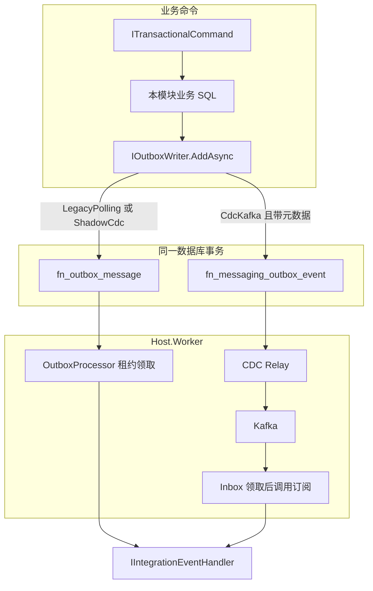

# 可靠事件交付：发布、消费与运维

> 更新：2026-10-15。代码基线：`aa305160`。本文按当前源码说明开发者如何发布和消费可靠业务事件。长期决策见 [ADR-0006](../docs/architecture/adr/ADR-0006-transactional-outbox-cdc-kafka-event-delivery.md)。运行拓扑、切流门禁和容量边界以文末运维文档为准。

## 1. 从哪里开始

- 要在业务事务里发出一条跨模块事件：阅读第 5、7、9 节。
- 要在另一个模块里消费这条事件：阅读第 8、9 节。
- 要确认当前环境走轮询还是 Kafka：阅读第 3、6、10 节。
- 要查死信、做重放或切换交付所有权：阅读第 11、12 节。
- 要区分日志、审计、缓存失效和业务事件：阅读第 13 节。

## 2. 名称对照

可靠事件交付是基础设施能力，注册名不叫某一个业务模块。仓库里这几个名字各管一段：

| 名称 | 位置 | 职责 |
| --- | --- | --- |
| 可靠事件交付 | `Full.NET.Data.Dapper` 的 Outbox/Inbox、`Full.NET.Messaging.Abstractions`、`Full.NET.Messaging.Kafka`、`Full.NET.Host.Worker` | 与业务数据同事务写入，再按所有权投递并幂等消费 |
| `ICommand` / `IQuery` | `Full.NET.Abstractions/Messaging` | 同进程 CQRS。直接调用，不序列化，不进入 Kafka |
| `Messaging` 模块 | `Full.NET.Modules.Messaging` | 运维控制面：交付状态、所有权切换与回退、死信查询和重放 |
| 应用日志 Kafka | `Full.NET.Logging.Kafka`、`Host.LogConsumer` | 诊断日志集中投递。与业务 Outbox 分开，说明见 [日志指南](./logging-guide.md) |

业务模块只依赖 `IOutboxWriter` 和 `IIntegrationEventHandler`。业务项目不得直接引用 Kafka 或 Debezium 客户端。

## 3. 当前默认与试点边界

生产默认路径是 **Legacy 轮询**：

- Worker 配置 `Messaging:Worker:Mode` 默认为 `LegacyPolling`。
- Helm `worker.messaging.mode` 默认为 `LegacyPolling`。
- 切流总开关 `Messaging:DeliveryCutover:Enabled` 默认为 `false`。部署应用代码本身不会把正式事件流切到 CDC Relay。

CDC Relay、Kafka Consumer 和 Inbox 已经实现，状态是试点。组织机构单元变更 `fullnet.organization.unit.changed` 是当前显式登记的候选流，目录默认所有权仍是 `LegacyPolling`。试点通过不能当成生产切流许可，也不能把该能力标成 `Production-verified`。容量测量保持 `Capacity-not-verified`。

## 4. 代码与表

| 职责 | 位置 |
| --- | --- |
| 业务写入 | `IOutboxWriter`，运行时实现为 `DapperRoutedOutboxWriter` |
| Legacy 队列表 | `fn_outbox_message`：领取、租约、重试、死信 |
| 追加式 Outbox | `fn_messaging_outbox_event`：仅 `CdcKafka` 所有权写入，只追加 |
| 消费去重 | `fn_messaging_inbox_message`：Kafka 消费路径按消费者领取 |
| 流所有权 | `fn_messaging_stream_ownership`；没有记录时用 Topic 目录里的默认所有者 |
| Legacy 处理循环 | `Full.NET.Host.Worker/OutboxProcessor` |
| Kafka 消费 | `KafkaConsumerWorker`，经 `IntegrationEventConsumerDispatcher` 进入 Inbox |
| 影子比对 | `ShadowEventComparisonProcessor` |
| 订阅路由生成 | `Full.NET.Messaging.Generators` |

`DapperRoutedOutboxWriter` 按**这一条事件流**的有效所有权选表。同一次调用只写一张表。`LegacyPolling` 与 `ShadowCdc` 写 `fn_outbox_message`。`CdcKafka` 写 `fn_messaging_outbox_event`。业务代码不判断当前模式。

## 5. 端到端路径



事务提交之后，Worker 或 CDC Relay 才把事件送出去。事务内禁止发布 Kafka、调用外部 HTTP 或等待 Broker 确认。

端到端语义是至少一次。同一条消息在租约回收、进程重启或 Offset 提交前宕机时会再次投递。消费者必须能接受重复。Kafka Producer 的幂等只覆盖单个 Producer Session，不能代替稳定 `MessageId` 和消费侧幂等。

同进程模块内部调用继续走 `ICommandDispatcher` / `IQueryDispatcher`。只有需要可靠重试、跨模块最终一致的重要业务集成事件才进入 Outbox。

## 6. 两个枚举

流的发布所有权和 Worker 进程模式是两套值，配套使用。

### 6.1 `EventDeliveryOwner`：这一条事件流归谁

定义在 `Full.NET.Messaging.Abstractions`。同一 `(EventType, SchemaVersion)` 只有一个所有者。

| 值 | 含义 |
| --- | --- |
| `LegacyPolling` = 0 | 旧 Worker 轮询 `fn_outbox_message` 并调用 Handler |
| `ShadowCdc` = 1 | 影子 Topic 只做比对，不绑定业务消费者。业务写入仍进 Legacy 表 |
| `CdcKafka` = 2 | CDC Relay 发布该流，Kafka Consumer 经 Inbox 消费 |

有效所有者 = `fn_messaging_stream_ownership` 中的记录；没有记录时用 `IntegrationEventTopicDefinition` 的默认值。机构单元变更的目录默认值是 `LegacyPolling`。

### 6.2 `MessagingWorkerMode`：这个 Worker 进程启用哪些循环

定义在 `Full.NET.Host.Worker`。配置节是 `Messaging:Worker:Mode`。

| 值 | Worker 实际注册 |
| --- | --- |
| `LegacyPolling` = 0 | `OutboxProcessor` 与保留清理。Kafka 消费者关闭 |
| `ShadowCdc` = 1 | 上述轮询，再加上影子比对。不得注册正式业务 Kafka 订阅 |
| `HybridKafka` = 2 | 轮询与 Kafka 消费者并存。所有权已是 `CdcKafka` 的流由 Kafka 消费；其余流继续轮询 |

`CdcKafka` 作为 Worker 模式的过时别名，数值也是 2。进程启动时把它规范成 `HybridKafka`。当前 Helm Chart 的 `worker.messaging.mode` 仍只接受 `LegacyPolling`、`ShadowCdc`、`CdcKafka`。Chart 取值 `CdcKafka` 时，Worker Deployment 把 `Messaging:Kafka:Enabled` 设为 `true`，进程再按 `HybridKafka` 运行；其余取值由 ConfigMap 把该开关设为 `false`。

`HybridKafka` 下，Legacy 轮询遇到已切走的流会以原因码 `outbox.legacy_owner_revoked` 死信，避免两套发布者同时投递同一条正式流。

## 7. 如何发布

发布点放在已经打开的本地命令事务里，与本模块业务写入一起提交。实现 `ITransactionalCommand` 的命令由 `CommandDispatcher` 自动包进 `ICommandTransaction`。`IOutboxWriter.AddAsync` 发现当前没有打开的事务时抛出 `InvalidOperationException`。

带元数据的重载可以同时覆盖切流前和切流后：

```csharp
await outboxWriter.AddAsync(
    IdentityOrganizationUnitProjectionIntegrationEventTypes.UnitChanged,
    schemaVersion: 1,
    new IdentityOrganizationUnitChangedIntegrationEvent(
        tenantId,
        unit.Id,
        unit.Name,
        unit.IsActive,
        unit.Version,
        unit.UpdatedAtUtc ?? changedAtUtc),
    IntegrationEventMetadata.Create(
        partitionKey: tenantId.ToString("D"),
        producer: "fullnet.organization"),
    cancellationToken);
```

现有机构单元变更就在 `TenantUnitManagementService` 里按这个形状发布。路由规则：

- 所有权是 `LegacyPolling` 或 `ShadowCdc` 时，元数据被忽略，行写入 `fn_outbox_message`。
- 所有权是 `CdcKafka` 时，必须提供 `PartitionKey` 和 `Producer`，行写入 `fn_messaging_outbox_event`。
- 无元数据重载遇到 `CdcKafka` 所有权会失败关闭，避免切流后悄悄写回旧表。

新事件在第一次发布时就带上 `IntegrationEventMetadata`。这样切流当天只改所有权，业务模块不用再改调用。

`TenantId`、`TraceId`、`OccurredAtUtc` 从当前环境上下文提取。普通业务调用不要手写 `TenantId`。带元数据重载里的 `TenantId` 为空时，实现仍从上下文注入。显式元数据只留给 Host 级网关、外部回调或受控历史回填。

`PartitionKey` 决定 Kafka 分区。需要同一聚合按发生顺序处理时，使用稳定业务标识。ADR-0006 的默认组成是 `TenantId + AggregateType + AggregateId`。禁止随机值和翻译文本。同一事务里多次 `AddAsync` 的持久化顺序等于调用顺序。

## 8. 如何消费

### 8.1 Legacy 轮询 Handler

默认路径不经过 Inbox。`OutboxProcessor` 按 `(MessageType, SchemaVersion)` 精确匹配 `IIntegrationEventHandler`，再调用 `HandleAsync`。路由重复或找不到 Handler 时，该消息进入死信，不阻塞同批其他消息。

在消费方模块的 `AddBackgroundServices` 里注册为 Scoped：

```csharp
services.TryAddScoped<OrganizationUnitChangedIntegrationEventHandler>();
services.TryAddEnumerable(ServiceDescriptor.Scoped<
    IIntegrationEventHandler,
    OrganizationUnitChangedIntegrationEventHandler>());
```

Handler 声明规范消息类型、正整数 `SchemaVersion`，以及一种幂等策略。Worker 启动时拒绝 `Unspecified`。

| 策略 | 适用条件 |
| --- | --- |
| `NaturallyIdempotent` | 重复执行会收敛到同一业务状态，例如用版本号忽略旧消息和重复消息 |
| `MessageIdDeduplication` | 副作用提交边界持久化稳定 `MessageId`。去重记录与副作用放在同一个本地事务。只在内存里记住 `MessageId` 不够 |

`MessageId` 来自 Outbox 行，重试和租约回收不会更换。不要用 `TraceId`、租约 `LockId` 或尝试次数当幂等键。

载荷是 MemoryPack 字节，线格式 `application/x-memorypack`。用 `IIntegrationEventSerializer.Deserialize<T>` 还原，不要在 Handler 里另选序列化器。

消费时恢复消息上的租户上下文，并按订阅允许的 Host 或 Tenant 作用域校验。Topic ACL 不能代替应用内租户隔离。

### 8.2 Kafka 订阅要单独登记

`IIntegrationEventHandler` 不会自动变成 Kafka 订阅。进入 HybridKafka 的流必须再实现 `IIntegrationEventSubscription`，写上稳定 `ConsumerName`、消息类型、版本和幂等策略，并在 Worker 后台服务里逐条注册。

机构单元变更的订阅是 `OrganizationUnitChangedKafkaSubscription`，`ConsumerName` 为 `fullnet.identity.organization-unit-projection`。Topic 机器码 `organization.unit-changed.v1` 由消费方 `IdentityIntegrationEventTopicDefinitions` 登记，默认所有者 `LegacyPolling`。

Kafka 路径的去重键是 `(ConsumerName, MessageId)`。`IntegrationEventConsumerDispatcher` 在本地事务中完成 Inbox 领取、业务写入和完成标记，数据库提交之后才提交 Offset。不同 Consumer Group 各自消费一份；同一组内竞争消费。重放仍走 Inbox，不能靠删除 Inbox 唯一记录来强制再执行一遍业务副作用。需要重做业务时，使用专门的补偿命令。

订阅目录是 Scoped。`KafkaConsumerWorker` 是 Singleton，每次处理消息单独建作用域，避免持有 Scoped Handler。

## 9. 契约

消息类型使用小写点分层 `{owner}.{module}.{entity}.{event}`，例如 `fullnet.organization.unit.changed`。`SchemaVersion` 是独立正整数，不写进消息类型。出现第二个版本时，保留并行旧版本 Handler，或提供已记录的相邻升级链。未知版本失败关闭。

可靠事件信封至少包含：`EventId` / `MessageId`、`MessageType`、`SchemaVersion`、`ContentType`、`TenantId`、`PartitionKey`、`CorrelationId`、`CausationId`、`TraceParent`、`Producer`、`OccurredAtUtc`、`Payload`。`EventId` 使用应用端 UUID v7。

Kafka Topic 使用 `fullnet.{environment}.{owner}.{module}.{stream}.v{major}`。死信 Topic 在基础名后加 `.dlq`，重试 Topic 使用 `.retry.{stage}`。业务代码通过目录和 `KafkaTopicNames` 间接得到名称，不自行拼接保留后缀。

顺序只在同一 Topic 分区内成立。载荷遵守数据分类和保留政策，不放入密码、令牌、连接串或不必要的个人敏感信息。

## 10. Worker 配置

配置节 `OutboxWorker` 的代码默认值：

| 键 | 默认 | 约束 |
| --- | --- | --- |
| `BatchSize` | 20 | 1 到 200 |
| `MaxConcurrency` | 1 | 1 到 16，且不超过 `BatchSize`。Helm 将该值固定为 1 |
| `LeaseSeconds` | 30 | 5 到 3600 |
| `LeaseRenewalSeconds` | 10 | 不超过租约的一半 |
| `PollMilliseconds` | 1000 | 空队列会退避，上限 `MaximumIdlePollMilliseconds` 默认 30000 |
| `MaxAttempts` | 5 | 含当前这次领取 |

多副本靠数据库租约：领取时写入 `LockId` 和 `LockedUntilUtc` 并递增 `Attempts`，处理期间按 `LeaseRenewalSeconds` 续租。成功后写入 `ProcessedAtUtc`。临时失败释放租约并设置 `NextAttemptAtUtc`。租约丢失后另一个副本可以再次领取，所以 Handler 必须幂等。

Kafka 连接、确认、缓冲和提交间隔在 `Messaging:Kafka`。生产要求 TLS、显式 `acks=all`、Producer 幂等，以及关闭自动提交 Offset。完整键和校验见 `KafkaMessagingOptions`。影子比对使用 `Messaging:ShadowComparison`。

Helm 只把模式和一部分并发参数放进 Chart。Broker、Debezium Connector、Topic、ACL 和 Secret 由平台另行提供，Chart 不创建 Kafka 集群。

## 11. 重试、死信与重放

Legacy 轮询把可恢复失败留在 `fn_outbox_message` 上等待下次领取。永久失败或达到 `MaxAttempts` 后进入死信终态，后续领取会跳过它。稳定原因码：

| 原因码 | 含义 |
| --- | --- |
| `outbox.unsupported_content_type` | 线格式不是当前 Worker 支持的格式 |
| `outbox.handler_not_found` | 没有匹配的 Handler |
| `outbox.ambiguous_handler` | 同一路由有多个 Handler |
| `outbox.invalid_payload` | 载荷损坏或无法反序列化 |
| `outbox.max_attempts_exceeded` | 瞬时失败达到上限 |
| `outbox.legacy_owner_revoked` | 该流已离开 Legacy 所有权，旧轮询不得再消费 |

Kafka 路径把临时故障送到有上限的分级 Retry Topic。契约错误、租户或权限边界错误、载荷损坏和超过最大尝试次数进入 DLQ。DLQ 保留原始信封、Topic、分区、Offset、`ConsumerName`、失败时间和脱敏错误摘要。

人工重放只从受保护的 Host 运维接口发起，并写入领域审计。范围和权限见下一节。

## 12. Messaging 运维模块

`Full.NET.Modules.Messaging` 依赖 Identity，操作都在 Host 作用域，客户端隐藏菜单不能代替服务端权限。

| 方法与路径 | 权限码 | 作用 |
| --- | --- | --- |
| `GET /api/v1/messaging/delivery-status` | `messaging.events.read` | 查看事件流交付状态与积压 |
| `POST /api/v1/messaging/delivery/cutover` | `messaging.delivery.cutover` | 切换交付所有权 |
| `POST /api/v1/messaging/delivery/rollback` | `messaging.delivery.rollback` | 回退交付所有权 |
| `GET /api/v1/messaging/dead-letters` | `messaging.dead_letters.read` | 查询消费死信 |
| `POST /api/v1/messaging/dead-letters/replay` | `messaging.dead_letters.replay` | 按消费者和消息重放一条死信 |
| `POST /api/v1/messaging/kafka/replay` | `messaging.kafka.range_replay` | 按受控范围重放 Kafka |

切换使用数据库事务里的比较并交换，避免两个发布者同时拥有同一条流。切到 `CdcKafka` 之前要排空该流的 Legacy 积压、完成影子比对，并确认 `Messaging:DeliveryCutover:Enabled=true`。回退先停止该流的 CDC Relay 和消费者，记录位点，再恢复旧 Worker。不要用两套发布者同时开启来做回退。

管理端导航键是 `host-messaging-ops`，路径 `/messaging/operations`。

## 13. 不要写入这条 Outbox 的数据

下列数据有自己的通路，禁止改道进入可靠业务 Outbox：

| 数据 | 实际通路 |
| --- | --- |
| 缓存失效 | 事务提交后删除本实例 L1/L2，再用 Redis Backplane 通知其他实例 |
| 领域审计 | 与业务状态写在同一个数据库事务里 |
| HTTP 操作、异常和出站审计 | 有界微批写入审计库 |
| 诊断日志、Trace、Metrics | 日志管道与 OpenTelemetry |
| 同进程命令和查询 | `ICommandDispatcher` / `IQueryDispatcher` |

跨模块需要当下权威答案时，使用消费方定义的最小只读 Port。高频列表和事务内读取使用本地投影，由本节的集成事件维护。禁止 JOIN 其他模块的表，也禁止跨模块共享一个数据库事务。

## 14. 排障时先看哪一层

1. 业务事务是否提交。未提交的命令不会留下 Outbox 行。
2. 该流的有效所有者是 `LegacyPolling`、`ShadowCdc` 还是 `CdcKafka`，以及 Worker 模式是否配套。
3. Legacy 行看 `ProcessedAtUtc`、`DeadLetteredAtUtc`、`NextAttemptAtUtc`、`Attempts` 和原因码。
4. 已切到 `CdcKafka` 的流看追加表是否只有插入、Connector 位点是否前进、Consumer Lag，以及 Inbox 是否已按 `(ConsumerName, MessageId)` 领取。
5. Handler 启动失败时，先看幂等策略是否仍为 `Unspecified`，以及 `(MessageType, SchemaVersion)` 或 `(ConsumerName, MessageType, SchemaVersion)` 是否重复。

短时 Broker 故障不阻塞已经只写 Outbox 的 API 请求。Outbox、事务日志、CDC 变更表或 Binlog 接近保留上限时要告警并停止切流，不能静默丢掉可靠事件。

## 15. 相关文档

- [ADR-0006](../docs/architecture/adr/ADR-0006-transactional-outbox-cdc-kafka-event-delivery.md)：决策与可靠性边界
- [Outbox Worker 运维说明](../docs/operations/outbox-worker-topology.md)：租约、续租和 Legacy 死信
- [Messaging 运行时拓扑](../docs/operations/messaging-runtime-topology.md)：默认路径与试点组件归属
- [CDC Kafka 试点切流](../docs/operations/cdc-kafka-event-delivery.md)：候选流、切流和回退门禁
- [架构总览](./architecture-overview.md)、[基础设施层](./building-blocks.md)、[关键接口](./key-interfaces-and-classes.md)：类型与装配索引
- [宿主与部署](./hosts-and-deployment.md)：Worker 启动和 CDC/Kafka 部署
- [核心业务模块](./modules-core.md) 第八节：Messaging 运维模块本身
