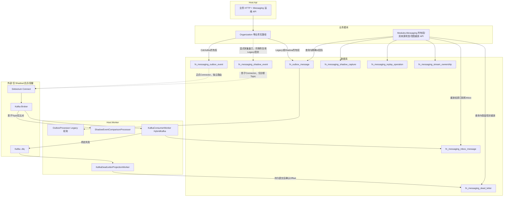

# Messaging 运行时拓扑（当前真实状态）

> 更新时间：2026-10-24；第一批在 `main / a77902afd8` 基线上实施，验收记录见 [实施计划](../superpowers/plans/2026-10-24-messaging-operations-batch1.md)。本文是 **Legacy Outbox + Shadow CDC + HybridKafka 试点** 的单一拓扑视图；容量认证与正式切流边界仍以 [`capability-status.md`](../roadmap/capability-status.md) 与 [`ADR-0006`](../architecture/adr/ADR-0006-transactional-outbox-cdc-kafka-event-delivery.md) 为准。

## 生产当前语义（默认）

| 项 | 值 |
| --- | --- |
| Worker 默认模式 | `LegacyPolling` |
| 正式 Kafka Consumer | **关闭**（`HybridKafka` 仅在运维显式启用且流所有权为 `CdcKafka` 时参与 Inbox） |
| 切流开关 | `Messaging:DeliveryCutover:Enabled=false`（默认） |
| CDC/Kafka 能力状态 | `Build-verified / Pilot`；已增加持久恢复与切流证明，本地定向验证不等于真实双库 Debezium 演练，**不得据此正式切流** |
| 管理页数据来源 | 默认 Legacy `fn_outbox_message` 死信；Kafka 页签查询真实 `.dlq` 的数据库投影 `fn_messaging_dead_letter` |
| API 回退读取器 | 默认失败关闭；API/Worker 共用独立控制面注册，显式启用才装配真实读取器 |
| 容量 Runner | 工具 `Build-verified`；测量结果 **`Capacity-not-verified`** |

Legacy 轮询语义详见 [`outbox-worker-topology.md`](outbox-worker-topology.md)。试点切流 API 与 Shadow 模式详见 [`cdc-kafka-event-delivery.md`](cdc-kafka-event-delivery.md)。

## 总览

## 组件归属

| 职责 | 位置 | 说明 |
| --- | --- | --- |
| Outbox 写入、租约、重试、死信 | `BuildingBlocks/Full.NET.Data.Dapper/Outbox` | 所有模块经 `IOutboxWriter` / 路由写入 |
| Kafka Producer/Consumer、Envelope、Connect 客户端 | `BuildingBlocks/Full.NET.Messaging.Kafka` | Broker 运行时 |
| Inbox 事务 + Handler 调度 | `BuildingBlocks/Full.NET.Modularity/Messaging` | `IntegrationEventConsumerDispatcher` |
| 流所有权、切流/回退、双来源死信、Kafka 重放 API | `Modules/Full.NET.Modules.Messaging` | Legacy 走基础设施运维端口；模块拥有 DLQ 投影，API 不启动常驻 Consumer |
| DLQ 投影 Worker | `BuildingBlocks/Full.NET.Messaging.Kafka` | 消费已登记订阅 Topic 的 `.dlq`，经模块端口持久化后提交 Offset |
| 宿主 Messaging DI | `Hosts/Full.NET.Host.Api/HostApiServiceRegistration.cs`、`Hosts/Full.NET.Host.Worker/Program.cs` | API 只注册范围重放；Worker HybridKafka 注册完整 Kafka Provider |
| Legacy 轮询 Worker | `Hosts/Full.NET.Host.Worker/OutboxProcessor.cs` | **当前生产主路径** |
| Shadow 比对 | `Hosts/Full.NET.Host.Worker/ShadowEventComparisonProcessor.cs` | 非切流 |
| HybridKafka Consumer | `Hosts/Full.NET.Host.Worker` + `KafkaConsumerWorker` | 仅 `CdcKafka` 所有权流 |
| Kafka 重放（无常驻 Consumer） | `Host.Api` + Messaging 模块 | 默认关闭 |
| 容量测量 Runner | `benchmarks/Full.NET.Benchmarks/Kafka` | **非生产 DI**；见 [`kafka-capacity-runner.md`](kafka-capacity-runner.md) |
| Connector 模板 / 本地 Compose | `deploy/messaging/` | 开发、Shadow、容量专用 |
| Identity 消费方 Topic 目录 | `Modules/Full.NET.Modules.Identity/IdentityIntegrationEventTopicDefinitions` | Organization 单位变更试点 Topic |

**边界原则：** Broker/Connect/Consumer 运行时归 BuildingBlocks；运维 API 与所有权表归 Messaging 模块；Topic 目录归消费方模块（Identity）。Connect REST 使用 `IKafkaConnectAdminClient` / `KafkaConnectAdminClient`。宿主实际装配见 [API 注册](../../src/Hosts/Full.NET.Host.Api/HostApiServiceRegistration.cs) 与 [Worker 入口](../../src/Hosts/Full.NET.Host.Worker/Program.cs)。

## 交付模式对照

| 模式 | Outbox 来源 | 到达 Kafka | 进入 Inbox | 生产默认 |
| --- | --- | --- | --- | --- |
| Legacy 轮询 | 业务事务写 Legacy 表 | 否（Worker 直读 Outbox） | 否（走 Legacy Handler） | **是** |
| Shadow CDC | Legacy 业务交付仍走旧表；追加表影子数据需独立准备 | Debezium 影子 Topic | 否（仅比对） | 试点/验证 |
| HybridKafka | CDC 拥有权的流 | 是 | 是 | **否**（开关关闭） |
| Capacity Runner | 专用 DB + 合成/Outbox | 是（Scope A/B/C） | Scope B/C 是 | **否**（手动/CI） |

## 与 Runner / 切流的常见误读

| 读者可能误解 | 实际边界 |
| --- | --- |
| “Scope B/C 集成测试通过 = 可切流” | 否。Delivery 路径为 `Build-verified / Pilot`，仍禁止默认切流 |
| “Kafka Capacity Runner = Build-verified” | 仅表示 **工具与预检** 可构建运行；不等于 Delivery 或容量 Production-verified |
| “Runner 复用 Inbox 核心 = 生产等价” | Runner 使用精简 `ServiceProvider`、可选 permissive 所有权；**不是** Worker 完整宿主图 |
| “MySQL CDC E2E 通过 = 双库已验收” | 单库记录不能外推双库；2026-10-25 已另行通过 MySQL Binlog 与独享 SQL Server Agent 的[完整真实切流/回退](../superpowers/plans/2026-10-25-messaging-real-cutover-rollback.md)，仍不证明多进程或容量。历史 Inconclusive 记录保留原范围 |
| “消息运维页为空 = 没有死信” | Legacy 页签只展示尚未回队的死信；Kafka 页签是异步投影，需独立核对 Worker、组位点、Broker 保留期及授权 Topic 范围 |
| “Inbox 重放测试通过 = 真实 DLQ 闭环” | 历史 Inbox failed 行测试仍只证明该接口；第一批另用真实 Worker/Broker 失败验证持久投影与恢复，证据见实施计划 |
| “切流 CAS 成功 = Connector/Consumer 已就绪” | 切流改变数据库所有权和后续写入路由，不自动启停 Connector/Consumer；现在要求持久影子证明与实际运行资源匹配，仍须运维演练 |

## 2026-10-24 运维整改范围（第一批已实现）

第二批已实现安全切换闭环，定向单元及真实双库/Broker 场景已通过；相邻检查与最终交付状态见[第二批记录](../superpowers/plans/2026-10-24-messaging-operations-batch2.md)。能力仍为受约束试点，正式开关默认关闭。

1. **第一批已实现：**经基础设施端口提供 Legacy 查询和精确 Id 回队；从真实 Kafka DLQ 建立可恢复查询投影，保留 Consumer、来源 Topic/Partition/Offset 与信封。人工写操作从认证上下文读取操作者，必填理由最长 512 字符；恢复与领域审计同事务，Kafka 经原订阅/Inbox，Legacy 保留载荷、Id 和 Attempts。损坏信封保留 Broker 位置与原始字节，拒绝业务重放；新增查询响应不暴露载荷或原始错误。Vue 提供来源页签、分页筛选、详情、独立恢复权限和确认表单。
2. **第二批已实现的安全切换：**持久化回退操作的 generation、资源与执行意图，解决暂停后失败、提交结果未知、重启和多实例接管。失败后先核对数据库所有权与操作状态，仅当同一 generation 仍处于 CdcKafka Preparing 时才补偿恢复控制面，确认实际恢复后解除 producer fence；数据库已经切回 Legacy 时不能无条件 resume 旧发布路径，无法判定则保留保护并人工接管。已提取 API 专用控制面注册，不能以启动常驻 Consumer 的完整注册替代。切流已补按流、版本、环境、配置版本绑定的有效影子证据与实际就绪证明；排空范围包含相关组、Retry Topic 和在途处理，并明确共享 Connector 的影响范围。
3. **运维体验：**范围重放返回 OperationId 并持久化进度、部分完成和结果未知状态；总览展示单流状态与阻断原因，区分未知/未启用/错误/零值；页面权限、本地化及 Worker/Helm 命名同步收敛。

第二批以持久日志替换进程内登记：暂停前先等待 CDC 追赶并持久意图，恢复确认全部任务 RUNNING 后才解除 fence，最终提交响应丢失时重新读取 Completed 并禁止恢复旧 Connector。真实 Broker 验证了有界影子比对及消费组资源；Connect 生命周期采用 HTTP 故障模型，SQL Server 捕获查询使用受控 CT 投影，不能外推为真实 Debezium/Agent 演练。协议仅支持单活动试点流；完整限制、配置和恢复接口见 [CDC 运维说明](cdc-kafka-event-delivery.md) 与 [Runbook](../runbooks/cdc-kafka-cutover-rollback.md)。

### 死信运维配置与接口

页面入口使用 `messaging.operations.read`；总览及操作记录使用 `messaging.events.read`，死信区域使用 `messaging.dead_letters.read`。Legacy 回队需要 `messaging.outbox_dead_letters.requeue`，Kafka 重放需要 `messaging.dead_letters.replay`。所有接口仅 Host 可用。

| 来源 | 列表 / 详情 | 单条恢复 |
| --- | --- | --- |
| Legacy | `GET /api/v1/messaging/outbox/dead-letters[/{id}]` | `POST /api/v1/messaging/outbox/dead-letters/{id}/requeue` |
| Kafka | `GET /api/v1/messaging/kafka/dead-letters[/{id}]` | `POST /api/v1/messaging/kafka/dead-letters/{id}/replay` |

列表支持 `page`、`pageSize`（最大 100）、`messageType`、`schemaVersion`、`errorCode`、`fromUtc`、`toUtc`；Kafka 额外按 `consumerName` 精确筛选。Offset 以十进制字符串返回，避免浏览器整数精度丢失。恢复请求为 `{ "reason": "根因修复与对账依据" }`，身份不能由请求体指定。原有 `/messaging/dead-letters` 仍是 Inbox failed 行接口，单条重放现同样要求理由。

投影仅在 `Messaging:Kafka:Enabled=true` 的 Kafka Worker 注册中运行，`Messaging:Kafka:DeadLetterProjectionEnabled` 默认 `true`，组名 `Messaging:Kafka:DeadLetterProjectionGroupId` 默认 `fullnet.messaging.dead-letter-projection.v1`。同一数据库投影的多实例使用同一稳定组；独立环境/数据库使用各自的组名，改变组名会重新读取 Broker 尚保留的记录；唯一 Broker 位置保证重复收敛且不覆盖恢复状态。数据库持久化失败不确认 Offset。上线前执行双库迁移 287，核对 DLQ 读 ACL 和保留期；数据库中的信封/损坏原始字节属于受控运维数据，当前无自动清理作业，保留与备份策略需随部署确定。当前每个投影库绑定一个 Broker 集群和稳定 Topic 身份；更换集群或重建同名 Topic 前须单独设计投影代际迁移，不能把 Offset 当作跨集群/代际的全局身份。默认 Legacy 部署不需要启用 Kafka。

## 2026-10-25 完整真实切流与回退

两个双库场景均经真实 Organization HTTP 创建业务、Legacy 处理器和受控影子证明切流，随后由 Debezium/Kafka 和生产 Kafka Worker 经 Inbox 提交 Identity 投影。真实 readiness reader 完成位点追赶、暂停和排空后，验证 producer fence 的 503 及业务零落库；最终审计故障会补偿恢复 Connector 并解除 fence，恢复后的业务继续经 CDC 交付。再次成功回退后，Completed 重复恢复不 resume，后续业务由 Legacy 处理，正式 Topic 高水位不增加。操作者、审计、四条投影与 Inbox/源表均对账。

实际结果为 2 通过、0 失败、0 跳过，见[完整记录](../superpowers/plans/2026-10-25-messaging-real-cutover-rollback.md)。修复包括原始二进制与元数据转换配置、SQL Server 时间字段守卫、MySQL 静默位点心跳及 HTTP fence 映射。Worker 组件在同一测试进程运行，不能报告多进程、断网、Soak、容量或独立复核已通过；正式开关仍默认关闭。

## 相关文档

- [`outbox-worker-topology.md`](outbox-worker-topology.md) — Legacy Worker 多副本
- [`cdc-kafka-event-delivery.md`](cdc-kafka-event-delivery.md) — 切流/回退 API 与门禁
- [`kafka-capacity-runner.md`](kafka-capacity-runner.md) — Scope A/B/C 工具边界
- [`kafka-consumer-buffer-and-offset-commit.md`](kafka-consumer-buffer-and-offset-commit.md) — Consumer 协议细节
- [`capability-status.md`](../roadmap/capability-status.md) — 能力状态矩阵

### 持久范围重放与分区检查点

第三批将 HTTP 范围重放统一到 `fn_messaging_replay_operation`（双库迁移 293）。推荐先 `POST /api/v1/messaging/kafka/replay-operations`，携带一次创建意图内稳定的 `requestId`、目录 Topic/消费者、范围、每次消息预算和理由；201 返回应用生成的 UUID v7 操作 ID。创建不执行业务，网络重试复用相同键和请求；不同正文或操作者复用键返回冲突。原快捷入口仍复用该日志协议。

`GET /api/v1/messaging/kafka/replay-operations[/{id}]` 查询记录，`POST /{id}/execute` 执行或继续，`POST /{id}/cancel` 持久请求取消；写权限为 `messaging.kafka.range_replay`，每次人工操作必填理由。执行只接受当前 CDC 所有者及匹配订阅，固定实际 Cluster/Topic 身份、分区与结束位点。恢复不扩大窗口，不重置正式 Group 位点；原资源重建或保留范围丢失时阻断。

每条业务调用前写入持久意图，Inbox 确认后再推进检查点。业务已提交而检查点未确认时保留 `result_unknown`，恢复通过原 Inbox 去重确认，不能把未知计为零或失败。单次预算用尽为 `partial`，仍需显式继续；取消不能撤销已发生的业务副作用。会话锁、代次和租约共同拒绝并发及过期检查点，终态和审计同事务。位点以十进制字符串传输；计数不等于位点差，不展示由压缩缺口推算的百分比。

总览批量读取单流 Legacy 积压、未恢复死信和所有者，同时标注读取失败及截断。`retainedEventCount` 是追加源表保留数量，Kafka 死信数仅代表本地投影；两者均不能作为 Broker lag 或正式链路健康证明。页面提供交付总览、Legacy/Kafka 死信和重放操作区域，读取权限撤销后清除区域并中止查询。Worker 模式统一 `LegacyPolling / ShadowCdc / HybridKafka`；事件流所有者仍用 `CdcKafka`，二者不可互换。

## 2026-10-25 第三批实现边界

总览、Legacy 死信、Kafka 死信和重放操作四个区域共享页面入口，各区域及写操作各自授权。总览展示实际按流聚合与稳定阻断码；数据库观测失败、截断、尚未查询目标运行时均不假报健康。范围操作具有持久 UUID、固定窗口、幂等创建和未知结果恢复，跨浏览器中断仍可按 operationId 查询。

影子准备采用独立诊断源，不能把已由 Legacy 处理的消息镜像到正式追加表。显式部署策略与持久 Legacy 所有权满足后，通过总览开始/关闭有界采集代次，复用真实业务信封与事务。专用 Connector、代次 Header、事件时间及源/目标完整比较共同约束证明；开始新代次只清除旧诊断样本。配置、权限和恢复详见 [运维说明](cdc-kafka-event-delivery.md) 与 [部署说明](../../deploy/messaging/README.md)。实际测试结果及未验收项以 [第三批记录](../superpowers/plans/2026-10-24-messaging-operations-batch3.md) 为准，正式切流仍默认关闭，容量状态不变。
