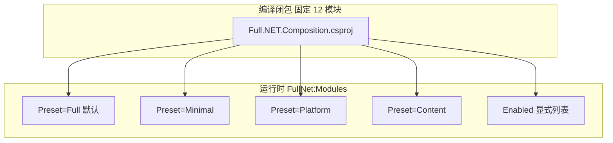

# Full.NET 平台运行时拓扑（当前真实状态）

> 更新时间：2026-08-16。本文是 **Api / Worker / Migrator / Composition** 的单一平台视图；Messaging 细节见 [`messaging-runtime-topology.md`](messaging-runtime-topology.md)。

## 宿主角色

| 宿主 | 职责 | 模块装配 |
| --- | --- | --- |
| `Host.Api` | HTTP API、OpenAPI、SignalR、Kafka 重放运维 | `AddFullNetApplicationModules(Api)` + `AddFullNetMessagingReplayForApi` |
| `Host.Worker` | Legacy Outbox 轮询、Shadow、HybridKafka Consumer | `AddFullNetApplicationModules(Worker)` + 条件 `AddFullNetMessagingWorkerRuntime` |
| `Host.Migrator` | DbUp 迁移与安全 Seed | `AddFullNetApplicationModules(Migrator)` |
| `AppHost` | 本地编排 SQL Server/Redis/Api/Worker/Migrator | 不承载业务模块 |

## 编译闭包 vs 运行时裁剪



- **编译闭包**：始终包含 12 官方模块 `.csproj` 引用（Admin.NET 对标与 Architecture 扫描）。
- **运行时裁剪**：`FullNet:Modules:Preset` 或 `Enabled[]` 控制 DI 注册与 HTTP Endpoint；未启用模块不得暴露 `/api/v1/{module}/*`（Architecture 门禁）。
- **模块依赖 DAG**：见 [`module-dependency-graph.mmd`](module-dependency-graph.mmd)（`pnpm run generate:module-dependency-graph` 同步）。

## 请求链（Api）

```text
TrustedProxy → Localization → RequestLogging
  → ModuleMiddleware(BeforeExceptionHandler：Access、AuditWriteCoordinator)
  → ExceptionHandler
  → CORS → RateLimit → ModuleMiddleware(BeforeAuthentication)
  → Authentication → ModuleMiddleware(BeforeAuthorization)
  → Authorization → ModuleMiddleware(BeforeEndpoints)
  → Module Endpoints (/api/v1/...)
```

Tenancy 解析在 Identity 认证前后由模块中间件与 `ICurrentTenant` 协作完成；详见 [`code-wiki/architecture-overview.md`](../../code-wiki/architecture-overview.md)。

内网 K3s 网关通过 [Refresh-Edge.py](../../eng/deploy/ubuntu/Refresh-Edge.py) 根据 API 的 EndpointSlice 更新上游地址。读取成功且没有就绪端点时，刷新会将上游设为停用，NGINX 对新代理请求返回 502。就绪端点恢复后，下次刷新接回流量。EndpointSlice 读取失败时保留最后一份配置，NGINX 校验失败时恢复原文件；重载失败或响应丢失时，恢复原文件后再次校验并重载，以处理新配置可能已经生效的情况。刷新只调用 reload，不隐式启动或重启服务。失败退出码为 1，标准错误只含固定码与 configRestored、rollbackReloadAcknowledged；恢复文件失败或恢复重载失败会分别标记，不能把磁盘恢复当作在线路由恢复。即使恢复命令得到确认，本轮更新仍报告失败；实际运行状态须另行观察新连接响应和 worker 排空。[NGINX upstream 文档](https://nginx.org/en/docs/http/ngx_http_upstream_module.html#server)

## 内网网关代理信任更新

在既有部署流程中，Configure-GatewayTrust.py GATEWAY_IPV4 默认要求 root，并绑定 /etc/rancher/k3s/k3s.yaml；调用者原入口保持不变。显式使用其他 kubectl 时必须同时提供 --kubectl 和 --context，不能借环境当前 context 选择目标。操作仅针对 fullnet-production 的 fullnet-runtime ConfigMap 和 fullnet-internal-edge NetworkPolicy，不读取 Secret，不滚动 API。

先要求网关 InternalIP 唯一对应一个未删除的 Ready 节点，IPv4 PodCIDR 为私有、/16—/30 且不与网关地址重叠。保留既有 Flannel 主机地址推导约定，只把节点 PodCIDR 的 network_address 作为单个 /32；此推导不代替现场观察 SNAT 来源。更新移除 ConfigMap 全部大小写变体的 TrustedProxy 配置项，精确写入 Enabled=true、ForwardLimit=1 和网关/Flannel 两个 KnownProxies，无关数据和元数据保留；正式宿主默认 KnownProxies/KnownNetworks 为空。其他配置来源和实际生效值仍须在目标发布窗口核对。

对已有资源使用 UID、resourceVersion 的 JSON Patch 条件测试，拒绝并发覆盖；先写固定 NetworkPolicy 的完整精确 spec，再写 ConfigMap。跨资源无事务，后一步失败不会自动恢复旧宽策略或旧宽信任。每次写入附本轮标记，命令响应丢失后只有资源身份、标记和完整内容均吻合才接受；最终重新检查节点和资源。每条 kubectl 请求十五秒、进程二十秒，错误输出只含固定阶段码及 networkPolicy/runtimeConfig 部分状态。unknown 或 not_verified 都不能作完成回执，应核对现状后重新执行，禁止以失败为由自动放宽信任。

成功 JSON 明确 apiRolloutRequired=true、runtimeActivationVerified=false。必须在授权发布窗口滚动 API 并验证实际转发 Header、客户端地址与隔离。NetworkPolicy 的许可按所有适用策略合并，且由目标 CNI 执行；单份精确资源不能证明没有其他宽规则或网络已限制。定向入口 helm-runtime-focused / gateway-trust 仅验证合成边界及独立 Kind 的真实资源更新、幂等和版本冲突，不认证 Flannel、CNI、现有 API 或生产容量。协议依据 [Kubernetes 条件更新](https://kubernetes.io/docs/reference/using-api/api-concepts/) 和 [NetworkPolicy 语义](https://kubernetes.io/docs/concepts/services-networking/network-policies/)。

## 缓存与实时

| 组件 | 位置 | 说明 |
| --- | --- | --- |
| FusionCache L1/L2 | `Full.NET.Caching.Fusion` | 写路径提交后本实例删除 + Redis Backplane |
| SignalR Hub | `Host.Api` + Redis Backplane | 通知推送；Worker 使用 `IRealtimePublisher` |
| 缓存策略注册表 | 模块 `ICachePolicyRegistry` | Architecture allowlist 为零 |

## 数据访问三入口

权威说明见 [`code-wiki/dapper-sql-sources.md`](../../code-wiki/dapper-sql-sources.md)：

1. 模块手写 `*Sql.cs`（默认）
2. [`global-sql-statements.json`](../../contracts/architecture/global-sql-statements.json)（Global 语句）
3. CodeGeneration `*Sql.g.cs`（CRUD 导入）

## 日志平台边界（2026-09-28 补充）

三个宿主共享 Hosting 的 ILogger/Serilog 有界普通/高优先级输出；B0/B1 审计保留各自数据库写入语义。当前应用没有持久日志队列；日志 Kafka 尚未接入，业务 Messaging Kafka 不承载普通日志。详细现状见[日志模块说明](logging-module.md)。

目标入口正式比较两条路线：Collector 为快照 → Console/文件 → 采集缓冲 → Direct 或日志 Kafka；ApplicationKafka 为快照 → 可选静态适配/后台 Producer → 日志 Kafka，省去同流采集。Kafka 后仍有独立消费写入端；原 Logstash/PQ 可靠档基线因 Offset 可能领先安全落盘而准入阻塞，LG00 重新评估能证明持久接收或最终逐项写入/可靠隔离后提交连续 Offset 的实现。

DeliveryMode 与平台 ingress/transport 一致；准入后按配置选择，直发须具备构建能力，仅注入最小 Producer 写凭据，采集器排除同流，不默认双写/自动切路。比较请求 P99、每实例字节吞吐、总 CPU/内存、丢弃和恢复，不能凭队列或集群微基准选型。默认产物不强制引入日志客户端；运行时关闭不等于 native 包退出发布闭包。

Restricted 请求/返回/IP 详情仍仅存 B1，由独立 Worker 清理。关闭组件不连接，Broker/ES/消费者不放进应用 Chart，不复用业务 Outbox/Inbox。ES 固定事件日期索引，ACK/Bulk/恢复按组合准入；直发默认无 Spool，未确认崩溃缺口须披露。这是 [ADR-0012](../architecture/adr/ADR-0012-configurable-log-delivery.md)规划，实施见[开发计划](../superpowers/plans/2026-09-28-configurable-log-delivery.md)，不改写其他拓扑的历史证据。

网关恢复定向入口为 helm-runtime-focused / edge-reload-recovery，仅选择恢复函数回归与真实临时 NGINX 进程：先实际加载停用配置并观察 502，再模拟重载响应超时，恢复后核对原代理响应及 master PID 未变；另验空上游停用、就绪恢复。测试只使用回环上游和临时配置，下载并解包 NGINX 二进制而不安装系统服务，不连接发布节点。[NGINX 配置重载及旧 worker 排空说明](https://nginx.org/en/docs/control.html)。

## 相关文档

- [`messaging-runtime-topology.md`](messaging-runtime-topology.md) — Outbox / CDC / Kafka
- [`module-dependency-graph.mmd`](module-dependency-graph.mmd) — 模块 DAG
- [`hosts-and-deployment.md`](../../code-wiki/hosts-and-deployment.md) — K8s/Helm
- [`ADR-0002`](../architecture/adr/ADR-0002-modular-monolith-evolution.md) — 编译闭包与 Preset
