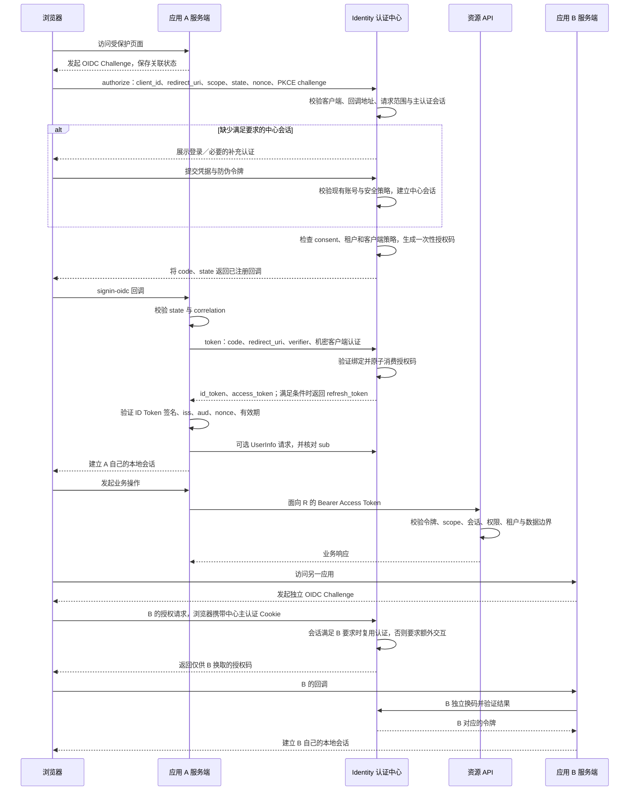

# Full.NET 认证中心与 SSO：对照研究、模块审查与验证方案

> 当前阅读入口：[执行授权与 B1 实施记录](#16-2026-10-26-执行授权与-b1-实施记录)；产品比较与审查依据见[模块复核与改造建议](#15-2026-10-26-模块复核与改造建议)。§1—§15 保留各次研究/验证的输入与范围；旧的 CI 前置、全量执行和强制兼容要求不覆盖现行规则，不将建议或源码存在升级为运行验收通过。

## 1. 状态、范围与基线

- 日期：2026-09-13。
- 初次研究状态：源码与官方资料核对完成；PoC、集成、浏览器、多实例与 Native AOT 验证均未执行。
- 历史确认：项目所有者于 2026-09-13 要求按建议推进并同步项目文档和执行计划。演进方向已接受，见 [ADR-0011](../architecture/adr/ADR-0011-identity-oidc-sso-evolution.md)、[Identity 规格 §14](../superpowers/specs/2026-07-17-identity-session-foundation-design.md#14-oidc-认证中心与-sso-演进2026-09-13-已确认)及[唯一活动计划](../superpowers/plans/2026-09-13-identity-oidc-sso-evolution.md)；当时 P0 尚未开始，不表示 2026-10-26 仍无实现。
- 初次研究授权：合并两轮讨论与用户提供的补充分析，形成验证 Markdown；当时不实施认证中心、不新增依赖、迁移或运行服务。后续按已确认计划与阶段门禁推进。
- Full.NET 基线：分支 `main`，HEAD `f74515d1b9e4544e4c75eeb623892970790b4d0c`。工作区已有大量未提交变更，包括 Identity 注册文件；本报告观察的是当前工作区，不能将所有本地事实归于该提交。
- eShop 固定基线：`b4a40872005d4bb29e5b1fa1ff7e244143d39215`。其中央包文件实际指定 Duende IdentityServer 相关包 `7.3.2`；不能用当前 Duende 最新版文档推定示例已经具有新版能力。[包配置](https://github.com/dotnet/eShop/blob/b4a40872005d4bb29e5b1fa1ff7e244143d39215/Directory.Packages.props)
- 方法：阅读相关源码、仓库规则和官方协议／组件资料；未抓取真实登录流量，未测试 eShop 的实际登录、刷新或退出。
- 本文件保留原始评估与待执行验证清单；批准边界以更新后的 Identity 规格、ADR-0011 和执行计划为准，不以报告自身替代设计或提升任何能力为 `Verified`。

## 2. 研究结论

建议优先验证“OpenIddict 协议服务端 + Full.NET 现有 Identity 账号、安全策略与权限体系”。认证中心先作为 Identity 模块内的逻辑能力，通过现有 Composition 装配；不因参考 eShop 就拆分微服务或另建用户数据库。

Full.NET 已有第一方登录、RSA JWT、刷新轮换、会话撤销与外部 OIDC 客户端代码。缺口主要是标准 OIDC 服务端、客户端注册与授权管理、中心登录会话、各应用会话关联以及退出传播。替换 `IAccessTokenIssuer` 不能独自完成这些能力。

优先完成 P0 可行性验证，再考虑管理后台与现有 Vue 登录迁移。若实际需求仅是接入企业已有统一登录，应另选“Full.NET 作为外部 IdP 客户端”路线，而无需自建完整认证平台。

## 3. 对补充分析逐条核对

### 3.1 授权码 + PKCE 不等于浏览器永远拿不到令牌

**结论：方向正确，但混淆了协议流程与客户端部署方式。**

授权码流避免在授权响应中直接返回 Access Token。谁向 token endpoint 换码，取决于客户端：服务端 WebApp／BFF 在服务器换码；纯 SPA 可以由浏览器 JavaScript 换码并持有 Access Token。PKCE 将授权码绑定到发起者持有的 `code_verifier`，不承担隐藏令牌、消除 XSS 或完成客户端身份认证的职责。

eShop WebApp 设置 `ResponseType = code`，使用 ASP.NET Core 服务端 OIDC Handler。IdentityServer 的 `webapp` 注册却设置 `RequirePkce = false`，MAUI 为 `true`。这表示服务端没有强制 WebApp 使用 PKCE，并不等于 WebApp 实际没有发送 PKCE：所用 ASP.NET Core OIDC Handler 的 `UsePkce` 默认是 `true`。实际请求中的 `code_challenge`、`S256` 和换码时的 verifier 仍需要运行时验证。[eShop 客户端注册][eshop-clients]、[WebApp 配置][eshop-webapp]、[UsePkce 官方说明](https://learn.microsoft.com/en-us/dotnet/api/microsoft.aspnetcore.authentication.openidconnect.openidconnectoptions.usepkce?view=aspnetcore-10.0)

Full.NET 建议对交互式客户端显式要求授权码 + PKCE S256，并分别验证公开客户端和机密客户端。禁止把浏览器／移动应用中的固定 client secret 当作可靠秘密。[OAuth 安全最佳实践][oauth-bcp]

### 3.2 SSO 依赖中心主认证会话，不能只看 idsrv.session

**结论：中心会话与应用会话分离是正确的；Cookie 名称与职责需要修正。**

`idsrv.session` 是辅助会话检测 Cookie，从主认证 Cookie 派生，服务于 check-session 场景；它本身不是完整登录凭据。eShop 使用 `AddAspNetIdentity<ApplicationUser>()` 和 `SignInManager`，主认证 Scheme 为 ASP.NET Identity 的 `Identity.Application`。Scheme 名称与浏览器 Cookie 名称也不能混为一谈，实际名称和属性以最终配置及响应为准。[Duende 认证会话说明][duende-session]、[ASP.NET Identity 集成说明][duende-schemes]、[eShop 启动][eshop-program]

至少区分以下状态：

| 状态 | 作用 | 验证重点 |
| --- | --- | --- |
| IdP 主认证会话 | 中心确认当前浏览器已经完成认证 | 过期、撤销、认证强度、账号状态、正确 Scheme |
| 客户端本地会话 | A、B 分别维持自己的登录态 | 各自过期与退出，不能靠共享跨站 Cookie 冒充 SSO |
| 辅助会话检测状态 | 帮助客户端发现中心登录态变化 | 不是认证凭据；浏览器限制下不得作为唯一退出保障 |
| 协议临时状态 | correlation、nonce、PKCE 等 | 防请求混淆、重放和回调替换，按流程清理 |

因此“有两类主要会话”可以成立，“只有两个 Cookie”不成立。只有辅助 Cookie 而没有有效主认证会话时，不应获得免密授权。

### 3.3 SaveTokens 保存已收到的令牌，不自动获取或刷新令牌

**结论：认证票据与后续 API 调用有关，但原文高估了此选项的职责。**

`SaveTokens = true` 将成功认证返回的令牌保存到 `AuthenticationProperties`。eShop 的 `.AddAuthToken()` 实现从当前 `HttpContext.GetTokenAsync("access_token")` 取值并附加 Bearer Header；该 Handler 没有刷新逻辑。[SaveTokens 官方说明](https://learn.microsoft.com/en-us/dotnet/api/microsoft.aspnetcore.authentication.remoteauthenticationoptions.savetokens?view=aspnetcore-10.0)、[eShop HTTP Handler][eshop-http]

eShop 服务端允许 WebApp 请求离线访问，但 WebApp 配置中没有添加 `offline_access`。不能仅凭服务端的 `AllowOfflineAccess` 或 `SaveTokens` 断言正常登录会返回 Refresh Token，更不能断言会自动续期。[客户端注册][eshop-clients]、[实际请求配置][eshop-webapp]

保存到认证票据也不等于存进服务端数据库：Cookie 认证默认可以将受保护的票据放在浏览器 Cookie 中，采用服务端 ticket store 才是另一种存储方式。HttpOnly 意味着 JavaScript 不能直接读取，不意味着浏览器完全不承载票据。Full.NET 应单独决定令牌存储、Cookie 大小、服务端续期和 Blazor 长连接上下文下的取令牌方式。

### 3.4 scope 与 aud 共同限制访问，但不等于完整业务权限

**结论：应保留资源边界思想，修正“API 校验 aud 就足够”的说法。**

- `aud` 回答令牌面向哪个资源服务；`scope` 表示授予的访问范围，两者不等价。
- JwtBearer 校验签名、Issuer、Audience、有效期，并不会自动替每个业务 Endpoint 检查所需 scope、数据归属或用户权限。
- eShop 的共享 API 认证配置虽然设置 `Audience`，同时却设置了 `ValidateAudience = false`。不能将“示例通过 aud 拒绝跨 API 越权”作为已验证事实。[API 认证配置][eshop-api-auth]
- Full.NET 应将客户端可获 scope、用户精确权限、账号／会话状态、租户与数据归属组合判断。公开应用不能得到完整管理权限或超管声明。

现有 `fullnet_scope` 是 Host/Tenant 上下文；新增标准 `scope` 时保留两者独立语义，禁止覆盖旧 Claim。[Full.NET Claim 契约](../../src/Modules/Full.NET.Modules.Identity.Contracts/FullNetIdentityClaimTypes.cs)

### 3.5 API 不回调 IdP 仅描述离线 JWT 验证模式

**结论：不是所有 API 的必然行为，也不适用于 Full.NET 当前会话约束。**

JWT 的密码学校验可使用缓存的公钥离线完成；首次拉取元数据、密钥刷新仍可能访问 IdP。业务授权还可能访问数据库。Introspection 是在线状态查询，不是离线验签自动附带的即时撤销机制；其缓存会影响撤销延迟。

Full.NET 在 JwtBearer 验签后执行 `AccessSessionValidator`，查询权威会话、账号与租户状态。认证中心接入不能为了复用“API 不查库”的说法而删除该保护。[JwtBearer 事件](../../src/Modules/Full.NET.Modules.Identity/Security/FullNetJwtBearerEvents.cs)、[会话校验](../../src/Modules/Full.NET.Modules.Identity/Security/AccessSessionValidator.cs)

令牌记录标记撤销、阻止刷新、清除浏览器会话、让资源 API 拒绝既有令牌是不同动作。现有受保护管理路径应继续在后续请求中查询权威状态；将来外部 API 若采用短期离线 JWT，必须单独约定最大撤销延迟，不能宣称即时下线。[OpenIddict 令牌存储][openiddict-storage]

### 3.6 第二个客户端免密登录有条件，全局退出也需另行实现

**结论：第二客户端复用中心认证是 SSO 的关键，但不能保证永远直接发 code。**

中心会话必须仍有效，且满足目标客户端要求。`prompt=login`、`max_age`、更高认证强度、账号停用、租户选择或 consent 都可能要求额外交互。`prompt=none` 在无法静默完成时应返回协议错误，而不是绕过这些要求。[OIDC Core][oidc-core]

eShop 的 `LogOutService` 调用本地 Cookie 与 OIDC 两个 Scheme 的 `SignOutAsync`；中心侧通过 `SignInManager.SignOutAsync` 清理其认证会话。这是可参考的退出衔接，但不能据此断言其他客户端的本地 Cookie、离线 JWT 和 Refresh Token 都已撤销。[WebApp 退出][eshop-logout]、[中心登录／退出][eshop-account]

Full.NET 需要分别定义“退出当前应用”“退出中心及所有已接入应用”“管理员强制下线”，以及通知重试和客户端不可达时的失效上界。

## 4. 登录与 SSO 时序

以下是建议验证的服务端 WebApp／BFF 授权码 + PKCE 模型，不是本轮运行 eShop 后采集的实际轨迹。采用纯 SPA 时，换码方和令牌存储位置不同。

`state`、`nonce`、PKCE 和客户端认证承担不同职责，不能互相替代。前通道使用 query、form_post 或其他标准传输方式不改变授权码绑定与结果验证要求。UserInfo 只应在配置需要且已取得适用 Access Token 时调用。[OIDC Core][oidc-core]、[OAuth 安全最佳实践][oauth-bcp]

## 5. eShop 的可吸收点与排除项

| 主题 | 可吸收 | 不直接照搬 |
| --- | --- | --- |
| 职责分工 | 用户规则、协议引擎、登录 UI 分开 | 重建平行用户库或复制 EF Core／PostgreSQL 数据层 |
| 客户端管理 | 独立 client_id、精确回调和 scope 白名单 | 固定 secret、Implicit、生产客户端全免 consent |
| 用户信息 | 通过 Profile 边界向客户端提供身份 | 示例 ProfileService 收集卡号与安全码等敏感声明 |
| 密钥 | 集中签发、资源服务验证 | DeveloperSigningCredential、临时 key 文件与关闭密钥管理 |
| 持久化 | 区分用户数据、客户端配置与授权状态 | 将内存客户端配置误当成完整生产管理能力 |
| 运维 | 可独立观察认证入口 | API 启动即迁移与播种、关闭 HTTPS 元数据检查 |

eShop 的 `identitydb` 承载其用户 EF 存储，Client／Scope／Resource 在启动时以内存配置注册；仅引用 Duende EF 包不能证明配置和授权状态均已持久化。上述判断来自[启动代码][eshop-program]、[项目文件][eshop-project]与[ProfileService][eshop-profile]。注册页面、密码找回等完整生命周期本轮未做端到端核对，不因存在模型或依赖而标记为完整功能。

## 6. Full.NET 现有基础与设计接缝

| 代码入口 | 源码观察 | 后续验证要求 |
| --- | --- | --- |
| [Login Handler](../../src/Modules/Full.NET.Modules.Identity/Features/Login/Handler.cs) | 密码、安全戳、账号状态、锁定、登录会话与审计 | 中心登录复用这些规则，不能另写简化认证旁路 |
| [JWT Issuer](../../src/Modules/Full.NET.Modules.Identity/Security/JwtAccessTokenIssuer.cs) | 自有 JWT 与租户／权限声明 | 按 client／resource 分配声明，ID Token 与 Access Token 用途分开 |
| [认证注册](../../src/Modules/Full.NET.Modules.Identity/DependencyInjection/IdentityAuthenticationServiceCollectionExtensions.cs) | 固定配置的 Issuer／Audience／密钥环及 JWT 事件 | 新旧 Scheme 明确路由，未知 Issuer 默认拒绝 |
| [Refresh Handler](../../src/Modules/Full.NET.Modules.Identity/Features/RefreshSession/Handler.cs) | 刷新产生新记录，继承会话族，旧记录消费后失效 | 中心会话、客户端会话和令牌族分离，不能把轮换记录 ID 直接作为稳定 SSO sid |
| [OAuthFlow](../../src/Modules/Full.NET.Modules.Identity/Features/OAuthFlow/OAuthFlowService.cs) | 接入外部 IdP 并关联本地用户 | 保留客户端与服务端角色区别；外部身份不能按未验证邮箱自动合并 |
| [Claim 契约](../../src/Modules/Full.NET.Modules.Identity.Contracts/FullNetIdentityClaimTypes.cs) | `fullnet_scope`、租户、权限与安全戳是现有契约 | 新增 OAuth scope 不覆盖旧值，迁移需要兼容测试 |

建议首期使用现有 Host 账号和两个受控第一方应用验证，避免同时重构跨租户账号体系。租户阶段必须明确稳定用户身份、应用授权、租户成员关系与各应用活动租户；客户端提交的 tenant 只能作为请求，不能作为可信上下文。

建议边界如下，均为待验证设计：

1. Identity 保持账号与认证状态所有权；业务模块继续自行执行精确权限与数据边界，跨模块不得直查 Identity 表。
2. 协议层由 OpenIddict 承担；不自制授权码、Discovery、JWT 协议栈来替代成熟组件。
3. 自定义 Application／Authorization／Scope／Token Store 经 Full.NET 自有 Dapper 执行与事务边界访问双库。需要验证组件查询接口、并发、撤销、清理和缓存语义，不能只实现简单 CRUD。
4. 中心登录 Cookie 与客户端 Cookie 不共用域级万能登录凭据；正常 SSO 使用顶层浏览器跳转，不依赖第三方 Cookie iframe 静默登录必然成功。
5. 新旧会话并行期不允许“只要 JWT 签名通过就接受”；接入适配必须重新获得可信账号、客户端、会话、权限和租户上下文。
6. OAuth／OIDC 协议端点使用标准协议响应及错误格式；业务管理 API 继续遵守 ProblemDetails。该边界需在后续批准设计中明确，防止被统一包络或异常中间件改写。
7. Discovery 中的 Issuer 使用稳定 HTTPS 地址；JWKS 只公开公钥。签名密钥、加密密钥与 Data Protection key ring 分清职责，同一服务的多实例共享必要材料，不要求无关应用共享解密密钥。
8. 多实例客户端禁用、授权撤销不能仅依靠库内进程缓存。强一致状态按既有缓存规则处理；缓存通知不进入 Outbox，可靠跨应用退出通知若需持久化投递则另定义事务、幂等与重试边界。

相关项目约束：[模块与安全规则](../../rules/development-quality.md)、[Native AOT 规则](../../rules/native-aot.md)、[Vue 客户端规则](../../rules/client-frontend.md)。

## 7. 选型建议与 P0 验证范围

| 候选 | 本项目适配判断 | 尚需证明 |
| --- | --- | --- |
| OpenIddict + 现有 Identity | 优先验证；协议与账号实现可分离，支持自定义 Store | Dapper 双库完整语义、Linux Native AOT、会话衔接、后续维护成本 |
| Duende + 现有 Identity | 有商业支持需求时的备选 | 生产与再分发授权、实际所选版本功能与运行闭包 |
| 外部 IdP | 企业统一登录接入路线的候选 | 账号权威源、用户绑定、租户映射、现有本地会话与上游撤销联动 |

OpenIddict 使用 Apache 2.0，用户认证由应用提供；官方支持自定义 Store。7.0 发布说明声明 .NET 9 及以上的组件裁剪／Native AOT 支持，但完整 Full.NET 依赖闭包必须另外验证。[许可](https://openiddict.com/)、[组件边界](https://documentation.openiddict.com/introduction)、[AOT 发布说明](https://kevinchalet.com/2025/07/07/openiddict-7-0-is-out/)

Duende 的生产使用和产品再分发分别受其授权约束，eShop 的 MIT 不能自动覆盖这些条件。[Duende 授权](https://docs.duendesoftware.com/general/licensing/)

P0 应锁定组件版本、目标 RID 与运行配置，并用最小探针回答：

- 现有密码认证如何建立中心会话；客户端会话如何与旧验证器兼容。
- 两个客户端能否真实完成授权码交换，授权码是否只能消费一次。
- 四类 Store 是否能通过自有执行器运行；不支持的查询表达式如何在适配边界明确处理。
- OpenIddict 默认 Access Token 加密如何与现有 JwtBearer 衔接。需明确选择签名 JWT、JWE 支持或其他验证方式，不靠共享中心私钥给资源 API 解决。[令牌格式](https://documentation.openiddict.com/configuration/token-formats.html)
- 禁用账号、撤销会话和刷新重用后，资源 API 是否继续满足现有拒绝语义。
- 同一最小流程能否在 SQL Server、MySQL 及 Linux Native AOT 实际执行。

P0 不建设通用管理后台，不开放动态客户端注册，不引入 SAML、CAS、设备流、令牌交换或机器身份流。MFA／认证强度保持现有保护要求，不把现有 TOTP 强重认证能力直接宣称为已实现 OIDC MFA 登录。

## 8. 待执行验收矩阵

下表所有项目状态均为“未执行”。证据须记录代码 SHA、工作区状态／后续任务快照、组件版本、数据库、RID、客户端模式、实际断言、执行结果与 CI／日志链接；日志与 HAR 不保存可重放令牌、Cookie 或密码。

| 编号 | 场景／操作 | 必须观察到的结果 |
| --- | --- | --- |
| V01 | A 首次登录，检查授权和换码请求 | code 流、PKCE S256、关联 state／nonce；BFF 模式下令牌不暴露给页面 JS |
| V02 | 缺失／错误 verifier，授权码用于另一 client 或回调 | 标准协议错误，不返回令牌 |
| V03 | 同一授权码顺序重放及跨实例并发换码 | 两种数据库中最多一次成功，不产生多份有效授权 |
| V04 | 替换 state、correlation、nonce，使用错误 Issuer 的 ID Token | 客户端拒绝建立本地会话 |
| V05 | A 登录后访问独立 Origin 的 B | B 通过中心授权获得自己的会话，无需再次输密码；不复制 A 的令牌或 Cookie |
| V06 | 仅保留辅助 Cookie；或使用 prompt=login、过期 max_age | 辅助 Cookie 不能认证；需要重新认证时不得静默放行 |
| V07 | 无可用中心会话时 prompt=none；需要 consent／更高强度 | 返回适当协议错误或正常交互，不绕过要求 |
| V08 | 对比未请求／获准请求 offline_access | 明确是否获得 Refresh Token；SaveTokens 不自行增加授权范围 |
| V09 | Access Token 到期，检查续期与并发刷新 | 仅由明确的刷新实现续期；重用按策略拒绝和撤销，Cookie 票据同步正确 |
| V10 | 向 API 发送错误 aud／iss／过期令牌／ID Token | 验证失败；不能用 ID Token 调业务 API |
| V11 | 缺 scope、有 scope 无业务权限、无数据归属 | 均按对应边界拒绝；前端隐藏不是唯一授权 |
| V12 | 伪造 tenant、跨租户读取、单应用切换租户 | 不越权；其他应用的租户上下文不被隐式改变 |
| V13 | 停用账号、改密、安全戳变化、管理员强制下线 | 后续受保护 Full.NET 请求和刷新被拒绝；中心不能凭旧会话重新发有效授权 |
| V14 | 退出当前应用、退出全部应用、客户端离线 | 按各操作定义清理；记录未通知客户端的失效上界和重试结果 |
| V15 | 客户端／授权禁用后命中另一实例旧缓存 | 不继续发新授权或刷新；既有 API 令牌按已声明撤销策略失效 |
| V16 | 双实例交错登录、换码、刷新、重启 | 状态可恢复，无进程内独占依赖；回调与票据不因落到另一实例失败 |
| V17 | 签名和加密密钥轮换，资源 API 刷新 JWKS | 新旧合法令牌按窗口验证；未知／退役密钥拒绝，JWKS 不泄露私钥 |
| V18 | 非法 redirect_uri、退出回跳、伪造代理头、恶意 Origin | 精确回调与代理信任生效；浏览器会话写操作保留 CSRF 与限流 |
| V19 | 双库过期清理、撤销事务失败、迁移中断恢复 | 无半完成有效授权、可重试恢复；API／Worker 不迁移或播种 |
| V20 | Linux 原生产物实际启动并执行 V01／V03／V10／V13 | 无运行时闭包缺失；不能用 JIT 通过或测试发现替代 |
| V21 | 新旧认证 Scheme 并行、切回旧登录入口 | 既有用户、权限、租户、改密和会话约束不退化；未知令牌不兜底接受 |
| V22 | 无痕浏览器、不同站点、第三方 Cookie 受限 | 正常顶层跳转可用；不将未实现的 iframe 静默登录当作阻塞条件 |
| V23 | 模拟状态库不可用、退出通知失败 | 受保护状态检查失败关闭；通知有界重试，不能误报全部退出成功 |
| V24 | 检查票据体积、Claim、日志及错误内容 | 不包含卡数据、安全戳等不必要对外信息；不泄露秘密或内部异常 |

V14／V15 的跨应用传播时限、外部 API 离线令牌存活窗口，应在实施前明确数值和测量方法；目前未决定，因此不能据此给出“全局即时下线”的能力承诺。

## 9. 阶段建议与停止条件

| 阶段 | 交付范围 | 退出条件 |
| --- | --- | --- |
| P0 可行性 | 固定客户端探针、Dapper Store、会话与令牌适配、AOT | 最小真实登录闭环、双库一次性消费、旧会话保护与 Linux 原生运行有证据 |
| P1 最小 SSO | 中心登录 UI、两个受控应用、Discovery／JWKS、授权／令牌／UserInfo、基础退出 | 真实浏览器完成跨应用免密登录和负向协议验证 |
| P2 接入治理 | 客户端／scope 管理、授权撤销、刷新、全局退出、多实例、密钥轮换 | 撤销策略和传播上界实测成立，双库状态并发与恢复通过 |
| P3 Vue 迁移 | 服务端回调或 BFF 决策、旧入口并行、契约兼容、监控回退 | 原有权限、租户和会话保护回归通过，旧入口退役条件明确 |

如果需要以关闭 Host.Api AOT、引入未批准 EF Core、跨模块直查表、放松会话撤销或扩大客户端信任来换取 PoC 成功，应停止该路径并记录原因，重新比较架构候选。新增独立宿主、改变长期契约或数据所有权应按现有规则确认设计，不由本报告自动批准。

未来实施的测试位置、影响集和 GitHub Actions 门禁统一遵循[测试与验证](../../rules/development-quality.md#11-测试与验证)与[Native AOT 规则](../../rules/native-aot.md)。本报告不建立另一套测试流程，不复制测试数量门槛，不因计划列出项目就认定运行通过。

## 10. 初次研究证据与未验证项

已核对：两份用户分析、本文列出的 eShop 源码、Full.NET 认证接缝及官方资料。补充分析不能原样作为实施依据，主要修正为 PKCE 的适用边界、中心主 Cookie 与辅助 Cookie、SaveTokens／offline_access、scope／aud／业务权限分工，以及离线 JWT 与即时撤销的区别。

本轮只新增本文件；文档结构、UTF-8、仓库内相对链接与空白检查属于文档验证，不证明 SSO 可运行。未执行 eShop／Full.NET 服务启动、网络抓包、双库集成、真实浏览器、多实例、故障注入、组件漏洞审计、OIDC 一致性认证或 Native AOT 发布。V01—V24 保持未执行；OpenIddict 保持首选候选而非最终选型。

| 本轮文档检查 | 实际结果 |
| --- | --- |
| `node --input-type=module -` 执行聚焦检查，调用现有 `validateMarkdownBuffer` 并验证链接／围栏／编号 | 通过：UTF-8 有效，15 个本地链接存在，14 个参考链接定义完整，Mermaid 围栏闭合，24 个验收编号唯一且保持未执行；未验证 Mermaid 渲染效果 |
| `git diff --no-index --check -- /dev/null docs/verification/2026-09-13-identity-oidc-sso-research-validation.md` | 无空白错误诊断；退出码 1 表示新增文件与空文件有差异。初次检查脚本把该退出码误判为失败，随后修正为检查诊断内容并独立检查行尾空白。Git 的 LF／CRLF 提示不是空白错误 |
| 本文件范围的 `git diff --check`、`git status --short` 与 `git branch --show-current` | 无空白错误；新文件未跟踪；分支仍为 `main`，未提交或推送 |

## 11. P0 执行记录

### T00（2026-09-15）：冻结最小实验输入，验证依赖和静态注册

| 项 | 证据 |
| --- | --- |
| 基线 | 分支 `main`；任务快照 `identity-oidc-sso-p0`（复用已有快照）；代码工作 HEAD 以实施时工作区为准 |
| 组件版本 | OpenIddict **7.7.0**（`OpenIddict.Abstractions` / `OpenIddict.Core` / `OpenIddict.Server` / `OpenIddict.Server.AspNetCore`）；许可证 Apache-2.0；未引入 EF/Mongo 持久化包 |
| 传递依赖调整 | 中央包将 `Microsoft.Extensions.Options`、`Microsoft.Extensions.DependencyInjection` 升至 **10.0.11** 以满足 OpenIddict 7.7.0 下限 |
| 静态注册 | `AddIdentityOidc` 默认 `Identity:Oidc:Enable=false`；启用时静态注册 `AddOpenIddict().AddCore().AddServer()` 与 PKCE S256；未映射协议端点 |
| 负向配置 | `IdentityOidcOptionsTests`：默认未启用；Production 启用缺 Issuer/持久化密钥失败；通配/任意回调拒绝（6 发现，0 失败） |
| 架构边界 | `IdentityOidcBoundaryTests`：无 EF/持久化包、无跨模块实现引用、无通配协议授权例外（5 发现，0 失败） |
| AOT analyzer | `pnpm test:aot:analyzers` 退出码 0（Windows 本地，2026-09-15） |
| 未验证 | V01—V24 运行场景、双库 Store、Linux 原生发布、SSO 浏览器、T02 消费方适配（§6 三组入口） |

**T00 结论：** 静态闭包与负向配置门禁通过；仅证明依赖可编译装配与配置边界，不证明协议可运行或 P0 Go。

### T01（2026-09-15）：协议持久化与一次性状态

| 项 | 证据 |
| --- | --- |
| 迁移 | **216** `IdentityOidcProtocolState`：四表 `fn_identity_oidc_application` / `_authorization` / `_scope` / `_token`；双库 expand-only；`object-comments.json` 已登记 |
| Store | OpenIddict 7.7.0 四类 Dapper Store（`IQueryExecutor` / `ICommandExecutor`）；`Replace*Store` 静态注册；LINQ 重载显式 `NotSupportedException` |
| V03 | `IdentityOidcStoreAssertions`：8 路并发授权码兑换仅 1 次成功（CAS `RedeemAuthorizationCode`） |
| V15 | 撤销授权后换新 Store 实例仍无法兑换；`RedemptionDateUtc` 保持为空 |
| V19 | `Migration216IdentityOidcRecoveryTests`：全量与 token 表中断恢复（SQL Server + MySQL，4/4） |
| 双库入口 | `IdentityApiSqlServerTests` / `IdentityApiMySqlTests` 挂接 `IdentityOidcStoreAssertions` |
| 聚焦验证 | `pnpm test:dotnet:unit -- --selection identity-oidc` 6/6；`pnpm test:dotnet:architecture -- --selection identity-oidc` 5/5；集成 `Oidc_stores_enforce_redemption\|recovers_oidc_protocol\|recovers_partial_token_schema` 6/6（Windows 本地，2026-09-15） |
| 未验证 | 协议 HTTP 端点（T03/T04）、中心会话衔接（T02）、Linux Native AOT 运行时、V01—V24 其余场景 |

**T01 结论：** Store 层 V03/V15/V19 在双库成立；不证明 OIDC 协议端点可运行或 P0 Go。

### T02（2026-09-15）：中心会话、应用会话与旧会话衔接

| 项 | 证据 |
| --- | --- |
| 迁移 | **217** `IdentityOidcSession`：`fn_identity_oidc_center_session` / `fn_identity_oidc_application_session`；双库 expand-only；`object-comments.json` 已登记 |
| 服务 | `IdentityOidcSessionService`、`IdentityOidcPrincipalFactory`、`IdentityOidcAccessSessionValidator`；`AccessSessionValidator` 按 Issuer 路由 |
| 消费方 | `CurrentSessionAuthorization`、`BackgroundSessionBindingValidator`、`IdentitySessionContextService`、`HostOnlineSessionManagementService` / `HostOnlineSessionQueryService` |
| V10/V12/V13/V21/V23 | `IdentityOidcPrincipalTests`、`IdentityOidcSessionTests`、`IdentityOidcSessionAssertions` |
| 迁移恢复 | `Migration217IdentityOidcSessionTests`（SQL Server + MySQL，4/4） |
| 聚焦验证 | 单元 `IdentityOidcSession\|IdentityOidcPrincipal` 7/7；集成 `Oidc_session\|Migration217IdentityOidc` 6/6（Windows 本地，2026-09-15） |
| 双库入口 | `IdentityApiSqlServerTests` / `IdentityApiMySqlTests` 挂接 `IdentityOidcSessionAssertions` |
| 未验证 | 旧登录全量回归、协议 HTTP 端点（T03）、Linux Native AOT 运行时 |

**T02 结论：** 中心／应用会话权威与消费方适配在单元与双库服务层成立；完整协议入口与旧体系回归由 T03 与专项回归补齐。

### T03（2026-09-15）：最小标准授权闭环与两个客户端夹具

| 项 | 证据 |
| --- | --- |
| 协议端点 | `/.well-known/openid-configuration`、`/.well-known/jwks`、`/connect/authorize`、`/connect/token`、`/connect/userinfo`；OpenIddict 7.7.0 passthrough + 中心登录 HTML |
| 签名 | `IdentityOidcSigningKeyRing`；`DisableAccessTokenEncryption()`；Access Token 为签名 JWT（`token_use=access`） |
| 宿主上下文 | `IdentityOidcHostContextMiddleware`（`InvokeAsync` 注入 Scoped 租户写入器，认证前建立 Host 上下文） |
| 客户端 | `IdentityOidcClientRegistrar` 同步 A/B 夹具；`AllowRefreshTokenFlow()` + `offline_access` scope |
| V01/V02/V08/V10/V18 | `IdentityOidcProtocolAssertions` + `IdentityOidcRelyingPartyFixture`（PKCE S256、双库） |
| 聚焦验证 | 单元 `IdentityOidc` 15/15；集成 `Oidc_protocol_authorization_flow` SQL Server + MySQL 2/2（Windows 本地，2026-09-15） |
| 未验证 | §6 三组入口全量验收、V04 nonce 客户端校验专项、V09 票据保存、Linux Native AOT（T04）、旧登录全量回归、`pnpm test:aot:analyzers` 对 `IdentityOidcStoreSupport` 既有 IL 告警 |

**T03 结论：** 双客户端 PKCE 授权码闭环、UserInfo、协议/业务错误边界在双库 HTTP 入口成立；§6 消费方入口与 AOT 运行时证据仍待 T04 与专项回归。

### T04（2026-09-17）：Linux Native AOT 与双实例可行性

| 项 | 证据 |
| --- | --- |
| 原生夹具 | `NativeApiOidcE2EAssertions`（刷新重用、密钥轮换重叠、中心重启换码、§6 切租户 refresh 轮换）；`NativeApiOidcSqlServerE2ETests`、`NativeApiOidcMySqlE2ETests`（双库各 8 项） |
| JIT 并发换码 | `IdentityOidcAuthorizationCodeConcurrencyAssertions`：同一授权码 8 路 `POST /connect/token` 仅 1 次成功；挂接 `IdentityApiSqlServerTests` / `IdentityApiMySqlTests` |
| CI 入口 | `pnpm test:aot:native:oidc:e2e` → `scripts/testing/run-native-aot-oidc-e2e.mjs`；`eng/testing/test-matrix.json` `nativeAotOidcIntegration`（**16** 项，45m）；`.github/workflows/api-native-aot-linux.yml` job `linux-native-aot` |
| V01/V02/V08/V10/V18 | 原生进程复跑 `IdentityOidcProtocolAssertions`（双库各 1 项） |
| V03 | JIT 授权码并发兑换（双库）；Native 刷新重用拒绝（双库各 1 项） |
| V13/V21 | §6 消费方：强制下线后 `/api/v1/me` 拒绝；`ChangeOidcAsync` Host↔租户与租户 A→B 切换并轮换 refresh；Agent Run 创建与 revoke 后 resume 拒绝 |
| V12/V21 | 工具入口：`/api/v1/ai/agent-tools` 接受 OIDC Access Token |
| V16/V17/V20 | 双实例共享持久化签名环换码；密钥轮换重叠窗口；中心 `StopGracefully` 重启后 pending code 仍可换码 |
| Windows 本地（2026-09-17） | `dotnet build tests/Full.NET.IntegrationTests` Release **0** 错误；`pnpm test:aot:native:oidc:e2e` 发现 **16/16 Inconclusive**（无 Linux 原生产物） |
| 未验证 | **Linux CI fresh 双库 TRX**（`.ci-artifacts-api/` 或 Actions `linux-native-aot` 工件）；JIT 双库集成需 Docker Testcontainers；P0 Go/No-go 最终结论 |

**T04 结论：** P0 原生门禁已扩展至 16 项并登记矩阵；代码与 Windows 编译证据就绪，**P0 Go 仍依赖 Linux `api-native-aot-linux` 绿结果与 TRX 归档**，Windows 发现不能单独作依据。

### logout-semantics（2026-09-17）：四种退出操作语义

| 操作 | 清 Cookie | 撤 refresh | 拒绝现有 access | 范围 |
| --- | --- | --- | --- | --- |
| 应用退出 | 可选 RP 本地 | 该 client 族 | 下次校验失败 | 当前应用 |
| 中心退出 | 中心 cookie | 全部族 | 下次校验失败 | 当前浏览器全部应用 |
| 全局退出（revoke-all） | 不自动清 RP cookie | 目标用户全部 | 下次校验失败 | 目标用户全部设备会话 |
| 管理员强制下线 | 不自动清 | 对应会话族 | 即时 401 | 单会话 |

**P0 传播 SLA（本地权威）：**

- 数据库撤销与会话族标记：**即时**（同一事务提交后即可查询到 revoked 状态）。
- 资源 API access 拒绝：**≤ 1 次后续请求**（`AccessSessionValidator` / OIDC 应用会话权威查询）；`IdentityOidcLogoutPropagationSlaAssertions` 在双库测量下一请求 401。
- 实时通知投递：**best-effort**；`IdentityOidcRevokeRealtimeFaultAssertions` 证明通知失败时 API 仍返回成功且 access 已拒绝，不误报“全部应用已退出”。
- 幂等撤销：`IdentityOidcRevokeNotificationAssertions` 证明重复 revoke 不重复发布通知。

### 浏览器 SSO 矩阵（2026-09-17）

`identity-oidc-sso.spec.mjs` 已扩展：`prompt=none` 成功、`max_age=0` 强制重登、无效 CSRF、state 篡改、中心 Cookie 清除、`sub` 相同且 `application_session_id` 独立、PKCE verifier 失败、ID Token nonce、prompt=login 不替换既有用户会话；V22 受限第三方 Cookie 在 CI Chromium **条件跳过**并注明原因。

## 12. 2026-09-16 接手审查与安全修复

接手基线 `main` / `0ccfbe1cecae2a4f30698df8a279cb91c3e8cc8d`，任务快照 `identity-oidc-takeover-20260916`。范围为审查 Cursor 已实现的 OIDC 并修复确认缺口，不代表完成全部认证中心、SSO 或 Vue 迁移。既有文档勾选不代替实际运行证据。

| 确认问题 | 本轮修复与验证边界 |
| --- | --- |
| OIDC 权威查询覆盖调用者租户上下文，取消／异常路径也不恢复；未知 token_use 可被接受 | HostOnly 查询使用临时 Host 上下文，finally 恢复原状态；仅接受精确 access。新增 8 个回归，其中 7 个在修复前失败 |
| 中心登录表单可被跨站构造，无防伪校验 | GET 签发防伪 Cookie／表单令牌，凭据 POST 先验证再执行；无效请求不写中心 Cookie。共享 HTTP 夹具增加裸表单拒绝与正确表单提交，浏览器与双库运行待 CI |
| max_age 仅回传、不执行；未维护原始认证时间 | Cookie 和授权主体记录中心会话创建时间；过期、缺失、未来时间以及 max_age=0 不复用 Cookie，prompt=none 返回 login_required；auth_time 仅向 ID Token 投影 |
| profile 字段无条件外发，签发暂存标记被删除，多项权限 ToString 后丢失语义 | 依 profile scope 设置公开 destinations；暂存分类／权限仅留在加密协议令牌中；未知客户端分类不提升为第一方；权限使用重复 Claim。两次签发处理回归与实际 JWT 双库断言分别保留 |
| OIDC 错误／登录响应使用匿名 JSON，Store／元数据使用反射序列化 | 具名响应契约、显式源生成元数据；持久化单独使用默认 JSON 格式闭包，不改变数据库已有扩展属性键名。AOT 分析初次发现 24 个 IL2026/IL3050 错误，修复后 0 警告、0 错误 |
| 既有注册、权限快照及 Integration 总门槛未随 OIDC 同步 | 补齐明确服务及 9 项治理权限；主分片合计为 863，全量门槛由旧 855 上调至 863；未降低任何门禁 |

协议新增回归在修复前为 12 项中 8 失败；扩至 Identity 全部测试后发现的 3 个旧断言失败已修正。独立只读审查未发现本轮协议修复的明确阻断回归；该审查不替代双库或真实浏览器执行。

本次新增 27 个 Unit 测试用例，登记到唯一测试矩阵；只扩展既有 Integration 断言，未新增 Integration 顶层用例。精确验证结果如下（全部是本地证据）：

| 命令／门禁 | 结果 |
| --- | --- |
| `pnpm test:dotnet:unit -- --filter 'FullyQualifiedName~Full.NET.UnitTests.Identity.' --minimum-expected-tests 357` | 357 通过，0 失败、0 跳过；新增回归及全部 Identity 单元测试 |
| `pnpm test:dotnet:architecture -- --filter 'FullyQualifiedName~IdentityOidcBoundaryTests\|FullyQualifiedName~NativeAot\|FullyQualifiedName~MemoryPackControlledProtocol' --minimum-expected-tests 41` | 78 通过，0 失败、0 跳过；包含原有匿名对象失败检查 |
| `pnpm test:governance` | 53 通过，0 失败；含 UTF-8 文档检查与测试矩阵一致性 |
| `pnpm test:aot:analyzers` | 通过，0 警告、0 错误；这是分析构建，不是 Linux 原生发布或运行 |
| `pnpm test:integration:tooling` | 46 通过，0 失败 |
| `dotnet build tests/Full.NET.IntegrationTests/Full.NET.IntegrationTests.csproj --configuration Release --nologo -clp:ErrorsOnly` | 编译通过，0 警告、0 错误；未运行双库集成 |
| 本任务 `git diff --check`、新增文件 UTF-8／空白及文档本地链接检查 | 通过；分支仍为 main，HEAD 未改变 |
| `pnpm test:integration:affected:plan -- --snapshot identity-oidc-takeover-20260916 --phase inner` | 成功生成 Identity 影响集；仅计划，未运行数据库 |

**未关闭事项：** UserInfo／换码／刷新与权威撤销的完整矩阵还需继续审查和回归；切租户后 refresh 轮换依赖 offline_access 与 OpenIddict 令牌管线；双库实际 JWT、真实防伪交互、浏览器 SSO、多实例和 Linux 原生门禁需在后续授权提交对应的 CI 验证。未提交、推送或部署，不把本轮 Unit／分析构建升级为 P0 Go 或 Verified。继续按[唯一执行计划](../superpowers/plans/2026-09-13-identity-oidc-sso-evolution.md)推进。

## 13. T08 Vue 消费与并行入口（2026-09-16）

| 项 | 证据 |
| --- | --- |
| 基线 | 分支 `main`；记录 HEAD `4941a7b5`（切片 241–245 前）；默认 `legacy` 用户名密码登录不变 |
| 启用方式 | `VITE_IDENTITY_AUTH_MODE=oidc-center`；`VITE_IDENTITY_OIDC_CLIENT_ID` 默认 `admin-spa`；样例见 [`ui/admin/.env.example`](../../ui/admin/.env.example) 与 [getting-started §3.1](../development/getting-started.md#31-vue-管理端) |
| 登录／回调 | `oidc-center-login`（PKCE、`#/identity/oidc/callback`）；`OidcCallbackView`；`App.vue` 匿名回调路由走 `router-view` 而非 `LoginView` |
| 会话 | `session.ts`：`externalRefreshAccessToken`、应用＋中心 logout、`handleRemoteSessionRevoke`；refresh token 仅存 `sessionStorage`（`fullnet.admin.oidc.refresh`），access token 仍仅内存 |
| 路由守卫 | `selfServicePaths` 含 `/identity/oidc/callback`；已认证用户无需导航下发即可进入回调页 |
| 切租户 | `session-oidc-center-switch-tenant.test.ts`：OIDC 会话成功切换后替换内存 token、轮换 refresh 并重载授权快照；API 返回 `identity.session_context_conflict` 时刷新并重试一次，成功后重载授权快照（2026-09-18 修正旧测试与描述） |
| 并发刷新 | `session-oidc-center-restore.test.ts`：并行 `restore` 时 token 交换经 `sessionRefreshCoordinator` 串行化，不出现重叠 `/connect/token` 请求（V09/V18 回归） |
| 真实栈 E2E | Playwright `vue-admin-oidc-center`（25175，`admin-oidc-center.spec.mjs`：**130** 项：登录、刷新、Host／租户工作台 `/api/v1/me` 探针、工作流待办页与 `/api/v1/workflow/todos/mine` 正／负 API 探针、同意／驳回操作（§6 审批探针）、Agent 工具页与 `/api/v1/ai/agent-tools` 正／负 API 探针（§6 V12/V21）、Agent 运行页 UI 创建／加载／取消排队运行（Host／租户／切租户返回 Host）、后台任务定义页与 `/api/v1/jobs/host-definitions` 正／负 API 探针、触发操作、退出／强制下线后 access token 无法再次触发任务或列举定义（§6 后台任务探针）、OIDC 创建并读取／取消排队 Agent Run 正探针（三上下文 clientRequestId 幂等后读取仍为排队并可取消，含幂等取消后重复取消负探针与三上下文 UI 加载并取消）、切租户／切租户返回 Host 后后台任务触发与执行历史 API／UI 正探针、排队运行恢复／重复取消负探针、退出／强制下线后已排队 Agent Run 无法读取／取消／恢复／新建（§6 后台任务绑定探针，含切租户并返回 Host 往返后创建）、切租户并返回 Host（含往返后工作流待办／Agent 工具／后台任务定义／Agent Run API 与 Agent 运行页探针）、租户内受保护页面（含 Agent 运行页）与切租户后工作流待办／Agent 工具／后台任务定义／Agent Run API 探针（§6 上下文切换）、退出后受保护路由回登录（含 Agent 运行页）／access token 与 refresh 拒绝、强制下线后 access token／refresh 拒绝且无法用已撤销 refresh 恢复（§6 在线会话探针））；`vue-admin`（25173）`auth-smoke` 断言 legacy 不展示身份中心入口 |
| 并行回退 | [getting-started §3.1](../development/getting-started.md#31-vue-管理端) 记录移除 `VITE_IDENTITY_AUTH_MODE` 后回到 legacy 表单的本地验证步骤；`vue-admin` `auth-smoke` 断言遗留 `fullnet.admin.oidc.refresh` 不阻断 legacy 密码登录、登录后不写入新 OIDC 凭据，且刷新后仍通过 Refresh Cookie 恢复 legacy 会话 |
| 聚焦验证（Windows 本地，2026-09-16） | `ui/admin` OIDC 相关 Vitest **35/35**；`@fullnet/client-contracts` `identity-auth-config` + `oidc-interactive-auth` **11/11**；`admin-real-stack` `spec-contracts` 治理测试登记 oidc-center 项目与 §6 探针契约；E2E 聚焦入口 `pnpm test:e2e:real:oidc-center`（**130** 用例，待 CI／本机真实栈执行） |
| 未验证 | 真实栈 E2E 未在本机执行（API `5149` 未就绪）；`main` push 时 CI `real-stack-e2e` 通过 `pnpm test:e2e:real` 执行 legacy 与 oidc-center 全量 Playwright 项目（治理测试已登记，fresh TRX 证据待 push 后采集）；§6 三组入口**全量**验收、能力状态 `Verified` 升级 |

**§6 最小矩阵（E2E 探针编写状态，待 CI 执行）：**

**2026-09-24 安全边界校正：** `HostJobPermissions` 仅允许 `AuthorizationScope.Host`。租户上下文对 Host 后台任务定义、触发和执行历史 API 必须返回 403；租户切换后 Host job 正向探针不成立，Host 上下文及切换回 Host 的正向探针继续保留。

| 入口组 | 已编写探针 |
| --- | --- |
| 在线会话管理 | 应用退出／强制下线后 access／refresh 拒绝、四类受保护路由回登录（`OIDC_CENTER_PROTECTED_ROUTE_PROBES`，含 Agent 运行页；Host／切租户／切租户返回 Host 三上下文退出／强撤后批量探针）、三上下文 Agent 运行页加载运行后退出／强撤无法直达该页、本地凭据与中心 Cookie 清理对称探针（Host／切租户／切租户返回 Host 三上下文退出／强撤后 `expectOidcCenterLocalCredentialsCleared` + `expectOidcCenterTokensRejected`，三上下文 stale refresh 写回拒绝与强撤实时通知综合探针）、已撤销 refresh 无法恢复；强撤独立 API 负探针与 `revokeCurrentOidcCenterSession` 辅助 |
| 上下文切换 | 切租户后工作流／Agent 工具／后台任务（含触发与执行历史 API／UI，退出／强撤后工作流／Agent 工具／触发与执行历史绑定失效）／Agent Run API（含取消与 clientRequestId 幂等）与 Agent 运行页打开／UI 创建／加载／取消；切租户并返回 Host 后四类 API 往返（含后台任务触发与执行历史及退出／强撤后绑定失效、取消与 clientRequestId 幂等）与 Agent 运行页打开／UI 创建／加载／取消；切租户后及切租户并返回 Host 后创建的 Agent Run 在退出／强撤后绑定失效 |
| 工具／审批／后台任务 | UI 页面与操作（同意／驳回：Host 与切租户上下文、Host／租户／切租户返回 Host 任务触发、Agent 工具／Agent 运行页三上下文打开、UI 创建与三上下文加载／取消／加载已取消运行、三上下文 API 幂等创建后 UI 加载并取消、三上下文排队运行不展示恢复按钮、三上下文取消后隐藏操作按钮）；工作流／Agent 工具／后台任务定义与执行历史 API 正／负探针；OIDC 创建并读取／取消排队 Agent Run API 正探针（三上下文 clientRequestId 幂等后读取仍为排队并可取消，含幂等取消后重复取消负探针）与三上下文排队恢复／重复取消负探针；退出／强撤后触发、列举定义与执行历史绑定失效；已排队 Agent Run 读取／取消／恢复／新建绑定失效（`expectRevokedOidcCenterAgentRunAccessRejected`） |

**§6 退出／强撤对称性（E2E 探针编写状态）：**

| 探针 | 应用退出 | 强制下线 |
| --- | --- | --- |
| Agent 工具 API | 独立负探针 | 独立负探针 |
| 工作流待办 API | 独立负探针 | 独立负探针 |
| 后台任务定义 API | 独立负探针 | 独立负探针 |
| 后台任务执行历史 API | 独立负探针 | 独立负探针 |
| 后台任务触发 API | 独立负探针 | 独立负探针 |
| 已排队 Agent Run 读取／取消／恢复／新建 API | `expectRevokedOidcCenterAgentRunAccessRejected` | 同左 |
| 受保护路由（4 类，含 Agent 运行页） | `expectProtectedRoutesRedirectToOidcLogin` | 同左 |
| 本地凭据／Cookie 清理 + token 拒绝 | `expectOidcCenterLocalCredentialsCleared` + `expectOidcCenterTokensRejected` | 同左 |
| 已撤销 refresh 写回后仍无法恢复 | 独立探针（`expectStaleOidcRefreshCannotRestoreSession`） | 实时通知综合探针（同辅助函数） |

**T08 结论：** Vue 可选 `oidc-center` 消费路径与 legacy 并行入口在单元层成立；生产启用与 P3 退出条件仍依赖真实栈 E2E、§6 回归与能力状态独立门禁，不得由单元测试单独升级为 `Verified`。

## 14. 2026-09-18 Cursor 接手复核与增量修复

本轮以当前 `main` 的 Cursor 多轮实现为输入，重点复核 OIDC 登录失败语义、协议端点限流和切租户 Refresh Token 元数据。发现并修复：中心登录输错密码未累计失败次数；授权端点与中心登录 API 未统一使用登录限流；自定义切租户 Refresh Token 签发路径未经过 OpenIddict 的标准元数据准备阶段，缺少创建／过期时间；成功登录也未清零连续失败计数。

新增 `IdentityOidcCenterLoginServiceTests`，验证达到锁定阈值时写入失败次数、锁定截止时间和乐观版本；并将测试加入 `identity-oidc` 选择器。初次聚焦命令结果：7 项通过、0 失败、0 跳过；`pnpm test:dotnet:architecture -- --selection identity-oidc` 为 5 项通过；Identity 项目 Release 构建 0 警告、0 错误。`pnpm test:governance` 为 54 项中 53 项通过、1 项因 Cursor 同轮新增的 architecture debt 两条登记与 capability-status 不同步而失败，未修改该无关债务文件。

审查确认的多标签 P1 已完成增量代码修复与单元回归：Vue 通过刷新协调锁取得有效 access 后发起单次中心退出，不再先撤销应用导致随后中心退出凭据失效。服务端验证 bearer 的认证结果、access 用途、应用会话标识，再以其用户为撤销目标；Cookie 属于另一用户时保留对方票据。带无效 Authorization 的请求返回 401，不回落 Cookie。应用退出同时绑定 client。无 Authorization 的既有 Cookie 调用仍保留兼容语义。

本轮 fresh 证据：`pnpm test:dotnet:unit -- --no-build --selection identity-oidc` 为 51 通过（此前已编译成功，0 警告、0 错误）；新增退出测试 4 项通过；`pnpm --dir ui/admin test -- --run src/auth/session-oidc-center.test.ts src/auth/oidc-center-login.test.ts` 为 8 通过；`pnpm --dir packages/client-contracts test -- --run tests/oidc-interactive-auth.test.ts` 为 10 通过。前端单次退出和过期 access 刷新断言均先观察失败、再修复通过。

`pnpm --dir ui/admin typecheck` 未通过：包含既有 OIDC 测试／页面类型错误，以及企业申请契约、租户订阅翻译等工作区错误。双库、真实浏览器多标签和 Linux Native AOT 尚未运行，不提升生产能力状态。网络或刷新失败仍只保证本地凭据清理，不宣称服务端撤销完成。

[eshop-program]: https://github.com/dotnet/eShop/blob/b4a40872005d4bb29e5b1fa1ff7e244143d39215/src/Identity.API/Program.cs
[eshop-clients]: https://github.com/dotnet/eShop/blob/b4a40872005d4bb29e5b1fa1ff7e244143d39215/src/Identity.API/Configuration/Config.cs
[eshop-webapp]: https://github.com/dotnet/eShop/blob/b4a40872005d4bb29e5b1fa1ff7e244143d39215/src/WebApp/Extensions/Extensions.cs
[eshop-http]: https://github.com/dotnet/eShop/blob/b4a40872005d4bb29e5b1fa1ff7e244143d39215/src/eShop.ServiceDefaults/HttpClientExtensions.cs
[eshop-api-auth]: https://github.com/dotnet/eShop/blob/b4a40872005d4bb29e5b1fa1ff7e244143d39215/src/eShop.ServiceDefaults/AuthenticationExtensions.cs
[eshop-account]: https://github.com/dotnet/eShop/blob/b4a40872005d4bb29e5b1fa1ff7e244143d39215/src/Identity.API/Quickstart/Account/AccountController.cs
[eshop-logout]: https://github.com/dotnet/eShop/blob/b4a40872005d4bb29e5b1fa1ff7e244143d39215/src/WebApp/Services/LogOutService.cs
[eshop-project]: https://github.com/dotnet/eShop/blob/b4a40872005d4bb29e5b1fa1ff7e244143d39215/src/Identity.API/Identity.API.csproj
[eshop-profile]: https://github.com/dotnet/eShop/blob/b4a40872005d4bb29e5b1fa1ff7e244143d39215/src/Identity.API/Services/ProfileService.cs
[duende-session]: https://docs.duendesoftware.com/identityserver/ui/login/session/
[duende-schemes]: https://docs.duendesoftware.com/identityserver/identity/aspnet-identity/schemes/
[oidc-core]: https://openid.net/specs/openid-connect-core-1_0.html
[oauth-bcp]: https://www.rfc-editor.org/rfc/rfc9700.html
[openiddict-storage]: https://documentation.openiddict.com/configuration/token-storage.html

### 2026-09-18 后续复核：类型与并发登录

- 已修正 OIDC 回调查询数组的 nullable 类型、Element Plus 提示 mock 返回契约、授权列表列泛型、强撤／切租户测试的 Bearer 字面量类型；全量 typecheck 输出已无 OIDC 文件错误，仍因企业申请契约及租户订阅翻译错误失败。
- 切租户冲突旧测试与文档错误要求保留旧 Host 令牌；现按已有共享会话层行为验证刷新后重试一次、更新 token／refresh 并重载权限，没有放宽失败关闭逻辑。
- 中心登录记录失败／成功时增加最多 32 次乐观重试，冲突后重读启用／锁定状态并重新验密；只有成功更新 1 行才能创建登录身份，持续争用拒绝登录。密码哈希需升级时同步更新。
- 登录回归扩至 7 项，覆盖错误密码锁定、失败和成功写入冲突、并发停用／锁定／改密、持续冲突。重试修复前 3 项中 2 项失败；修复后 `pnpm test:dotnet:unit -- --selection identity-oidc` 为 57 通过、0 失败、0 跳过，构建 0 警告／错误。
- Vue 聚焦命令覆盖 `oidc-center-login`、`session-oidc-center`、`session-oidc-center-revoke`、`session-oidc-center-switch-tenant`、`OidcCallbackView`，5 文件共 15 项通过。完整 typecheck 仍未通过，不升级生产 Verified；双库、真实浏览器、多实例与原生发布运行继续待 CI。
- 本轮 pnpm test:aot:analyzers 未通过：Webhooks 反射 JSON 序列化 2 项、Tenancy DbDataReader 日期读取 4 项、企业申请生成代码反射 1 项，共 7 个错误。此结果属于当前完整工作区门禁，不宣称 AOT 通过。中心登录并发修复经独立静态复核未发现明确阻断问题（该复核不替代测试）。

### 2026-09-18 后续复核：AOT 与客户端构建阻塞

- 修复 Webhook JSON 源生成、Tenancy 跨 Provider 日期读取及企业申请生成代码的反射参数复制；Webhook 保持原 PascalCase 负载及签名，生成器使用静态字典参数。`pnpm test:aot:analyzers` 通过（0 警告／错误），`pnpm test:dotnet:architecture -- --selection api-native-aot` 73 项通过；生成器与 Webhook 聚焦回归共 41 项通过。
- 统一后端、OpenAPI 与 Vue 生成器对下划线模块名的 operationId 转换；企业申请的 5 个真实端点加入客户端生成 manifest。补齐租户订阅相关中英文翻译，修复页面误把翻译函数第二参数作为默认文案的问题；admin-i18n 8 项通过。
- 真实导出揭示 SQL Server 222／223 迁移在同一批次引用新增列导致首次安装失败，改用 GO 分隔 DDL 与回填。修复后 SQL Server OpenAPI 集成测试 1 项通过、0 跳过；SQL 安全检查 5 项通过。
- 双库导出尚未通过：MySQL 容器就绪检查返回 Docker API 500，未进入数据库迁移；不能将 SQL Server 结果扩展为双库通过。新迁移的半完成恢复、真实浏览器、多实例和 Linux Native AOT 发布仍待 CI。
- 当前工作区命名检查失败，包含新增迁移注释缺失、索引名超长及未登记动态 SQL；不以新增豁免隐藏问题。影响集规划也因调用 git hash-object 失败而未完成。上述项不计为通过，不升级生产 Verified。
- SQL Server 单库导出重跑通过（1 项、0 跳过），已更新真实 OpenAPI 快照并重新生成客户端产物；离线快照检查与生成器 `--check` 均通过，产物零漂移。操作登记由 544 增至 549，同步对应归一化断言。
- 重生成暴露此前产物与当前契约的积累差异：管理端 typecheck 仍有 41 处错误，主要为请求字段可选性、枚举／数值表示、工作流新增业务标题测试夹具，以及企业申请表格只读数组／行类型。不得仅修改 generated 文件掩盖问题。
- `pnpm test:openapi` 初次为 160 通过、6 失败（166 项、0 跳过）；其中操作计数断言已更新，其他失败涉及 OIDC Schema 引用、未消费夹具和 7 个 Vue API 模块的覆盖登记。全套未重新通过。
- 下一步顺序：① 修正真实契约与调用方／测试夹具并清零 typecheck；② 补齐 OIDC 及新增模块契约覆盖，跑通 OpenAPI 门禁；③ 修复新增迁移命名／注释并补半完成恢复证据；④ 在 CI 验证 MySQL 与双库一致性、SSO 真实浏览器及原生运行。保持 Implemented／局部 Build-verified，不作完整验收结论。
- 客户端归一化契约聚焦复跑：node --test tests/openapi/client-openapi-normalization-contract.test.mjs，5 项全部通过；已同步新增操作数和生成分组。

### 2026-09-18 后续复核：管理端类型检查通过与 OIDC 契约收敛

- 完整 `pnpm --dir ui/admin typecheck` 已通过，上轮 41 处错误清零：请求适配显式补齐 nullable 字段，文件修订号按服务端 int 契约传递，在线会话策略按服务端数值枚举消费；工作流测试夹具补业务标题字段，企业申请表格显式处理只读数组与行类型。
- 修复批量上传真实契约：Endpoint 使用 IFormFileCollection 绑定并移除错误的单文件 Accepts 元数据。SQL Server 真实 OpenAPI 导出 1 项通过、0 跳过；生成客户端正确追加多个文件。新增上传请求回归验证 FormData 中两个独立 files 字段；文件与模块选择客户端 8 项通过，之前其余工作流相关 29 项通过。生成器 8 项通过，生成产物与离线快照检查均零漂移。
- OIDC 客户端／授权管理夹具补齐缺失 Schema，新增签名密钥管理夹具，并登记三个 Vue API 模块与页面。字段对照 C# 契约 3 项通过。批量上传兼容修正只接纳精确路径的已确认元数据变化，认证／响应／必填字段变更负例仍拒绝；兼容门禁 18 项通过。
- 本轮 `pnpm test:aot:analyzers` 通过，0 警告／错误。初次 SQL Server 导出因 Docker 未启动失败，启动后聚焦重跑通过；不代表 MySQL 或原生发布已验证。
- 最新 `pnpm test:openapi` 为 170 项中 167 通过、3 失败、0 跳过：企业申请样例夹具未消费、样例 API 调用层位置不合规，以及 public-auth／tenancy-entitlements／tenant-members／tenant-subscriptions 四个 Cursor 新增模块尚未完成共享契约及覆盖登记。下一步先完成这三组缺口，再回到迁移命名／注释、双库恢复和 SSO 真实栈验收。保持未完成整体验收状态。
- 2026-09-19：基础 API 新增响应形状回归 6 项通过；tenant-members、tenant-subscriptions、tenancy-entitlements 和 public-auth 仍需纳入正式共享契约与覆盖清单，暂不将其标记为完成。
- 2026-09-19：企业申请页面已改为 API 适配层；四个基础 API 和企业申请均登记共享覆盖清单与契约夹具。管理端 typecheck 通过；`pnpm test:openapi` 172/172 通过、0 失败、0 跳过；客户端生成 `--check` 与离线快照检查通过。MySQL 双库、真实浏览器、原生发布及迁移命名债务仍待 CI。
- 2026-09-19：OpenAPI 与客户端覆盖继续保持 172/172；新增基础 API 共享契约、企业申请适配层和运行时校验已完成，管理端 typecheck 通过。命名门禁当前 29/31 通过，剩余为存量 OIDC 迁移注释目录与新增迁移的精确索引名／动态 SQL 债务登记，未通过豁免隐藏。

### 2026-09-19 接管审查增量

- 修复 `generate-object-comments.mjs` 对 MySQL `IF NOT EXISTS`、`ENGINE` 建表语法的解析缺口，并新增回归测试，避免双库迁移表/列从注释目录漏登记。
- 为 Identity OIDC 协议状态与会话迁移补齐 SQL Server `MS_Description` 幂等注释；为新增双库迁移应用目录注释。
- 将账号挑战、注册邀请的超长索引名按确定性压缩规则统一到 SQL Server/MySQL；对仍需兼容旧 MySQL 的固定动态 DDL 登记精确 M1.0 债务。
- 新鲜门禁证据：`pnpm test:naming` 32/32、`pnpm test:sql-safety` 5/5、`pnpm test:openapi` 172/172、`pnpm --dir ui/admin typecheck` 通过；`git diff --check` 无错误（仅存在换行符提示）。
- 未完成的环境级验证仍是 MySQL/SQL Server 容器迁移恢复、真实浏览器 OIDC 全链路和 Native AOT 发布；本轮未提交或推送。
- 回归测试复核：迁移注释解析改为独立 SQL 夹具，覆盖 SQL Server 普通建表、MySQL IF NOT EXISTS + ENGINE、表 COMMENT + ENGINE 及生成列；临时恢复旧解析器时准确失败（漏掉两个 MySQL 表），恢复修复后 `pnpm test:naming` 32/32 通过。
- AOT 日志复核：`.fullnet/oidc-20260919-aot-final.log` 包含完整构建成功摘要，0 警告、0 错误，随后恢复默认 JIT 依赖图；仅为分析器构建证据，不代表 Linux 原生发布通过。客户端生成零漂移、离线快照与生成就绪 7/7 的上一轮证据已核对。
- 环境验收执行位置：遵循 R-20260903-github-actions-first-verification，双库集成/迁移恢复及 OIDC 真实浏览器交由 `.github/workflows/ci.yml`，原生发布/运行交由 `.github/workflows/api-native-aot-linux.yml`；当前没有新的远端运行证据。Docker 本地 Linux Engine 管道不可用，不启动本地重型全套，也不将这些项升级为 Verified。

### 2026-09-19 SSO 验收探针复核

- 修正 `identity-oidc-sso.spec.mjs` 的 max_age=0 用例：真实发送 max_age=0，不再用 prompt=login 替代，并完成重新认证与换票。
- 将授权码领取与兑换分离；错误 PKCE verifier 用例现在使用未消费授权码，要求 HTTP 400 + invalid_grant，避免授权码重放或服务端 500 造成假阳性。
- 新增辅助函数行为回归，验证未提前兑换、完整登录流只兑换一次、机密客户端凭据保留及服务故障不能充当协议拒绝。新增领取测试先失败，修复后通过；已加入 test:provisioner。
- 修复 oidc-governance.spec.mjs 的 UTF-16 编码导致 Playwright 全套发现失败；只转换为 UTF-8，保留原用例内容。同步既有 admin-oidc-center 探针的实际数量登记。
- 本轮证据：pnpm test:e2e:provisioner 27/27，通过且无跳过；在 tests/e2e/admin-real-stack 执行 pnpm exec playwright test --list，发现 59 个文件、286 个用例，退出码 0。发现不执行浏览器与数据库，不代表这些 E2E 已通过；真实双库运行继续待 CI。

### 2026-09-19 SSO state 探针复核

- 修复浏览器 state 篡改用例：保留真实 callback code，仅修改 state，并清除旧授权码后断言拒绝时未写入新授权码。此前跳转缺少 code，只会进入 ready 分支。
- 请求辅助函数在复用中心 Cookie 的直接 302/303 路径也验证 state，缺失或篡改均拒绝；两条新增回归修复前失败、修复后通过。
- 通过 Node VM 执行 A/B RP 实际夹具回调，覆盖匹配、篡改、缺失回调 state 和没有发起授权的情况。发现并修复夹具将两侧空 state 视为匹配的问题，两条负例修复前失败。
- 本轮 pnpm test:e2e:provisioner 37/37 通过，无失败或跳过；Playwright --list 发现 286 项/59 文件，退出码 0；git diff --check 通过。VM 验证只覆盖脚本回调逻辑，用例发现不等同于浏览器、Cookie 或双库协议运行，真实栈仍待 CI。

### 2026-09-19 全量代码提交检查

- 提交前发现 8 个新增文件为 UTF-16，已按文件字节证据转换为 UTF-8：两份 Vue 注册/找回密码页面、一份基线文档及五份迁移脚本。另清理新增文件尾部空白。
- 修正编码后 `pnpm --dir ui/admin typecheck` 通过，`pnpm test:sql-safety` 5/5 通过；`pnpm test:naming` 为 29/32，通过前记录已不代表当前完整工作区。新增失败为迁移注释目录/脚本注释缺失、228 双库超长索引名和 MySQL 223 固定动态 DDL 未登记。此次提交保存当前代码，不代表这些门禁已修复或 CI 验收完成。
- 全量正式源码、契约、模板、样例、测试与文档纳入提交；根目录临时日志、CI 下载产物及生成预览副本保留本地，不提交、不推送。

## 15. 2026-10-26 模块复核与改造建议

### 15.1 范围、授权与证据等级

- 用户要求：审查标准 OIDC 认证中心与 SSO，与成熟产品比较并提出改造建议；随后要求“改造建议写到文档 并审查更新”。本轮仅修改报告、规格、ADR 与唯一活动计划，不实施业务代码、迁移、依赖升级或生产启用。
- 基线：本地 `main`，HEAD `a77902afd87af1662af3b43206d85160eeec566b`；工作区已有其他任务改动。任务快照 `identity-oidc-review-docs-20261026` 只用于差异归属，不复制整仓。复核时主要 OIDC 实现与本次四份文档在修改前无未提交差异。
- 方法：静态阅读配置、注册、客户端管理、会话权威、签名密钥、Vue 与共享换码逻辑；核对原规格、ADR、计划和历史证据；2026-10-26 查阅官方产品与协议资料。未进行攻击复现、浏览器抓包、双库运行、集群故障演练或 Linux Native AOT 运行。
- 证据等级：R01—R05 为源码可确认的实现/治理缺口，运行影响按条件推导；R06—R07 为接入与产品能力差距，不将其统一标作可利用漏洞。高/中优先级是改造排序，不是 CVSS 或漏洞严重性评级。
- 状态：已有实现，完整验收尚未关闭。历史局部通过仅属于当时输入；本轮不提升 `Verified`、`Aot-published` 或容量状态。B1—B3 是建议批次，不因落盘自动取得代码实施授权。

### 15.2 应保留的设计与当前限制

继续以 OpenIddict 和现有 Identity 为默认演进方向。当前 [中央包配置](https://github.com/yan041108/Full.NET/blob/a77902afd87af1662af3b43206d85160eeec566b/Directory.Packages.props)固定 OpenIddict 7.7.0；这是仓库版本事实，不表示已核验它是最新版本或完成依赖漏洞审计。[会话模型](https://github.com/yan041108/Full.NET/blob/a77902afd87af1662af3b43206d85160eeec566b/src/Modules/Full.NET.Modules.Identity/Persistence/IdentityOidcSessionRecords.cs)分离中心与应用会话，[资源校验器](https://github.com/yan041108/Full.NET/blob/a77902afd87af1662af3b43206d85160eeec566b/src/Modules/Full.NET.Modules.Identity/Oidc/IdentityOidcAccessSessionValidator.cs)检查 issuer、audience、access 用途、权威会话与租户上下文；已有显式 SQL、双库迁移及 Store 并发控制。这些与业务权限结合的边界应保留。

当前能力定位为 Full.NET 第一方应用认证底座，不能仅凭采用 OpenIddict 就宣称具备完整企业 IAM。OpenIddict 专注协议，用户认证与应用交互仍由集成者负责；自定义 Dapper Store、集群状态、登录体验和长期协议回归是自建成本。[OpenIddict 定位](https://documentation.openiddict.com/introduction)

### 15.3 复核发现与建议

| 编号/优先级 | 源码证据与结论 | 建议及应验证的边界 |
| --- | --- | --- |
| R01 高：客户端权威冲突 | [Resolver](https://github.com/yan041108/Full.NET/blob/a77902afd87af1662af3b43206d85160eeec566b/src/Modules/Full.NET.Modules.Identity/Oidc/IdentityOidcClientConfigResolver.cs)优先配置并返回未禁用；[Registrar](https://github.com/yan041108/Full.NET/blob/a77902afd87af1662af3b43206d85160eeec566b/src/Modules/Full.NET.Modules.Identity/Oidc/IdentityOidcClientRegistrar.cs)启动时覆盖同 client_id 的数据库描述符。[管理服务](https://github.com/yan041108/Full.NET/blob/a77902afd87af1662af3b43206d85160eeec566b/src/Modules/Full.NET.Modules.Identity/Features/ManageOidcClients/OidcClientManagementService.cs)允许停用、修改与轮换。这使配置内客户端的管理状态与运行时判断存在冲突，重启可恢复旧策略/secret；不是所有动态客户端均受同一覆盖路径影响 | 数据库单一权威，Migrator 受控初始化，API 启动只验证；策略更新版本化，明确 OpenIddict 进程缓存收敛与失败关闭。验证停用/轮换/回调/信任级别调整后跨节点和重启不回退；配置不能重新启用新授权。停用服务会撤销既有会话与 grant，不能把配置覆盖误写成已撤销令牌必然复活 |
| R02 高：生产配置门槛不足 | [OptionsValidator](https://github.com/yan041108/Full.NET/blob/a77902afd87af1662af3b43206d85160eeec566b/src/Modules/Full.NET.Modules.Identity/Configuration/IdentityOidcOptionsValidator.cs)允许 HTTP Issuer，协议加密密钥仅在非空时校验；[DI](https://github.com/yan041108/Full.NET/blob/a77902afd87af1662af3b43206d85160eeec566b/src/Modules/Full.NET.Modules.Identity/DependencyInjection/IdentityOidcServiceCollectionExtensions.cs)空密钥回退临时密钥且无条件关闭 HTTPS 要求。跨节点/重启解密失败是条件性后果；是否能从公网明文访问取决于部署入口，本轮未验证 | 生产强制 HTTPS、持久化加密材料、安全 Cookie；开发/测试例外显式限定环境。代理正确恢复可信 Scheme，不以关闭检查解决 TLS 终止。验证缺失材料启动失败、伪造代理头拒绝和跨节点换码/刷新 |
| R03 高：激活仅作用于进程 | [SigningKeyRing](https://github.com/yan041108/Full.NET/blob/a77902afd87af1662af3b43206d85160eeec566b/src/Modules/Full.NET.Modules.Identity/Oidc/IdentityOidcSigningKeyRing.cs)在内存修改活动 KeyId；[管理服务](https://github.com/yan041108/Full.NET/blob/a77902afd87af1662af3b43206d85160eeec566b/src/Modules/Full.NET.Modules.Identity/Features/ManageOidcSigningKeys/OidcSigningKeyManagementService.cs)同步本进程选项，没有持久化活动版本或节点协调。若各节点预先持有全部公钥，不一定立即验签失败，但重启回退及节点签发状态不一致仍存在 | 持久化元数据/活动版本，私钥由受控 Secret 提供；预发布公钥、节点就绪、激活、保留旧验签窗口、退役。签名、协议加密和 Data Protection 分开管理；验证切换中断、审计失败、节点重启与旧令牌窗口，不把单节点 API 成功当集群完成 |
| R04 高：Vue RP 与令牌保管不完整 | [凭据存储](https://github.com/yan041108/Full.NET/blob/a77902afd87af1662af3b43206d85160eeec566b/ui/admin/src/auth/oidc-session-credentials.ts)保存 refresh token 到 sessionStorage；[回调](https://github.com/yan041108/Full.NET/blob/a77902afd87af1662af3b43206d85160eeec566b/ui/admin/src/auth/oidc-center-login.ts)检查 state，但 nonce 未用于 ID Token 校验；[换码映射](https://github.com/yan041108/Full.NET/blob/a77902afd87af1662af3b43206d85160eeec566b/packages/client-contracts/src/oidc-interactive-auth.ts)丢弃 id_token。已有 state/PKCE，且本轮未证明可利用登录绕过；缺口是完整 RP 验证及浏览器可读长期凭据 | 推荐同源 BFF：服务端换码、验证签名/iss/aud/nonce/有效期、保存令牌并刷新；浏览器仅安全 HttpOnly 会话 Cookie。独立处理 CSRF、防会话固定、session 绑定、并发刷新与失败清理。BFF 降低令牌窃取面，不消除 XSS 代用户发请求的风险；所选组件先验证 Native AOT，不默认新增宿主 |
| R05 高：客户端最小授权被扩展 | [描述符工厂](https://github.com/yan041108/Full.NET/blob/a77902afd87af1662af3b43206d85160eeec566b/src/Modules/Full.NET.Modules.Identity/Oidc/IdentityOidcClientDescriptorFactory.cs)无条件追加 profile、offline_access 与 RefreshToken grant；管理更新也补回 scope。管理员无法按输入精确限制这些能力。不是无请求就必然签发额外 scope，也不等于业务权限绕过 | 分开管理允许 scope/grant/audience/refresh/有效期，offline_access 显式授予。结合 OpenIddict 对内置 scope 的处理验证实际拒绝行为，不能只删集合条目就认定权限收紧。验证仅 openid 客户端不能额外获取 profile/离线续期，以及策略收紧对既有 grant 的处置 |
| R06 中：标准退出与外部撤销链路不足 | [会话入口](https://github.com/yan041108/Full.NET/blob/a77902afd87af1662af3b43206d85160eeec566b/src/Modules/Full.NET.Modules.Identity/Features/OidcSession/Endpoint.cs)使用自定义退出 API；所查注册未配置标准 End Session/Revocation/Introspection，未找到标准 Back-Channel Logout 投递。当前有本地权威撤销，不能描述为完全没有退出能力 | 优先 RP-Initiated Logout 与 Back-Channel Logout，明确当前应用、当前中心会话及全部设备目标。已注册回跳精确验证；logout token 验签、aud/iss/sid/sub/jti、幂等、重放与有界重试；本地撤销不等待外部通知。可靠业务通知可沿批准 Outbox 边界，缓存/日志不进入。外部离线 JWT 不能被通知即时撤销；在线检查或短 TTL 由实际资源需求决定 |
| R07 中：认证产品流程不足 | [中心凭据服务](https://github.com/yan041108/Full.NET/blob/a77902afd87af1662af3b43206d85160eeec566b/src/Modules/Full.NET.Modules.Identity/Oidc/IdentityOidcCenterLoginService.cs)限定 Host 账号密码；[授权入口](https://github.com/yan041108/Full.NET/blob/a77902afd87af1662af3b43206d85160eeec566b/src/Modules/Full.NET.Modules.Identity/Features/OidcAuthorization/Endpoint.cs)是英文拼接表单，所查流程未形成 consent、MFA 登录和 acr/amr 策略闭环。现有外部 OIDC 客户端及 TOTP 强重认证不自动补齐该中心流程 | 先完成多语言、强制改密/恢复、第一方预授权与第三方 consent、MFA 挑战和强度策略，再按真实消费者扩展企业 IdP/Passkey。验证 prompt/max_age、拒绝/撤回同意及强度不足的标准错误；租户选择经权限/成员关系确认，禁止按邮箱自动合并账号 |

标准限定：RP-Initiated Logout、Back-Channel Logout、Revocation、Introspection 是按需求支持的扩展，不能将缺少任意扩展都写成违反 OIDC Core。通过框架自身测试也不等于 Full.NET 集成已通过协议一致性或获得认证。[RP 退出规范](https://openid.net/specs/openid-connect-rpinitiated-1_0.html)、[OIDC Core](https://openid.net/specs/openid-connect-core-1_0.html)

生产 HTTPS 建议与 OpenIddict 官方要求一致；即便代理终止 TLS，仍应恢复可信 Scheme 并保留检查。[OpenIddict ASP.NET Core 集成](https://documentation.openiddict.com/integrations/aspnet-core)。BFF 与机密客户端建议参考 ASP.NET Core 10 官方指南，但该指南不证明本仓库选定集成的 AOT 可行性。[微软指南](https://learn.microsoft.com/aspnet/core/security/authentication/configure-oidc-web-authentication?view=aspnetcore-10.0)

### 15.4 成熟方案比较与适用条件

以下能力按 2026-10-26 官方资料核对；适配成本是本仓库约束下的工程判断，不是产品性能排名，不比较未经实测的吞吐量或价格。

| 方案 | 优势 | Full.NET 的代价/限制 | 选择条件 |
| --- | --- | --- | --- |
| OpenIddict + 现有 Identity | 保留账号权威、Dapper、业务授权与租户隔离；协议栈可定制 | 不是完整 IAM 成品；自有 Store、流程、集群治理及运维均需维护 | 推荐保留为当前底座路线，先修复 R01—R05，再补标准 SSO 与认证体验 |
| Keycloak | 成品管理控制台、身份代理、LDAP/AD、可配置认证流程、Passkey 与标准退出能力 | 独立身份系统与运维面；需要明确账号权威、绑定、租户映射及注销联动；不能直接替换 Full.NET 数据权限 | 急需广泛企业 SSO 能力且可以接受独立部署时评估，不能因功能多就推翻当前模块化单体基线 |
| Duende IdentityServer + BFF | .NET 协议/BFF 产品与支持；提供密钥管理能力 | 仍需账号和业务权限集成；生产及再分发许可、版本功能边界需核对；Dapper/AOT 验证不能省略 | 愿意用商业支持降低维护负担时评估；自动密钥管理能力取决于所选版本/许可 |
| Auth0 | 托管身份服务；Organizations 支持组织品牌、成员、角色和联合登录等 B2B 接入 | 外部依赖、套餐与迁移成本；数据驻留和服务约束须按项目核对；业务数据授权仍由 Full.NET 负责 | 优先上线速度且允许托管身份时评估，不把 Organizations 自动等同于 Full.NET 数据租户 |

来源：[OpenIddict](https://documentation.openiddict.com/introduction)、[Keycloak 管理指南](https://www.keycloak.org/docs/latest/server_admin/index.html)、[Duende BFF](https://docs.duendesoftware.com/bff/)、[密钥管理](https://docs.duendesoftware.com/identityserver/fundamentals/key-management/)、[许可](https://docs.duendesoftware.com/general/licensing/)、[Auth0 Organizations](https://auth0.com/docs/manage-users/organizations)。未选择或安装新产品，未确认任何采购或再分发授权。

### 15.5 改造顺序、验收与未验证项

建议顺序为 B1 治理与生产可靠性 → B2 标准 SSO 闭环 → B3 认证体验及按需企业接入。完整范围、文件定位、V 场景映射与停止条件集中维护在[唯一活动计划 §1](../superpowers/plans/2026-09-13-identity-oidc-sso-evolution.md#1-批准状态与范围)，本报告不另建执行清单。

每批先集中完成关联实现，再测试本次改动及直接必要边界。受影响持久化场景成对验证 SQL Server/MySQL；浏览器使用真实两个客户端及标准 RP，AOT 验证实际改变的 Linux 原生路径。生产容量、外部撤销传播时限和运行可靠性均需真实测量，不能借产品官方能力推导 Full.NET 已达标。OpenID 一致性测试只选择所开放的 profile，不要求为测试启用原本不支持的 flow；测试通过与申请认证是两件事。[OpenID OP 测试指南](https://openid.net/certification/connect_op_testing/)

本轮文档审查校正：旧“P0 未开始”改为已有实现但完整验收未关闭；旧 SPA 冻结策略标为历史实现；客户端覆盖不表述为已撤销会话必然复活；单节点切钥不表述为必然全站验签失败；nonce/ID Token 校验缺口不直接推导可利用绕过；可选退出扩展不表述为全部 OIDC Core 必选。历史证据保留原日期和结果，当前能力矩阵不变。

本轮文档验证：对本次四份 Markdown 调用仓库 `validateMarkdownBuffer`，UTF-8/乱码检查通过；检查 63 个本地链接及其中 16 个标题锚点，均有效；本任务 `git diff --check` 无空白错误。复核新旧决策状态、R01—R07 与 B1—B3 映射及历史记录限定，未修改任何能力通过标记。

本轮未执行代码测试、构建、真实协议交互、双库、多实例或 Native AOT；这些项均保持未验证，不据文档检查关闭运行验收。

## 16. 2026-10-26 执行授权与 B1 实施记录

### 16.1 输入、范围与已实现内容

用户在 §15 文档交付后明确要求“执行”。本次实施基线仍为 `main` / `a77902afd87af1662af3b43206d85160eeec566b`，任务快照为 `identity-oidc-remediation-20261026`。保护其他任务的文档、Document/CodeGeneration 等实现与契约改动；不提交、推送或发布。

本次先实现 B1 的治理与生产可靠性基础：

- 删除 API 启动客户端注册器，抽出不含服务器/Cookie 的 OpenIddict Store 闭包供 Migrator 使用。Baseline Contributor 只创建不存在的客户端和 scope，已有策略与 secret 不覆写；API 运行时 Resolver 只读数据库。
- 关闭 OpenIddict 进程实体缓存；第一方信任默认关闭。描述符与管理更新精确保留 scope，只有显式 offline_access 才开放刷新 grant；额外校验组件内置 scope，授权码兑换与刷新重验当前策略。策略变化与旧授权/应用会话撤销放在 Identity 本地事务中。
- 非 Development/Testing 环境强制 HTTPS Issuer、持久化签名与协议加密材料；协议明文测试例外限定开发/测试环境。生产中心 Cookie 强制 Secure。
- 成对新增 `291_IdentityOidcSigningPolicy.sql`，存储集群活动密钥指针与版本。Migrator 仅首次初始化；管理激活使用原指针与版本的条件更新，并与激活审计共用事务。签发路径读取持久化状态，节点重启不覆盖；缺少活动材料时失败关闭，公开 JWKS 不额外依赖数据库。
- 候选签名密钥预发布公钥，避免只注册活动密钥而使切换出现公钥空窗。各节点仍须在激活前受控部署材料；当前没有自动节点就绪确认、自动退役调度或完整集群传播时限承诺，不能将活动指针同步外推为这些能力已完成。
- 同步原生测试的准备流程：显式由 JIT Migrator 初始化 OIDC 客户端，原生 API 不再写入注册状态；密钥切换用例改为显式持久化激活，启动配置不再表示覆盖操作。

### 16.2 聚焦验证与边界

| 检查 | 实际结果与范围 |
| --- | --- |
| 环境自检 | `node scripts/doctor.mjs --profile backend --json` 通过；.NET SDK 10.0.402、Docker Engine 可用；该结果不等于运行验收 |
| Release 构建 | Unit 与 Integration 项目单节点构建通过，均 0 警告/错误。普通并行 Release 构建曾发生 MSBuild AccessViolation/子节点提前退出，按受控 `-m:1 -nodeReuse:false -p:UseSharedCompilation=false` 构建恢复；失败不计为测试通过 |
| Unit | `identity-oidc-remediation-b1` 对应的四个类共 20 项通过，0 失败/跳过；使用本次 Release 构建。早先未重建 Release 的旧产物运行不作为本批新实现的证据 |
| SQL Server/MySQL Integration | 精确选择新治理持久化类及既有协议、客户端管理、签名轮换与退役入口，共 12 项通过，0 失败/跳过。覆盖初始化重跑、节点重启后的活动指针、未记账迁移恢复、旧公钥保留与受控移除；不等于全部 OIDC 或前端验收 |
| 迁移结构 | 只对 291 双库文件调用命名、对象注释与 SQL 安全校验器，全部无违规；未自动执行全仓治理/全量测试 |
| Native AOT | 首次分析构建因 CodeGeneration 类型缺失失败；对应源码出现后重新执行 Host.Api `FullNetAotAnalysis=true`，0 警告/0 错误，默认 JIT 还原图已恢复。只证明当前静态闭包，不借此提升 `Aot-published`；Linux 原生发布/运行未执行 |

本次未新增第二份执行计划；B1 未完成的节点就绪/轮换生命周期与必要原生运行证据继续留在原计划，B2 Vue BFF/标准退出和 B3 认证体验尚未由本批实现。生产容量与跨应用注销传播上界保持未验证。

### 16.3 2026-10-26 改动与构建阻塞（历史记录）

12 项通过后，继续补充仅 openid 客户端请求 profile/offline_access 的真实协议拒绝断言，并复核密钥激活失败语义：未知/无私钥输入返回 400，持久化策略并发冲突返回 409；同步声明 409 元数据。删除被后续配置覆盖的冗余 Cookie 配置，中心 Cookie 继续 Secure。

重建 Integration 时，工作区其他任务的 `tests/Full.NET.IntegrationTests/CodeGeneration/GeneratedRemediationCommandTests.cs` 出现 CS0246：缺少 `ProductAggregateService`、`ProductDetailInput`、`ProductDetailQueryService`、`ProductDetailManagementService`。该次构建 5 个错误，新增负例未进入执行；上一轮 12 项结果不外推为这些最新改动已通过。没有修改或排除该任务的测试源码来绕过失败。

首次 Host.Api AOT 分析构建出现 4 个 CS0103，位置为 `CrudVueViewGenerator.cs` 对 `CrudAggregateVueGenerator` 的引用；这是编译失败，不能算 AOT 分析通过。失败期间工作区出现对应类型文件，因此对新输入另行重验。每次 AOT 尝试后均恢复默认 JIT 还原图。Linux 原生发布与运行尚未执行，不升级能力状态。

重验结果：Host.Api Release / `FullNetAotAnalysis=true` 构建通过，0 警告/0 错误，耗时 5 分 18 秒；该结果仅替代首次静态分析阻塞，不替代上文 Integration 最新构建失败或 Linux 原生运行证据。文档 UTF-8/乱码及本地链接/锚点检查通过；本任务差异空白检查通过。当前 B1 保持核心已实现、完整验收未关闭，B2/B3 尚未实施。

### 16.4 2026-10-27 续作：scope 顺序与标准 RP 退出

基线仍为 `main` / `a77902afd87af1662af3b43206d85160eeec566b`；新快照 `identity-oidc-continue-20261027`。后端只读自检通过。其他任务已补齐 Product 生成类型，本次 Integration 编译成功，§16.3 的类型缺失不再是当前阻塞；没有修改或排除其他任务的用例。

新增或修正的行为：

- 客户端 scope 校验移到 OpenIddict 默认 grant 权限检查之前，防止内置 `offline_access` 检查抢先返回另一错误；真实协议覆盖未授予的 `openid`、`profile`、`offline_access`，统一拒绝为 `invalid_scope`。
- 配置标准 `/connect/logout`，Discovery 发布 `end_session_endpoint`。GET 和普通 RP POST 展示确认页，确认 POST 先经过防伪验证；页面 no-store、无 referrer 且禁止嵌入。回调只由协议组件验证和产生，`state` 按协议回传，ID Token 输出当前中心会话的标准 `sid`。
- OpenIddict 默认允许可选 hint 验证失败后继续；本实现增加验证处理器，要求提供的 `id_token_hint` 必须有组件验证出的 principal，失败时拒绝，避免静默降级。确认与防伪要求不因提供 hint 而跳过，也不凭 hint 撤销其他设备。语义依据为 [RP-Initiated Logout 1.0 §2—§4](https://openid.net/specs/openid-connect-rpinitiated-1_0.html#RPLogout)，组件行为对照 [OpenIddict 7.7.0 Session 处理器](https://github.com/openiddict/openiddict-core/blob/7.7.0/src/OpenIddict.Server/OpenIddictServerHandlers.Session.cs)。
- 当前浏览器退出只撤销其中心与关联应用会话，审计共用 Identity 本地事务，提交后发布既有实时撤销提示；不调用按用户撤销全部 grant 的接口。access/refresh 的后续使用由现有权威会话校验拒绝，其他设备保持有效。中心撤销采用单向条件更新，避免并发续期版本递增使撤销丢失。

聚焦验证记录：

| 检查 | 结果与限制 |
| --- | --- |
| 初轮治理回归 | 构建成功；6 项中 4 通过、2 因 scope 错误码断言失败。未将该轮报告为通过 |
| 首轮退出回归 | 8 项中 4 通过、4 失败，分别揭示 scope 处理顺序及组件对无效可选 hint 的容忍行为；已针对真实路径修正 |
| 治理与退出双库重验 | 8/8 通过，0 失败/跳过：治理持久化类 4 项、签名密钥管理入口 2 项、标准退出 2 项。覆盖错误 hint、未注册回调、GET/普通 POST 无撤销、防伪、state 回传、当前 access/refresh 失效及其他设备保留；使用 HTTPS TestServer 浏览器维持 Secure Cookie 属性 |
| 补强后 Unit | 最新 Release 构建 0 警告/错误；上述治理类及直接受影响的主体投影、会话与退出边界共 52/52 通过，0 失败/跳过。矩阵选择器为 `identity-oidc-b1-b2`；不是整个 Identity Unit 套件 |
| 补强后 Integration | 最新 Release 构建 0 警告/错误；退出场景补充 hint/client 不匹配与真实续期插入撤销读写窗口的负例，与既有正常协议授权流一起精确选择 4/4 通过，0 失败/跳过。该轮与上一轮退出用例重叠，不能累加宣称 12 个不同用例 |
| 最新 AOT 分析 | Host.Api Release / `FullNetAotAnalysis=true` 构建通过，0 警告/错误，耗时 6 分 17 秒；已恢复默认 JIT 还原图。未执行 Linux 原生发布/运行 |
| 文档 | 5 个相关 Markdown 的 UTF-8、60 个本地文件链接与 20 个锚点检查通过；没有执行全量测试 |

该结果是 TestServer HTTP 协议与真实双库验证，不是浏览器 UI 或 Linux Native AOT 运行证明。标准退出尚未包含 Back-Channel 通知，Vue 仍未迁移 BFF；节点就绪/密钥生命周期、原生证据和 B3 认证体验继续由唯一活动计划追踪，不提升整批 `Verified` 或生产就绪状态。

收尾已核对分支/HEAD、任务相关差异空白与新文件编码；矩阵新增了 52 项 Unit 与 8 项双库聚焦选择器。成功运行的临时产物由现有上下文清理。两轮失败 TRX 已保留到各自系统临时运行目录根部；清理三处已结束测试的其余临时目录时，自动审批返回 `blocked by policy`，因此保留这些目录，没有改用其他工具绕过清理限制。

### 16.5 2026-10-27 BFF、可靠退出与中心认证交互

本轮快照 `identity-oidc-remaining-20261027`，基线仍为 `main` / `a77902afd87af1662af3b43206d85160eeec566b`。以下是本轮实现与实际验证，§16.4 的“尚未实施”只保留为上一切片历史。

- **BFF 与 RP。** 在现有 API 装配 OpenIddict Client 7.7.0，复用自有 Dapper Token Store 保持有状态、一次性回调。随机 256 位 `__Host-fullnet-browser` Cookie 使用 Secure/HttpOnly/SameSite=Lax；数据库仅保存句柄 SHA-256 与 Data Protection 密文。浏览器恢复响应只含到期时间与 CSRF 随机值，OAuth access/refresh/ID Token 留在服务器。组件回调保护依据 [OpenIddict 官方客户端说明](https://documentation.openiddict.com/guides/getting-started/integrating-with-a-remote-server-instance.html)；复用 Store 不引入 EF Core。
- **刷新与上下文。** 共享数据库版本/CAS 租约串行刷新及租户切换；结果未知、过期租约或保存失败关闭票据，不重用旧 refresh。禁止组件和宿主 HTTP 自动重试一次性凭据。写请求检查精确 Origin/Referer 和常量时间 CSRF 值，WebSocket 同样核对来源；租户切换返回 204，改密后要求重登。启用 BFF 时不映射旧人类密码/刷新/OAuth 回调，JWT 只接受 OIDC issuer。没有生成虚假 TokenResponse 供旧前端逻辑使用。
- **可靠退出。** 中心/全设备撤销和退出意图 Outbox 共用本地事务；Worker 先幂等落地 `fn_identity_oidc_logout_delivery`，再在事务外投递。标准签名 `logout_token` 绑定 issuer/audience/sub/sid、稳定 jti、事件声明，省略 nonce，采用 `logout+jwt`；协议依据 [Back-Channel Logout 1.0 §2](https://openid.net/specs/openid-connect-backchannel-1_0.html#BCLogout)。目的地须属于部署方许可的 HTTPS 来源，禁止重定向、代理和 Cookie。5 秒 HTTP 超时，5 秒轮询，最多 8 次退避重试，失败终态可按客户端更新权限审计重放；有界清理不删 pending 或持有租约的工作。这个调度参数不是已实测的外部传播 SLO，最终 RP 仍须实现签名校验、jti 幂等和自身会话撤销。
- **中心交互。** `ui_locales` 按现有规范化器选择中英文；第三方展示精确 scope 并明确同意，永久授权参与后续签发；安全设置页支持本人撤回同一应用全部授权、令牌和应用会话。已登记 TOTP 的账号必须提交第二因子，步长 CAS 防止重放；一次性恢复码可用于账号恢复，恢复不关闭 TOTP。必须改密时不创建中心会话或授权码，改密/恢复后撤销全部权威状态。`auth_time/amr/acr` 保留真实认证结果，租户切换不提升强度；不宣称 NIST AAL 或扩大企业协议范围。
- **部署与持久化。** 双库迁移 300/301/302 分别承载浏览器票据、TOTP 消费步长和退出队列；Migrator 仅初始化不存在的 BFF 机密客户端，API 不覆盖已保存策略。BFF 状态签名、状态加密和协议加密材料彼此独立，API/Migrator 共用配置门禁；多节点仍需共享 Data Protection。后台客户端编辑补 MFA 和退出地址，普通新客户端默认非第一方。

本轮验证记录：

| 检查 | 实际结果 |
| --- | --- |
| Vue BFF 单元/组件 | 7 个文件，20/20 通过，0 跳过；覆盖恢复、租户切换、撤销、回调及过期异步恢复不复活退出状态 |
| 共享客户端相关测试 | HTTP、会话、实时通知、OIDC 客户端/授权及交互辅助共 6 个文件，36/36 通过 |
| Vue 类型检查 | 新增本人授权表格修正后通过；不等同真实浏览器验收 |
| 首轮后端构建 | 修正 OpenIddict Discovery 上下文成员和测试取消令牌参数；共享 Organization 新测试缺少 friend assembly 导致编译失败，已补最小内部访问声明，未排除其用例 |
| 首轮双库联调 | Release 构建 0 警告/错误；14 项中 10 通过、4 失败、0 跳过。过期 ID Token 负例揭示组件授权码通道默认容忍有效期，已显式启用；另 2 项因先清 Cookie 再写 Cookie 产生两个响应头，已消除无意义的清 Cookie 响应。失败不计通过 |
| 修正后核心双库 | 16/16 通过，0 失败/跳过。真实过期/nonce/issuer/audience 拒绝、回调重放、并发刷新、未知网络结果仅发送一次、MFA/同意/改密、退出队列重启与迁移恢复均执行；后续 303 和密钥生命周期增量另行验证 |
| 本轮最新 Unit | Release 构建 0 警告/错误，矩阵 `identity-oidc-remaining` 精确选择 119/119 通过，0 失败/跳过；包含新增密钥材料、浏览器边界、权限目录和错误资源检查 |
| 最新前端补验 | Vue 类型检查通过；共享客户端密钥/客户端/HTTP/会话 4 文件 15/15 通过，与上文 36 项有重叠，不相加 |
| 架构检查首轮 | 7 项中 6 通过、1 失败；租户写入边界清单缺少并行任务的 Document 后台清理边界，且本次新增项顺序未同步。已核对固定 Host/finally 清理并修正清单，待新鲜重验；没有排除用例 |

本节记录核心实现阶段；后续密钥治理、真实浏览器与原生运行结果以 §16.6 为准，不能把本节早期未执行状态当作最终结论。外部退出传播时限和生产容量仍须单独实测。

### 16.6 2026-10-27 集群密钥治理与最终运行验收

迁移 303 成对创建公开密钥生命周期表和签发节点租约表。`kid` 绑定规范 RSA SPKI 指纹，不因 PEM 空白/编码改变，也不能重绑其他材料；API readiness 与 Worker 记录材料摘要、协议加密及期限配置指纹、策略版本、候选私钥标识和 90 秒租约，不存私钥。激活要求预发布窗口和最少 API 数，以及全部存活节点材料一致并具备候选私钥，持久化 CAS 阻止并发覆盖。生产预发布至少 60 秒；Helm 的最少节点数来自 API 最小副本数。

轮换后旧公钥继续保留，退役期限覆盖配置完整窗口和数据库现存合法令牌/中心会话最长到期，防止缩短配置后提前移除历史材料。活动钥不能退役，退役不可逆、不能重新发布；资源 API 每次核对权威退役状态，禁止对端仍缓存旧公钥时继续接受。启动缺少未退役的历史公钥失败关闭，已就绪节点仍可在数据库短暂不可用时提供已知 JWKS。原先“删配置即退役”的测试已同步为受控生命周期，并补精确 publish/retire 权限负例。

真实浏览器入口使用 `IdentityBrowserUiTests` 配合 `playwright.bff.config.mjs`，独立于历史 SPA/legacy 全栈夹具；真实 HTTPS Vue 代理终止 TLS，两个回环 Kestrel 后端只信任该代理，配合 SQL Server/MySQL 和系统 Edge，不 Mock Discovery、JWKS、令牌或后端。登录与回调分别进入两个 API，验证共享状态和保护票据。第二 RP 是独立 HTTPS 来源，测试凭据只在 Playwright Node 进程，浏览器复用中心 Cookie 进行 `prompt=none`，并验证标准 state/nonce/签名/issuer/audience/到期及应用退出范围。`pnpm test:e2e:real:oidc-center` 已指向资源门禁内的新夹具；历史 HTTP SPA 项目退出活动 Playwright 配置，其业务探针文件仅保留追踪，不谎报已在 BFF 下重跑。Native 入口为 `NativeApiBrowserSessionTests`，可通过 `node scripts/testing/run-identity-oidc-runtime.mjs --native` 真实发布和运行 Linux ELF；Windows 发现或跳过不能替代。

复核同时补强上下文切换的票据写入失败：新令牌可能已提交，保存失败须关闭票据；如果删除也失败，保留数据库租约并清除本请求的本地引用，不能由中间件 finally 再释放租约，使旧 refresh 重新可领取。下次读取等待或在租约过期后关闭票据，绝不接管。双库保存失败/清理失败组合负例已在最终 18 项批次通过。

退役补验还发现 `JwtBearerOptions.Events` 的委托会被现有 `EventsType=FullNetJwtBearerEvents` 替代，原权威退役检查没有真正运行；此前推进测试时钟又使令牌先过期，掩盖了问题。现把检查放入实际的 `FullNetJwtBearerEvents.TokenValidated`，保留 C0 会话判断，数据库异常失败关闭。回归在退役后恢复业务时钟，证明仍持旧 RSA 公钥、且令牌尚未自然过期的对端返回 401；双库均通过。

| 最终批次过程 | 实际结果与当前限制 |
| --- | --- |
| 定向后端构建 | 最新 Unit/Integration Release 均 0 警告/错误，包含票据失败、刷新 issuer 和真实 JWT 事件修正 |
| 架构边界重验 | 7/7 通过，0 失败/跳过，关闭 §16.5 首轮清单差异 |
| 双库扩展批次 | 38 项实际执行，36 通过、2 失败、0 跳过；失败均为历史多节点激活用例仍预期对端继续用旧钥，而实际已按数据库指针收敛。已同步断言并在重复治理前调用真实 readiness，后续定向重验不得沿用失败轮为通过 |
| 最新 Vue 相关批次 | 7 文件 23/23 通过；首次暴露默认客户端仍断言 `admin-spa`，已同步到 `fullnet-admin-bff` 后通过；与 §16.5 的 20 项重叠，不累加 |
| 双库脚本结构 | 迁移 300—303 共 8 文件的中文表/列注释及 SQL 安全检查通过；303 MySQL 表注释排列已与仓库解析器一致。不以静态检查替代双库重放用例 |
| 最终定向 Unit | 13/13 通过、零跳过：上下文服务 6 项、刷新签发器 1 项、模块条件装配 6 项；协议 HTTP 工厂另批 3/3。与前述 119 项重叠，不直接相加；矩阵登记的去重范围为至少 129 项，本轮没有重新整批运行该选择器 |
| 最终定向双库 | 18/18 通过、零跳过：BFF 8 项、多节点激活 2 项、单/多节点退役 4 项、多节点应用/中心退出 4 项。关闭扩展批次的旧激活断言、缓存公钥退役检查，以及历史 HTTP 夹具未携带 Secure 中心 Cookie 的失败；没有降低 Cookie 安全属性 |
| 最终真实浏览器 | 双库 MSTest 2/2 通过、内部 Edge 桌面/移动 4 条真实流程全通过、零跳过。覆盖 HTTPS 登录与跨 API 回调、第二 HTTPS RP 无提示 SSO、恢复/CSRF/租户切换、密钥 publish/activate/详情、客户端 MFA 与退出地址编辑后取消、投递查询刷新、本人授权空态和应用/中心退出。未见页面脚本异常或 API 5xx；响应式截图人工核对通过，不把空态浏览器检查冒充实际撤回同意的 UI 操作 |
| 浏览器密钥操作复核 | 新增真实 publish/activate 后，桌面流程发现行重排后操作组仍缓存旧插槽和回调，移动端重新载入则正常；该失败轮没有记为通过。最小组件回归先准确失败；操作组改为每轮渲染读取当前插槽，密钥表以 `keyId` 标识行。相关组件/API 回归和最终浏览器重验均通过，后端退役窗口没有放宽；补齐开关样式和 BFF 改密后的重新登录说明，截图等待抽屉进入视口 |
| Native 资源故障 | 6 GiB 容器上限在 ILC 生成对象阶段出现 OutOfMemoryException；入口已调整为 12 GiB 构建预算与容器上限，另保留门禁的 4 GiB 余量。纯编译不提前占用重型运行锁。复用既有 TEMP 缓存重试，未复制源码、未终止其他会话或数据库 |
| 最终 Native 发布/运行 | linux-x64 ELF 发布成功；9 条已登记第三方 ILC 告警、零新增。SQL Server/MySQL 原生进程 2/2 通过、零跳过，实际执行登录、回调、票据恢复、CSRF、切租户后刷新和应用退出；不是 Windows discovery 或跳过 |
| 最终客户端契约 | 退出投递 DTO/guard 移至共享契约，补客户端 MFA/退出地址、本人授权与密钥 publish/retire 夹具及消费者登记；离线管理契约 3/3、共享 OIDC 3 文件 9/9、Vue 组件/API 5 文件 13/13 通过，类型检查通过，相关覆盖零遗漏。与上文批次有重叠，不相加 |
| 文档结构 | 5 文件 UTF-8、65 个本地文件链接和 19 个锚点检查通过；本任务相关 `git diff --check` 通过 |

原生首轮历史：SDK 10.0.402 / linux-x64 发布 ELF，147,232,192 字节，SHA-256 `40690ca19283ade77d9b1c2934712e2f5c33b05c46f22b5273cf05da391b2ce4`；9 条 ILC 警告均为仓库已登记第三方程序集，零新增告警。双库原生运行均完成登录、一次性回调、票据恢复及租户切换，但切换后的真实刷新返回 `invalid_grant`（ID2088，issuer 无效），该轮 0/2 通过，不能计为原生运行验收。

根因是 `IdentityOidcContextRefreshTokenIssuer` 手动分派 `GenerateTokenContext`，没有设置组件取作标准 JWT issuer 的 `Claims.Private.Issuer`；同时捕获 `IOptions` 首次值，可能在轮换后继续使用旧凭据。现显式设置已配置 issuer，并每次读取 `IOptionsMonitor.CurrentValue`；依据为 [OpenIddict 7.7.0 令牌元数据生成实现](https://github.com/openiddict/openiddict-core/blob/7.7.0/src/OpenIddict.Server/OpenIddictServerHandlers.Protection.cs)。新增管理态“切换后立即真刷新”回归和当前选项单元验证均已通过；重用该轮系统 TEMP 的 Linux 构建缓存增量重发，不复制源码或保留多套产物。修正后最终 ELF 为 **147,232,112 字节**，SHA-256 **`5e93a402692f082b59883f22a0b7852a861589eb07432cc53cee4faaf24a372e`**，双库原生运行 2/2 通过，关闭该失败。

最终原生输入仍为上述 HEAD 的未提交工作树；发布前后核对 Identity 主模块与 Contracts 的 474 个 `.cs/.csproj/.resx`（排除 bin/obj），按相对路径排序、每文件 SHA-256 汇总为 `19b54051dd22cf7ec0df8be88209120b766b86ccbbe3218226c82d05c7cdb094`，未改变。该摘要限定本任务 Identity 范围，不冒充整个并行工作区的冻结哈希。环境为 Windows、Docker Desktop Linux、SDK 10.0.402 / .NET 10.0.13、SQL Server 2022/MySQL 8；宿主 i9-14900K（24 核/32 线程）、63.7 GiB RAM，发布容器限制 2 CPU/12 GiB。这是功能验收，不是容量实验，保持 `Capacity-not-verified`。

浏览器代理诊断已取得真实 Vite 传输错误：进入认证端点前，回环后端 TLS 握手断开。夹具改用真实 HTTPS 前端终止 TLS、仅信任回环代理恢复 HTTPS 的双 Kestrel HTTP 后端；这同时验证可信代理边界，原生入口继续验证端到端 TLS。协议客户端真实工厂的 3 项补验已通过，分别确认 BFF/退出投递仅发送一次，普通 HTTP 保留标准重试。

Back-Channel 的双库用例通过受控 HTTP Handler 验证签名载荷、持久队列、失败、幂等和重启，不是外网 RP 接收验收；真实外部传播时限仍未实测。双语消息键集合聚焦检查 1 项通过，同文件其他 8 项未选择，不计为通过。全量测试、历史全部 V 场景、完整 Worker 原生发布、外部认证一致性认证和生产容量不在本次验证范围。

| 原审查项 | 本轮处置与边界 |
| --- | --- |
| R01 客户端权威 | 数据库单一权威、Migrator 仅初始化缺失记录；停用、轮换、回调与信任调整不由 API 启动覆盖，双库/多节点路径已验证 |
| R02 生产材料 | 生产 HTTPS、持久签名/加密、可信代理、独立 BFF 状态材料和共享 DP 门禁已实现；真实生产 Ingress/Secret 部署未执行 |
| R03 集群密钥 | 持久策略 CAS、不可重绑指纹、API/Worker 租约及预发布/激活/保留/退役已实现并定向验证；实际 RP 缓存窗口须在接入时约定 |
| R04 Vue RP | 服务端有状态一次性 RP 校验和加密票据、Cookie/CSRF、未知刷新结果关闭、旧入口收敛已通过聚焦测试；真实浏览器与 Native AOT 均通过 |
| R05 最小授权 | 显式 scope/offline grant 与真实内置 scope 拒绝、授权收紧撤销已验证，不再自动补回 profile/offline_access |
| R06 标准退出 | 标准 RP 退出、可靠通知队列和管理重放完成；后续本地独立成熟 RP 与真实网络补验见 §16.7，生产部署的 RP 传播 SLO 仍须实际接入后验证。Revocation/Introspection 继续按资源消费者需求评审，不为功能数量启用 |
| R07 中心交互 | 中英文、consent/撤回、TOTP/恢复码、强制改密及真实认证强度已实现并聚焦验证；企业 IdP、Passkey、SAML/SCIM 等保持按需边界 |

本次授权实现与本地影响集验收已完成，继续保留 OpenIddict + 自有 Identity 路线。相较成品 IAM，优势仍是账号/权限/租户、Dapper 和 AOT 的统一控制；代价是自有 Store、交互、协议回归和密钥运维，以及强一致安全判断的权威读取成本，未经性能实验不宣称优于成熟产品。下一步面向实际接入方冻结退出上界与 JWKS 缓存策略、执行所开放 profile 的一致性验证，再根据真实企业身份需求评估扩展或外部产品；不因本轮通过扩大为完整企业 IAM。

收尾核对分支/HEAD、任务相关差异与文档结构，未提交、推送或部署。成功运行的常规 TEMP 由上下文自动清理；清理本轮复用的 `C:/Users/dai27/AppData/Local/Temp/fullnet-test-run-HalUs7` 下 build/publish/temp 时，自动审批返回 `blocked by policy`，未给出更具体原因，故保留这些目录及原始失败日志/TRX，没有改用其他工具绕过限制。

### 16.7 2026-10-27 独立 RP、真实网络与官方套件补验

用户要求继续剩余联调，并明确先采用本地独立 RP。基线仍为上述 HEAD 的未提交工作树，任务快照 `identity-oidc-interop-validation-20261027`。本节补充 §16.6 未覆盖的真实接收端、Worker 进程和选定 profile 一致性证据；历史结果不累计为新的测试数量。

独立 Node HTTPS RP 使用 `openid-client 6.8.8` 与 `jose 6.2.12`，两个隔离客户端分别采用 Basic/Post 认证；强制 S256、state、nonce、ID Token 验签及 UserInfo sub 校验，令牌只在 RP 服务端内存。OP 与 RP 使用不同 Cookie 主机，本轮证书仅加入测试进程信任，未关闭 TLS 验证。API 为真实 Kestrel，Worker 为独立 Linux 进程，共享本轮正式 Provider 数据库与独立 Redis；没有调用投递器或手工推进时钟代替网络。

联调发现并修复两项协议/作用域问题：

1. issuer 为 `https://host/identity` 时，标准客户端会请求 `/identity/.well-known/openid-configuration`，原配置仅公开根路径。现按 issuer 路径注册标准地址，BFF 同步采用该地址；显式根 Metadata 地址仍有效，JWKS/协议端点继续以元数据为准。依据为 [OIDC Discovery §4](https://openid.net/specs/openid-connect-discovery-1_0.html#ProviderConfig)。
2. 应用退出原先按用户与 client 撤销全部应用会话/授权，误伤另一设备的同客户端会话。现要求已验证 Bearer 的用户、client 和应用会话 ID 一致，事务内只撤销该会话，不撤回永久同意；Cookie 单独请求及错 client 返回 401。旧 access/refresh 随权威状态失效，其他设备和其他 RP 保持有效；重复旧凭据返回 401，不重复通知。共享客户端契约同步要求 accessToken，BFF 浏览器继续使用自身 CSRF 保护的退出入口。

网络用例覆盖正常应用退出、中心退出、其他设备隔离、无效签名/错 audience 拒绝、真实 HTTP 503、Worker 停止重启、接收方提交后断开连接导致 ACK 丢失及稳定 jti 重投幂等。每库连续三轮正常传播，预算 15 秒；故障恢复从重启前开始计时，预算 20 秒。选定用例双库已实际通过，最终复验与原始度量写入[结构化联调证据](2026-10-27-identity-oidc-interop-results.json)。这些预算是本地回归条件，未约定外部部署 SLO。

官方套件使用固定镜像摘要 `registry.gitlab.com/openid/conformance-suite@sha256:317614a73c69573907977c0a80a711e66742e9a4e3778c7f35f26cf50adcaef2`，分别执行 Discovery，以及授权码/S256 的 `client_secret_basic`、`client_secret_post`，两库合计 6 次模块执行通过。套件自己的回调 HTML 还要求回传 fragment，驱动按官方页面执行该步骤后才读取最终结果，不跳过令牌校验。没有运行全部 Basic profile，也未申请正式认证；未为运行不适用用例关闭强制 PKCE。套件使用和正式认证的区别见 [OIDF 说明](https://openid.net/certification/about-conformance-suite/)。

有限请求探针按并发 1/8/32 各执行 200 次资源访问，每阶段预热 10 次；通过真实 RP 转发到 `/api/v1/me`，保持默认限流。记录吞吐、错误率、P50/P95/P99、API/驱动进程 CPU、工作集、分配与 GC。它是短突发功能观测；未采集数据库 CPU/IO/锁和连接池等待，没有长时稳态、前后优化对照或 1 万同时在途实验，不作容量/性能改善结论，继续 `Capacity-not-verified`。首次无界热循环触发默认每分钟限流属于无效容量实验，已改为有界请求，未放宽限流。

新实现已重新执行 Linux Native AOT 发布及双库原生进程：**2/2 通过，零失败/跳过**。测试包含 BFF 一次性回调、Cookie/CSRF、上下文切换后真实刷新和退出，并新增有效 Bearer 的当前应用退出、旧 access/refresh 拒绝及另一设备的同客户端凭据保持有效。新 ELF 为 **147,261,680 字节**，SHA-256 **`ff17cf7590c63506bd82c828dcedead8b623a03c39655cea0809233e499a5d8a`**；9 条 ILC 警告全部匹配既有第三方精确白名单。Identity/Contracts 474 文件的发布前后摘要为 **`be8a97d0c0d17b64c6f4f2cf6db2b4a1f470d700119fcdc47da096d976e9e39c`**。环境和 2 CPU/12 GiB 发布上限同 §16.6；旧 ELF 仅保留为历史事实。

调用方定向回归 **14/14 通过**，覆盖双库 BFF 主流程、标准授权码、应用退出传播、跨节点撤销、重复撤销、离线客户端权威检查及中心 SSO 保留；共享客户端契约 **10/10** 与 TypeScript 编译通过。首轮 6 项失败来自旧夹具使用 HTTP，Secure 中心 Cookie 没有回送；夹具改为 HTTPS 后通过，没有降低 Cookie 或撤销校验。测试分片结构检查通过，1432 项仅作发现与完整互斥校验，**没有执行全量测试**；同步修正了普通分片既有计数差异，新网络专项仍独立排除。

网络夹具逐项停止自有进程、清理自有网络/Redis，并仅按本轮创建的完整随机库名删除数据库及 MySQL 对应库级授权；不清理其他任务的共享数据库。临时秘密始终清理，清理失败使本轮失败。曾有一轮协议 2/2 通过，但清理补改发生在构建启动边界，输入摘要检查正确拒绝该轮作为最终证据。冻结输入后最终重验于 **2026-10-27 05:25:05 UTC** 完成：双库 **2/2**、官方选定模块 **6/6**，零失败/跳过，自有进程、容器、网络、本轮新建测试库及秘密清理通过。结构化证据中的 15 项显式输入 SHA-256 为 **`2501c083a90e8d682190adf469416af075207bf85cab617fa3bf07f5acb44dff`**；该范围不是整个并行工作区的哈希。此前原生缓存删除被自动审批拒绝的边界保持，未尝试绕过。

| Provider | 正常退出三次实测（秒） | 重启后恢复（秒） | 本地回归预算 |
| --- | --- | --- | --- |
| SQL Server | 3.990 / 4.679 / 5.400 | 6.411 | 正常 15 秒、恢复 20 秒 |
| MySQL | 4.750 / 4.685 / 4.578 | 6.341 | 正常 15 秒、恢复 20 秒 |

| Provider／并发 | 请求／错误 | 请求每秒 | P50／P95／P99（毫秒） |
| --- | --- | --- | --- |
| SQL Server／1 | 200／0 | 68.22 | 15.37／19.87／23.10 |
| SQL Server／8 | 200／0 | 1056.19 | 6.13／13.92／28.14 |
| SQL Server／32 | 200／0 | 808.05 | 28.73／85.57／88.50 |
| MySQL／1 | 200／0 | 66.90 | 15.30／22.59／24.58 |
| MySQL／8 | 200／0 | 774.08 | 8.14／20.42／36.53 |
| MySQL／32 | 200／0 | 644.27 | 29.14／123.62／161.36 |

上述吞吐仅为固定 200 次短突发的观测值，不能作为稳态承载量。最终文档 UTF-8、本地链接/锚点与任务相关差异检查通过，分支/HEAD 未变，未提交、推送或部署。本轮获授权的本地联调验证已完成；实际生产入口、外部合作方部署、完整 OIDF 认证、JWKS 接入方缓存窗口和万级容量没有由本轮结果自动取得验收。
